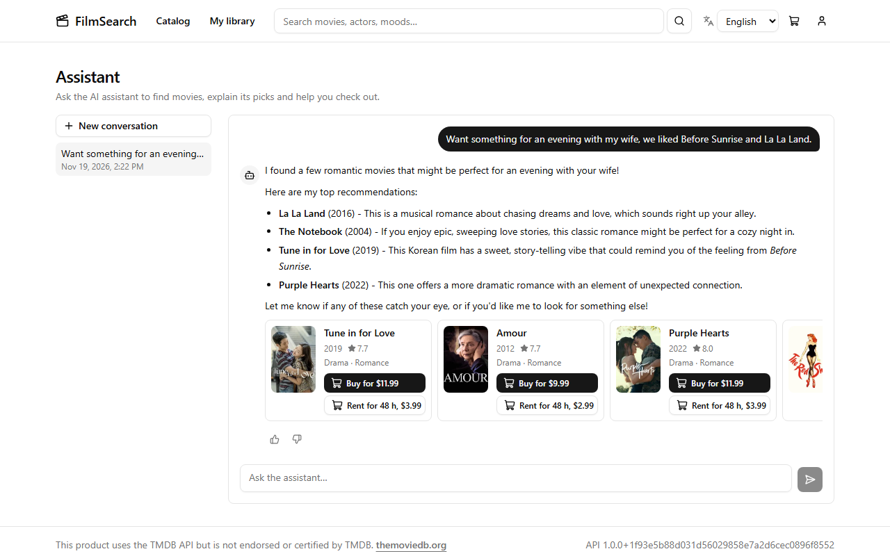
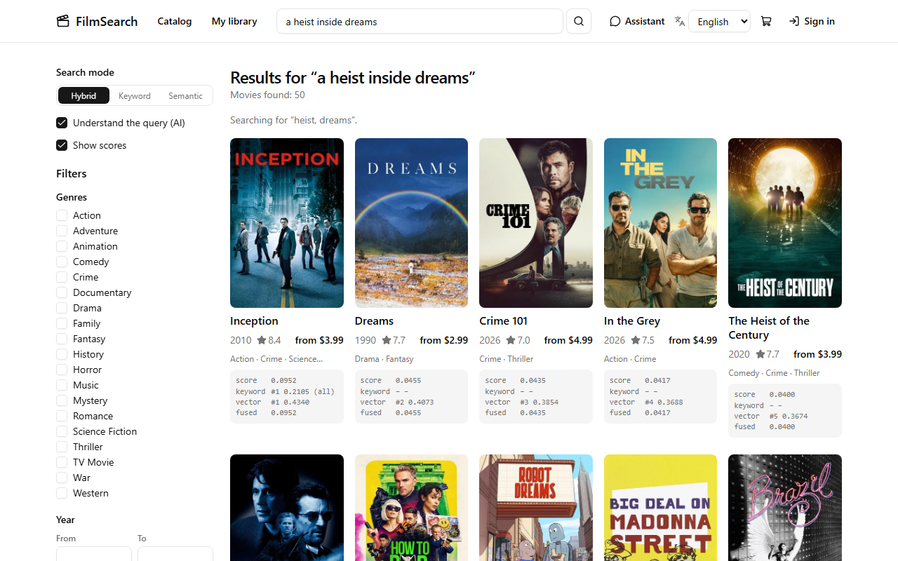
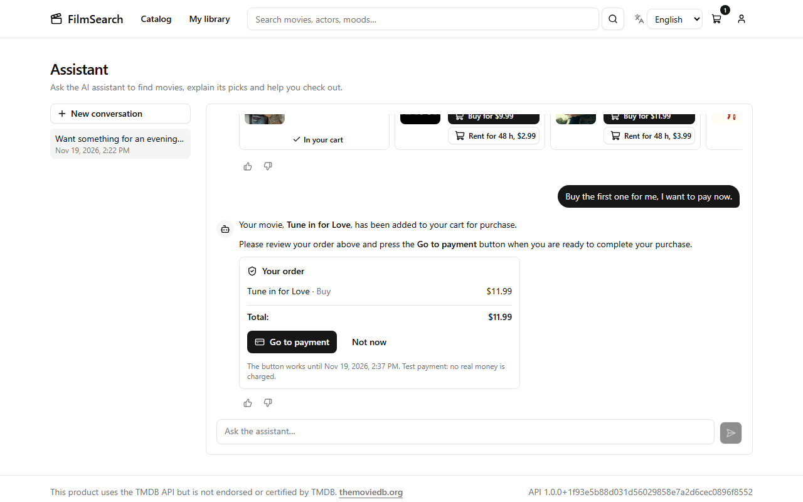
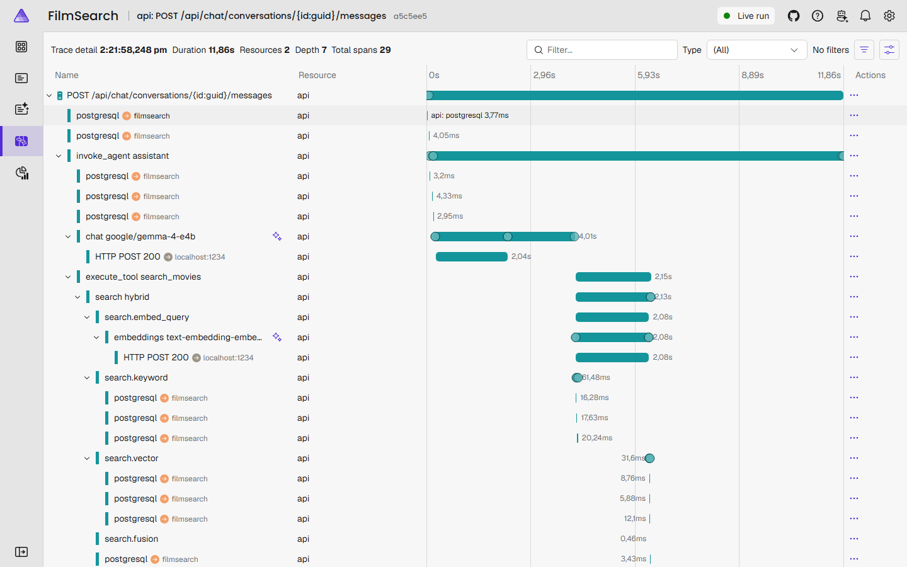
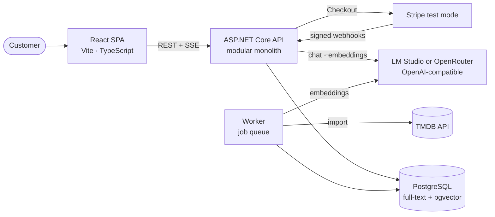

<div align="center">

# 🎬 FilmSearch

**An online movie store with semantic search and an AI sales assistant, built as close to production as practical.**

A learning pet project on the way from full-stack developer to AI engineer: RAG, embeddings, hybrid search, an agent
with tools, evaluations, observability and deployment, all in one small but complete product.

[](https://github.com/gray0072/ai-rag-film-search/actions/workflows/ci.yml)


[](LICENSE)

[Quick start](#quick-start) · [Documentation](docs/README.md) · [RAG guide](docs/guide/README.md) ·
[Build journal](docs/journal/README.md) · [Roadmap](docs/plan/roadmap.md)



</div>

> [!NOTE]
> **This is a pet project for learning.** Payments run in a fake gateway or Stripe **test mode** (no real money), and
> a purchased movie only appears in the library (there is no video player). Everything else (search quality, the agent, telemetry, tests,
> CI, containers) is built the way a real product would be. The whole project was built with AI coding agents; every
> prompt is in the [prompt history](docs/prompts/README.md).

## What it does

| | |
|---|---|
| **Search by meaning, not only by words.** "A heist inside dreams" finds *Inception* although the overview never says so. Keyword and vector results are fused (RRF); "show scores" explains every rank. |  |
| **Three languages.** Ask in Russian or Swedish, get the same catalog. An LLM turns "a time travel movie, but not an action movie" into a query plus a *not Action* filter. |  |
| **An assistant that sells, grounded in the catalog.** It searches, explains its picks, fills the cart and prepares the order. Money moves only after the customer presses the button. |  |
| **Observable to the last token.** One chat turn is one trace: the agent, each model call with tokens and cost, each tool, each search stage, each SQL query. |  |

More screenshots: [catalog](docs/images/screenshots/catalog.png) · [movie page](docs/images/screenshots/movie.png) ·
[Swedish assistant](docs/images/screenshots/assistant-sv.png) · [cart](docs/images/screenshots/cart.png) ·
[payment](docs/images/screenshots/fake-payment.png) · [library](docs/images/screenshots/library.png) ·
[model call span](docs/images/screenshots/aspire-span.png)

## Why it is interesting

The business problem is old: a customer who cannot name the movie they want leaves the store. Keyword search needs the
right words; a human sales assistant does not scale. FilmSearch shows how an AI engineer solves it, and how to prove
that the solution works.

| | What is in the project | Evidence |
|---|---|---|
| 🔎 Retrieval | Full-text search (PostgreSQL `tsvector`), multilingual embeddings in pgvector, hybrid fusion (RRF), LLM query understanding with structured output | Recall@10 on 105 golden queries: keyword **0.30** → semantic **0.87** → hybrid with Qwen3 embeddings **0.93** ([reports](evals/reports/)) |
| 🤖 Agent | Own tool-calling loop over `IChatClient`, 7 tools (search, details, similar, cart, checkout), streaming over SSE, rolling summary | 34 scenarios + 20 adversarial cases: **78%** with a 4B local model, **92%** with DeepSeek V4.1 Flash; **0** orders without the customer's click ([I14 report](evals/reports/2026-11-18_I14_assistant-evaluation.md)) |
| 🛡️ Guardrails | Grounding check (every title in the answer must come from a tool result), human confirmation for payments, prompt injection cases, token budgets, rate limits | Adversarial suite, budgets per conversation, owner and day |
| 📈 LLMOps | OpenTelemetry GenAI spans, cost per answer, metrics, trace id stored with every answer, user ratings, optional Langfuse | [Observability runbook](docs/runbooks/observability.md) |
| 🧱 Production | Stripe test mode with signed webhooks, a Worker with a PostgreSQL job queue, TMDB import, accounts, retries and circuit breakers per AI provider, fallback model, Docker Compose with Caddy, release workflow with Playwright smoke tests | 500+ .NET tests, web tests, CI on every push |
| 🏠 Local-first | LM Studio runs chat and embeddings on a laptop GPU; any OpenAI-compatible provider (OpenRouter) is a config switch | [AI providers](docs/handbook/local-setup.md#ai-providers) |

## Architecture



.NET 10 · ASP.NET Core Minimal APIs · EF Core · PostgreSQL 17 + pgvector · Microsoft.Extensions.AI · .NET Aspire ·
React 19 · TanStack Query · shadcn/ui + Tailwind CSS · Playwright · GitHub Actions. Details:
[architecture spec](docs/spec/02-architecture.md) and [architecture decisions](docs/adr/README.md).

## Quick start

You need the [.NET 10 SDK](https://dotnet.microsoft.com/download), [Docker Desktop](https://www.docker.com/products/docker-desktop/)
(running) and [Node.js 24](https://nodejs.org/). For the AI features also [LM Studio](https://lmstudio.ai/) (or an
OpenRouter key).

```bash
git clone https://github.com/gray0072/ai-rag-film-search.git && cd ai-rag-film-search
dotnet dev-certs https --trust

# AI models (optional: without them the store works with keyword search and the chat says the model is off)
lms server start
lms load google/gemma-4-e4b -y
lms load text-embedding-embeddinggemma-300m -y

# Admin account for the admin API (optional)
dotnet user-secrets set Auth:Admin:Password "<a long password>" --project src/FilmSearch.Api

dotnet run --project src/FilmSearch.AppHost
```

The console prints the **Aspire dashboard** login URL. Open it and click the **web** endpoint. The first start runs
`npm install`, creates the PostgreSQL container, loads 1000 movies and embeds them (about 30 s with LM Studio).
Then search for "a heist inside dreams" or ask the assistant for "something for an evening with my wife, we liked
Before Sunrise and La La Land". Pay with the fake payment page, and the movie appears in *My library*.

Run the tests with `dotnet test` (Docker needed) and `npm test` in `src/web`. OpenRouter instead of LM Studio, Stripe
test mode, TMDB import, Langfuse, evaluations and the production-like Docker stack:
**[local setup and configuration](docs/handbook/local-setup.md)**.

## Documentation

The documentation is one connected set. Start where your question is; every page links onward.

| I want to… | Start here |
|---|---|
| Learn how RAG and an AI assistant are built, from the business problem to production | 📘 [Guide: building an AI store](docs/guide/README.md) |
| See what really happened: plan vs fact, problems and how they were solved | 📓 [Build journal](docs/journal/README.md) |
| Use the store and the assistant | 🛒 [Customer guide](docs/handbook/customer.md) |
| Know what the system can do and which levers it has | 📊 [Product owner guide](docs/handbook/product-owner.md) |
| Run the catalog, imports, payments, budgets | 🛠️ [Administrator guide](docs/handbook/administrator.md) |
| Deploy, monitor and troubleshoot | 🚦 [Operator guide](docs/handbook/operator.md) |
| Change the code | 💻 [Developer guide](docs/handbook/developer.md) |
| Change models and prompts and measure the effect | 🧪 [AI engineer guide](docs/handbook/ai-engineer.md) |
| Read the spec, decisions and plan | [Spec](docs/spec/00-overview.md) · [ADRs](docs/adr/README.md) · [Roadmap](docs/plan/roadmap.md) |

All of it is mapped in the **[documentation hub](docs/README.md)**.

## Status

All five milestones of the [roadmap](docs/plan/roadmap.md) are done: store without AI (M1), smart search (M2), the AI
sales assistant (M3), real integrations: Stripe test mode, TMDB, accounts (M4), production readiness: observability,
resilience, containers (M5). The demo environment is prepared but has no public URL yet. Now: documentation (I21).
Ideas for later (MCP server, rerankers, agent frameworks, a semantic cache) are the
[stretch goals](docs/plan/roadmap.md#stretch-goals-after-m5-or-when-a-topic-is-interesting).

## How it was built

Every iteration was planned in a [plan file](docs/plan/iterations/), built by an AI coding agent (Claude Code)
in one or two sessions, checked by tests and evaluations, and closed with a written result. The prompts of every
session are in the [prompt history](docs/prompts/README.md), the rules for the agents in [AGENTS.md](AGENTS.md), and
what happened along the way in the [build journal](docs/journal/README.md).

---

<sub>Code under the [MIT License](LICENSE). This product uses the TMDB API but is not endorsed or certified by TMDB. Movie data and posters ©
[TMDB](https://www.themoviedb.org/).</sub>
