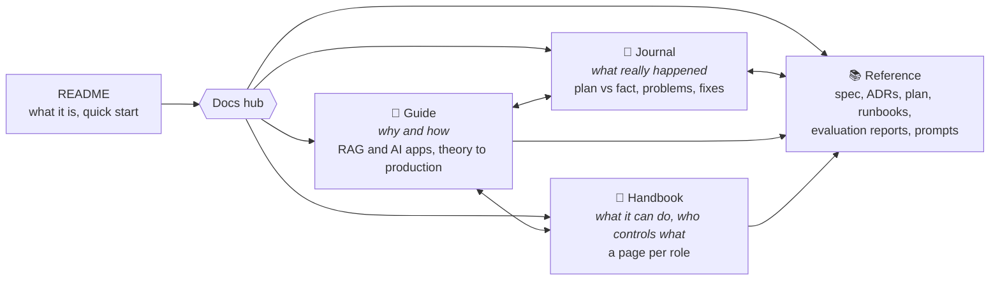

# FilmSearch documentation

> [README](../README.md) › Docs

FilmSearch is a learning pet project: a movie store with semantic search and an AI sales assistant. Its documentation
has four parts for four kinds of questions, plus the reference material they all link to.

| Part | Question it answers | Read it when |
|---|---|---|
| 📘 [Guide](guide/README.md) | *How do you build an AI store, and why this way?* Theory, the business problem, the decisions, the numbers that proved them. | You want to learn RAG, embeddings, agents, evaluations, or understand why the code looks like it does. |
| 📓 [Journal](journal/README.md) | *What actually happened?* The plan of every iteration next to the fact: what was built, what went wrong, how it was fixed. | You want real problems and solutions, or the history of a decision. |
| 🧭 [Handbook](handbook/README.md) | *What can the system do, and where is it controlled?* One page per role, from non-technical to technical. | You use, own, run, change or tune the system. |
| 📚 Reference | *What exactly is specified and decided?* | You need the precise contract. |

## Start by role

| You are… | What you get | Start with | Then |
|---|---|---|---|
| 🛒 **Customer** (or demoing the app) | How to search, ask the assistant, buy and watch | [Handbook: customer](handbook/README.md#roles) | — |
| 📊 **Product owner / manager** | What the system can do, its limits, quality and cost numbers, the levers | [Handbook: product owner](handbook/README.md#roles) | [Guide ch. 1: the business problem](guide/01-business-problem.md), [Journal](journal/README.md) |
| 🛠️ **Administrator** | Catalog, TMDB import, embeddings, jobs, payment provider, budgets | [Handbook: administrator](handbook/README.md#roles) | [Local setup](handbook/local-setup.md) |
| 🚦 **Operator / DevOps** | Environments, deploy, monitoring, incidents, backup, rollback | [Handbook: operator](handbook/README.md#roles) | [Deploy runbook](../deploy/README.md), [Observability runbook](runbooks/observability.md) |
| 💻 **Developer** | Setup, architecture, code map, conventions, tests | [Local setup](handbook/local-setup.md) | [Architecture](spec/02-architecture.md), [AGENTS.md](../AGENTS.md), [Journal](journal/README.md) |
| 🧪 **AI engineer** | Models, prompts, search parameters, evaluation suites | [Guide](guide/README.md) | [Evaluations](../evals/README.md), [reports](../evals/reports/) |
| 🎓 **Learner** (the main audience of a pet project) | RAG and AI engineering on a complete example | [Guide](guide/README.md) | [Learning path](learning-path.md), [Journal](journal/README.md) |

## Start by question

| Question | Answer |
|---|---|
| How do I run it on my machine? | [README quick start](../README.md#quick-start), then [local setup](handbook/local-setup.md) |
| What is RAG and where is it in the code? | [Guide ch. 9: RAG](guide/09-rag-grounded-answers.md), [ch. 10: agents and tools](guide/10-agents-and-tools.md) |
| Why PostgreSQL + pgvector and not a vector database? | [Guide ch. 6](guide/06-vector-search.md), [ADR-0001](adr/0001-postgresql-pgvector.md), [ADR-0008](adr/0008-vector-storage-per-dimension.md) |
| How good is search, in numbers? | [Guide ch. 11](guide/11-evaluation.md), [search evaluation reports](../evals/reports/), [I08 in the journal](journal/m2-smart-search.md) |
| How good is the assistant, and on which model? | [I14 assistant evaluation](../evals/reports/2026-11-18_I14_assistant-evaluation.md) |
| What does a chat answer cost, and how is spending capped? | [Local setup: demo environment](handbook/local-setup.md#demo-environment), [observability runbook](runbooks/observability.md) |
| A user complains about an answer. How do I see what happened? | [Observability runbook](runbooks/observability.md) |
| How do I deploy or roll back? | [Deploy runbook](../deploy/README.md) |
| Which problems came up while building it? | [Journal: problems and solutions](journal/README.md#problems-and-solutions) |
| What is planned next? | [Roadmap: stretch goals](plan/roadmap.md#stretch-goals-after-m5-or-when-a-topic-is-interesting) |

## Reference

| Document | What it is |
|---|---|
| [Spec](spec/00-overview.md) | The source of truth for behavior: requirements, architecture, domain, API, search, assistant, payments, ingestion, evaluation, ops |
| [ADRs](adr/README.md) | Architecture decisions with alternatives and consequences |
| [Roadmap](plan/roadmap.md) and [iteration plans](plan/iterations/) | The plan: milestones, iterations, dependencies, tasks, acceptance criteria, results |
| [Runbooks](runbooks/observability.md) and [deploy runbook](../deploy/README.md) | Step-by-step operations |
| [Evaluations](../evals/README.md) and [reports](../evals/reports/) | How quality is measured, and the history of the numbers |
| [Learning path](learning-path.md) | AI-engineering skills mapped to iterations |
| [Prompt history](prompts/README.md) | Every prompt used to build the project, by session |
| [AGENTS.md](../AGENTS.md) | Rules for AI coding agents working in the repository |
| [Seed data](../data/seed/README.md), [AI playground](../tools/ai-playground/README.md) | Tools around the app |

## How these pages are written

- Markdown in the repository is the source. It reads on GitHub (diagrams are Mermaid) and is also published as a
  website with search (I21, see the [plan](plan/iterations/I21-documentation.md)).
- Every page starts with a breadcrumb line and ends with "See also" links, so you can switch between the guide, the
  journal and the handbook at any point.
- English only. The product itself speaks English, Russian and Swedish.
- Screenshots live in [images/screenshots](images/screenshots/) and are taken by a script:
  `npm run docs:screenshots` in `src/web` against a running app (see the script header).
