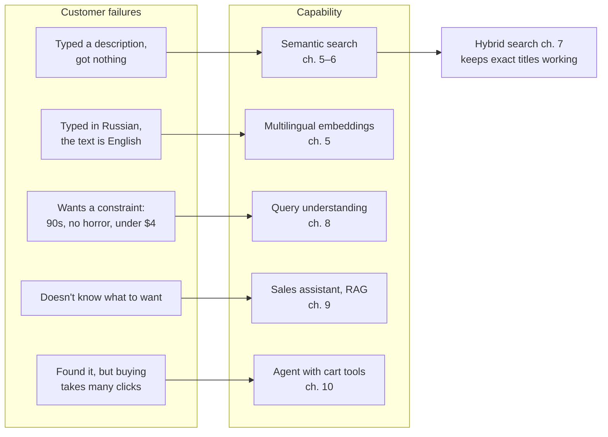

# 1. The business problem

> [Docs](../README.md) › [Guide](README.md) › 1. The business problem

Every AI feature in this project exists because a customer of a movie store fails at something without it. This chapter
names those failures, turns them into requirements and numbers, and shows which part of the system answers each one.
The rest of the guide follows the same order.

## The store and its customers

FilmSearch sells digital movies: buy one to keep, or rent it for 48 hours. About 1000 popular movies, with titles and
descriptions in English, Russian and Swedish ([spec 00](../spec/00-overview.md)). A customer arrives in one of three
moods:

| The customer… | Says | What a classic store does |
|---|---|---|
| knows the movie | "the godfather", "крестный отец", "pulp fiktion" | Finds it, unless there is a typo or the title is in another language |
| knows the *kind* of movie | "a heist inside dreams", "фильм про путешествие во времени, но без боевиков" | Finds nothing: none of these words are in the title, and few are in the description |
| knows only the occasion | "something for an evening with my wife, we liked Before Sunrise and La La Land" | Nothing. A shop assistant would ask one question and suggest three movies |

The first group is served by keyword search. The second and third leave the store, and those are exactly the customers
with no movie in mind yet: the ones a good recommendation turns into a sale.

## From failures to requirements

These became the functional requirements in [spec 01](../spec/01-requirements.md): `FR-SRCH-2` (semantic search across
languages), `FR-SRCH-3` (hybrid as the default), `FR-SRCH-4` (free text to filters, shown as removable chips),
`FR-AST-3` (the assistant recommends **only movies from the catalog**), `FR-AST-6` (checkout needs an **explicit click**).

Two requirements are not about features but about trust, and they shape the whole design:

1. **Facts come from the store, not from the model.** A price, a year, a cast list or a "this movie exists" must come
   from the database. A language model that invents a movie or a discount is not a sales assistant, it is a liability.
2. **Money moves only on a person's click.** The model may *suggest* a checkout; it may never create a payment.

## Measuring success

A business would measure conversion, average order value and support tickets. A pet project has no traffic, so the
project measures what drives those numbers and can be measured offline:

| Business question | Measured as | Where |
|---|---|---|
| Does the customer find the right movie? | Recall@10, MRR@10 on 105 labelled queries in three languages | [Ch. 11](11-evaluation.md), [search baseline](../../evals/reports/2026-11-17_search_baseline.md) |
| Are "no horror" requests respected? | Share of excluded genres in the top 10 | Same report: 0.171 → 0.000 with query understanding |
| Does the assistant sell correctly? | Pass rate of 34 scripted conversations; orders created without a click (must be 0) | [I14 summary](../../evals/reports/2026-11-18_I14_assistant-evaluation.md) |
| Does it invent movies? | Grounding violation rate | Same report: 2–4% |
| Is it fast enough? | p50 / p95 latency of search and of a chat turn | Reports, [Aspire traces](13-observability-and-cost.md) |
| What does it cost? | Tokens and USD per answer, per owner per day | [Ch. 13](13-observability-and-cost.md) |

The starting point matters as much as the target. Keyword search, the classic store, scores **Recall@10 = 0.30** on the
golden set; on plot descriptions it finds the expected movie in the top 3 in 9 of 36 cases. Every later chapter is
measured against that baseline.

## What the AI parts must *not* break

A store that only works when the model is up is worse than a store without AI. So the plan built the store first
([M1 in the journal](../journal/m1-store-without-ai.md)): catalog, filters, keyword search, cart, payment, all without a
model. AI was added on top, and every AI path has a non-AI answer:

- Embeddings down → search returns keyword results marked `degraded` ([ch. 14](14-resilience-and-shipping.md)).
- Query understanding fails → the query is searched as typed, without filters ([ch. 8](08-query-understanding.md)).
- Chat model down → the chat says so; the rest of the store works.

## Why a learning project picks these problems

The three customer moods map one-to-one to the core techniques of AI engineering: retrieval by meaning (embeddings,
vector search, hybrid fusion), structured output (query understanding), and agents that act on behalf of a person
(tools, confirmation, guardrails). The store adds the hard parts that toy RAG demos skip: real prices, a real payment
flow, several languages, and a catalog that changes.

## Pitfalls

- **Starting from the model instead of the failure.** "Add a chatbot" has no success criterion. "A customer who types a
  plot description finds the movie in the top 3" has one, and it can be measured before and after.
- **No baseline.** Without the keyword numbers, "semantic search is good" means nothing. Build the boring version first.
- **Letting the demo define done.** A demo works on the five queries you tried. The golden set has 105.

---

**Next:** [2. Architecture of an AI product](02-architecture.md) · **See also:** [Spec 00 Overview](../spec/00-overview.md) ·
[Spec 01 Requirements](../spec/01-requirements.md) · [Journal: M1 Store without AI](../journal/m1-store-without-ai.md) ·
[Handbook](../handbook/README.md)
