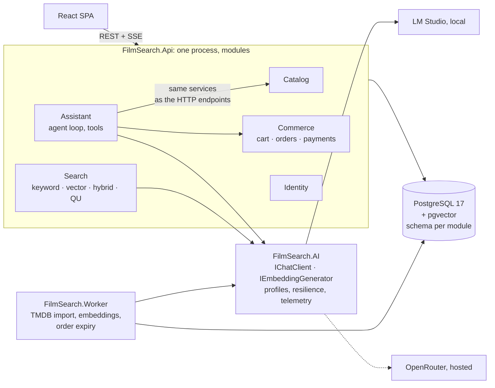

# 2. Architecture of an AI product

> [Docs](../README.md) › [Guide](README.md) › 2. Architecture

An AI feature is a small part of an AI product. Most of the code is the same as in any store: catalog, cart, orders,
payments, accounts. This chapter shows where the AI parts sit, which boundaries keep them replaceable, and why the
project is a modular monolith on one PostgreSQL database.

## The business problem

Models change every few months, providers change prices, and a local model on a laptop behaves differently from a
hosted one. If the store's code depends on one provider's SDK, every change of model is a rewrite. If the AI code can
reach any table, a prompt bug can become a data bug. The architecture has to make the model **replaceable** and the
AI **contained**.

## The shape of the system

| Layer | Project | Rule |
|---|---|---|
| Contracts and domain | [`FilmSearch.Core`](../../src/FilmSearch.Core/) | References nothing: no EF Core, no Stripe, no AI SDK |
| AI | [`FilmSearch.AI`](../../src/FilmSearch.AI/) | Providers, embeddings, query understanding, agent loop, prompts. Business code sees only `IChatClient` and `IEmbeddingGenerator` |
| Data and integrations | [`FilmSearch.Infrastructure`](../../src/FilmSearch.Infrastructure/) | EF Core, SQL for search, Stripe, TMDB, the job queue |
| Hosts | [`FilmSearch.Api`](../../src/FilmSearch.Api/), [`FilmSearch.Worker`](../../src/FilmSearch.Worker/) | Endpoints and background jobs; each module registers itself (`AddXxxModule()`) |
| Local orchestration | [`FilmSearch.AppHost`](../../src/FilmSearch.AppHost/AppHost.cs) | .NET Aspire starts PostgreSQL, the API, the Worker and Vite, and shows traces |

Full layout: [spec 02 §4](../spec/02-architecture.md#4-solution-layout-target).

## Three decisions that matter for AI

### 1. The model behind an abstraction

All AI calls go through [Microsoft.Extensions.AI](https://learn.microsoft.com/dotnet/ai/microsoft-extensions-ai):
`IChatClient` for chat, tools and structured output, `IEmbeddingGenerator` for vectors. LM Studio and OpenRouter both
speak the OpenAI-compatible API, so one client with a different endpoint, key and model covers both. A model is a
**profile** in configuration ([ch. 3](03-language-models.md)): switching from the local Gemma to a hosted DeepSeek is a
setting, not a code change (`NFR-1`). Provider SDK types appear only in the provider factory
([`AiClientFactory`](../../src/FilmSearch.AI/Providers/AiClientFactory.cs)).

The abstraction is also where cross-cutting concerns attach, as middleware around every call: OpenTelemetry GenAI
spans, logging, token and cost tracking, retries and a circuit breaker. The business code never sees any of it.
Why this library and not Semantic Kernel or a provider SDK: [ADR-0002](../adr/0002-ai-abstraction-meai.md).

### 2. One database for rows, words and vectors

PostgreSQL holds the catalog, full-text indexes (`tsvector`, GIN) and vectors (pgvector, HNSW). A separate vector
database would add a second source of truth that has to be kept in sync with prices and availability, and filters
("under $4, not owned, 1990s") would have to be applied in two places. In one database a single SQL query filters and
ranks ([ch. 6](06-vector-search.md)). At 1000–100 000 movies pgvector is far from its limits.
[ADR-0001](../adr/0001-postgresql-pgvector.md) lists when this stops being true.

### 3. The assistant uses the same services as the UI

A tool of the assistant is a thin adapter over a module service: `add_to_cart` calls the same `ICartService` as the
"Add to cart" button, with the same validation and the same owner check. The assistant has **no business logic of its
own** ([spec 02 §5](../spec/02-architecture.md#5-module-boundaries)). Consequences:

- The model cannot do anything a user could not do by clicking.
- Prices and totals are computed by the cart service, never by the model.
- The owner of the cart comes from the request's cookie, never from a tool argument ([ch. 10](10-agents-and-tools.md)).

## Why a modular monolith

For one developer, microservices add network calls, deployments and distributed transactions without teaching anything
about AI. Modules still have hard boundaries: each owns a schema (`catalog`, `search`, `assistant`, `commerce`,
`ingestion`, `identity`), and modules talk only through interfaces in Core (`ICatalogReader`, `IMovieSearch`,
`ICartService`). The one exception is deliberate: the search module keeps its own copy of the catalog text
and vectors: `search.movie_documents` is filled through a change hook in the same transaction as the catalog write
([ch. 4](04-keyword-search.md)), `search.movie_embeddings` by a reindex job that compares content hashes
([ch. 5](05-embeddings.md)).

The Worker is a second process with the same modules and no HTTP. It exists because some jobs (importing 1000 movies
from TMDB, embedding them) take minutes and must survive an API restart ([ADR-0009](../adr/0009-job-queue-in-postgresql.md)).

## Local first

The whole system runs offline: LM Studio serves the chat and embedding models on a laptop GPU (RTX 4070, 8 GB),
PostgreSQL runs in a container that Aspire starts. Cloud models are optional (`NFR-2`). This keeps development free,
lets tests and evaluations run without network, and makes failures visible: a local model is slow and sometimes down,
which forced the resilience work of [ch. 14](14-resilience-and-shipping.md) early. Aspire was chosen to start the
pieces and to see traces without extra setup ([ADR-0005](../adr/0005-dotnet-aspire.md)).

## Evidence

- Switching chat models is a configuration change: the I14 assistant evaluation ran the same code with Gemma 4 E4B
  (local) and DeepSeek V4.1 Flash (OpenRouter) with `--chat-profile` ([report](../../evals/reports/2026-11-18_I14_assistant-evaluation.md)).
- Switching embedding models too: the I20 run with Qwen3-Embedding-8B kept vectors of both models side by side
  ([report](../../evals/reports/2026-11-19_search_i20-openrouter-qwen3-embedding-8b.md), [ADR-0008](../adr/0008-vector-storage-per-dimension.md)).
- A reflection test proves that no assistant tool depends on the payment gateway ([I12 in the journal](../journal/m3-ai-assistant.md#i12--agent-tools-cart-checkout-confirmation)).
- Stripe was added in I15 as one more gateway behind `IPaymentGateway`; the order state machine did not change
  ([I15](../journal/m4-real-integrations.md#i15--stripe-test-mode)).

## Pitfalls

- **Provider SDK types leaking into business code.** Once `OpenAI.Chat.ChatMessage` is in a service signature, the
  provider is no longer replaceable. Keep it in one factory.
- **Letting the AI module write tables.** If a tool can run SQL, a prompt injection can too. Tools call services.
- **One HTTP timeout for everything.** The standard resilience handler has a 10 s attempt timeout; local generation
  takes longer. AI clients need their own pipeline ([I05](../journal/m2-smart-search.md#i05--ai-provider-layer)).

---

**Previous:** [1. The business problem](01-business-problem.md) · **Next:** [3. Language models for engineers](03-language-models.md) ·
**See also:** [Spec 02 Architecture](../spec/02-architecture.md) · [ADRs](../adr/README.md) ·
[Developer handbook](../handbook/developer.md)
