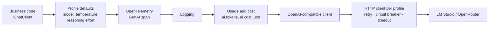

# 3. Language models for engineers

> [Docs](../README.md) › [Guide](README.md) › 3. Language models

You do not need to know how a transformer is trained to build on one. You do need to know what goes over the wire,
what you pay for, what makes answers differ between runs, and how to pick a model by measuring it on your own tasks.
This chapter covers that, with the numbers from the FilmSearch model benchmark.

## The business problem

The store needs a model for three jobs: call tools reliably (search, cart), return valid JSON (query understanding),
and write short, friendly answers in English, Russian and Swedish. It must be cheap enough to answer every visitor and
fast enough that a customer does not leave. Leaderboards do not say which model does *these* jobs well on *this*
hardware.

## Theory in five minutes

### A request is a list of messages

A chat completion request is a list of messages with roles, plus options:

```json
{
  "model": "google/gemma-4-e4b",
  "messages": [
    { "role": "system", "content": "You are the sales assistant of FilmSearch…" },
    { "role": "user", "content": "Something like Inception, but funnier" }
  ],
  "tools": [{ "type": "function", "function": { "name": "search_movies", "parameters": { … JSON Schema … } } }],
  "temperature": 0.3,
  "max_tokens": 1024,
  "reasoning_effort": "none",
  "stream": true
}
```

- **system**: the rules. **user**: what the person typed. **assistant**: earlier answers, including tool calls.
  **tool**: results of tool calls, sent back as data.
- The model is **stateless**. Every turn sends the whole relevant history again. "Memory" is something your code builds
  (FilmSearch: the last turns plus a rolling summary, [ch. 9](09-rag-grounded-answers.md)).
- Some chat templates are strict: Gemma requires user and assistant to alternate and accepts one system message at the
  start. Code that builds the history must respect that ([I11](../journal/m3-ai-assistant.md#i11--chat-foundation)).

### Tokens are the unit of everything

Models read and write tokens (pieces of words; roughly 4 characters of English, fewer for Russian). The **context
window** is the maximum number of tokens in one request plus its answer. Price is per million input and output tokens.
Output tokens are slower (generated one at a time) and usually several times more expensive. In FilmSearch a chat turn
sends about 5 000–7 000 input tokens (system prompt, tool declarations, history, tool results) and gets a few hundred
back: **input dominates**, so the prompt and the size of tool results matter for cost.

### Sampling and temperature

The model outputs a probability distribution over the next token; **temperature** scales it. At 0 the most likely token
wins (as deterministic as the server allows); higher values give more varied text. FilmSearch uses 0 for extraction
(query understanding, the judge) and 0.3 for conversation. Even at 0, answers can differ between runs (batching,
floating point), which is why evaluations repeat every case three times ([ch. 11](11-evaluation.md)).

### Streaming

With `stream: true` the server sends tokens as they are generated (server-sent events). Time to first token is what a
user feels; total time is what a tool loop waits for. FilmSearch streams the assistant's text to the browser over SSE
and runs tool calls between streamed model calls ([ch. 10](10-agents-and-tools.md)).

### Thinking models

Newer models (Gemma 4, Qwen 3.5, gpt-oss) "reason" in hidden tokens before answering unless told not to. That can help
on hard problems; for "call `search_movies` with these filters" it only adds latency and cost. The OpenAI-compatible
switch is `reasoning_effort`.

## What FilmSearch does

### Profiles instead of hard-coded models

A **profile** is a named model configuration ([`AiOptions`](../../src/FilmSearch.AI/Providers/AiOptions.cs),
`appsettings.json` section `AI`):

```jsonc
"ChatProfiles": {
  "local":      { "Endpoint": "http://localhost:1234/v1", "Model": "google/gemma-4-e4b",
                  "Temperature": 0.3, "MaxOutputTokens": 1024, "ReasoningEffort": "None",
                  "SupportsTools": true, "TimeoutSeconds": 300 },
  "openrouter": { "Endpoint": "https://openrouter.ai/api/v1", "Model": "deepseek/deepseek-v4.1-flash-1017",
                  "ReasoningEffort": "None", "TimeoutSeconds": 120 }        // ApiKey in user secrets
},
"ActiveChatProfile": "local",
"Pricing": { "deepseek/deepseek-v4.1-flash-1017": { "InputPerMTokUsd": 0.036, "OutputPerMTokUsd": 0.5 } }
```

Every profile is registered as a keyed `IChatClient`; the active one is also the default. Profiles carry the knobs
that belong to a model: temperature, output limit, reasoning effort, timeout, retries, prices. Chat and embeddings have
separate profiles, so the chat can run in the cloud while embeddings stay local. Options are validated at startup
([`AiOptionsValidator`](../../src/FilmSearch.AI/Providers/AiOptionsValidator.cs)).

### A pipeline around every call



This is `Microsoft.Extensions.AI` middleware ([`AiServiceCollectionExtensions`](../../src/FilmSearch.AI/Providers/AiServiceCollectionExtensions.cs)).
Business code calls `GetStreamingResponseAsync` and gets tracing, cost and resilience for free. Details:
[spec 06 §1](../spec/06-ai-assistant.md#1-providers-and-profiles).

### Look at the wire

`AI:LogRawHttp` (Development only) logs the raw request JSON and SSE events, never headers. `tools/ai-playground` sends
one chat, stream, tool or JSON request to any profile from the console ([README](../../tools/ai-playground/README.md)).
Reading the raw traffic once per feature is how the thinking-model problem below was found.

## Choosing a model by measuring it

The I05 benchmark ([report](../../evals/reports/2026-11-17_I05_model-benchmark.md)) ran every candidate on the store's
own tasks: 10 tool-call prompts in three languages ("Jag vill se en skräckfilm från 2010-talet" →
`search_movies(yearFrom=2010, yearTo=2019)`), 10 JSON extraction prompts, and a streamed recommendation per language.

| Model | Reasoning | Tool calls | JSON correct | Tokens/s | First text, s |
|---|---|---|---|---|---|
| `google/gemma-4-e4b` (local) | Medium | 10/10 | 8/10 | 13.0 | 20–29 |
| `google/gemma-4-e4b` (local) | **None** | **10/10** | **10/10** | **48.4** | **0.1–0.2** |
| `google/gemma-4-12b-qat` (local) | None | 10/10 | 10/10 | 20.8 | 0.3–0.7 |
| `openai/gpt-oss-20b` (local) | Low | 9/10 | 6/10 | 33.8 | 1.2–1.6 |
| `deepseek/deepseek-v4.1-flash-1017` (OpenRouter) | None | 10/10 | 10/10 | 132.6 | 0.4–0.9 |

Findings that became rules:

1. **Thinking off.** With `reasoning_effort` unset, Gemma 4 E4B was 6.6× slower and its JSON got worse.
   `ReasoningEffort: None` is now a profile setting. Not every model obeys it (one still thought for 26–58 s).
2. **Enums beat descriptions.** With free-string fields described as "en, ru or sv", Gemma returned `"Russian"`: 0/10.
   With an `enum` in the JSON Schema, LM Studio constrains generation: 10/10 ([ch. 8](08-query-understanding.md)).
3. **Small models invent facts.** 2–4B models recommended non-existent Swedish titles and wrong Russian translations.
   They are fine for tools and JSON, never as a source of facts ([ch. 9](09-rag-grounded-answers.md)).
4. **Parallel tool calls vary.** Most models return two `add_to_cart` calls in one response for "add movies 3 and 4";
   two return one. The agent loop must handle both.

Decisions: local `google/gemma-4-e4b` (fits in 8 GB VRAM, ~48 tokens/s) for development, hosted
`deepseek/deepseek-v4.1-flash` for users. The whole OpenRouter part of the benchmark cost about $0.01. Later, the
assistant evaluation confirmed the choice end to end: DeepSeek passes 92% of scenarios at about $0.0004 per turn, Gemma
78% for free ([I14 summary](../../evals/reports/2026-11-18_I14_assistant-evaluation.md)).

## Local vs hosted

| | Local (LM Studio, laptop GPU) | Hosted (OpenRouter) |
|---|---|---|
| Cost | Electricity | Per token (cents per hundred turns here) |
| Privacy | Nothing leaves the machine | Data goes to a provider |
| Latency of a chat turn (p50) | 21.6 s (Gemma 4 E4B, several tool rounds) | 3.2 s (DeepSeek) |
| Quality on the scenarios | 78% | 92% |
| Failure modes | Server not started, laptop on battery, queue stuck after a killed process | Rate limits (HTTP 429), credit limits, network |

Both behind the same `IChatClient`, so the choice is a setting per environment: local for development, tests that need
a real model, and evaluations; hosted for the demo ([ch. 14](14-resilience-and-shipping.md)).

## Pitfalls

- **Trusting a leaderboard.** The 4B model called tools perfectly and invented facts. Only your own tasks tell.
- **A 10 s HTTP timeout.** The default resilience handler cut local generation; AI clients need their own pipeline.
- **Cost from usage fields only.** Some middleware attaches usage only to non-streamed responses; FilmSearch prices
  tokens itself from `AI:Pricing` ([I11](../journal/m3-ai-assistant.md#i11--chat-foundation)).
- **Unpinned model ids.** `deepseek-v4.1-flash-1017` (a dated id) keeps evaluation results reproducible.

---

**Previous:** [2. Architecture](02-architecture.md) · **Next:** [4. Keyword search](04-keyword-search.md) ·
**See also:** [Journal: I05](../journal/m2-smart-search.md#i05--ai-provider-layer) · [ADR-0002](../adr/0002-ai-abstraction-meai.md) ·
[Spec 06 §1](../spec/06-ai-assistant.md#1-providers-and-profiles) · [AI playground](../../tools/ai-playground/README.md)
