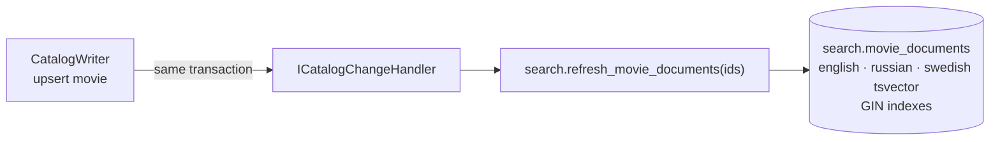
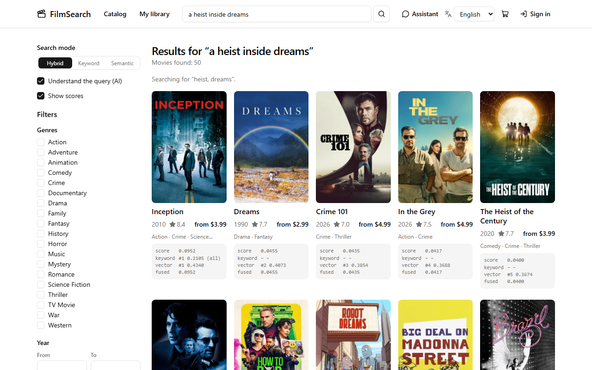

# 4. Keyword search is still the baseline

> [Docs](../README.md) › [Guide](README.md) › 4. Keyword search

Before any embedding, FilmSearch had PostgreSQL full-text search. It is fast, explainable and exact, and it is half of
the hybrid search in [ch. 7](07-hybrid-search.md). This chapter shows how it works in three languages, where it fails,
and why that failure is the number every AI feature has to beat.

## The business problem

A customer who knows the title must find it instantly, in the language they type: "the godfather", "крестный отец",
"gudfadern", or a director's name. Semantic search is surprisingly bad at this ([ch. 5](05-embeddings.md)): a name has
no "meaning" to embed. Keyword search is the tool for exact words.

## Theory

Full-text search splits text into **lexemes**: words lower-cased, stop words ("the", "и", "och") removed, and
**stemmed** with a language-specific dictionary ("movies" → "movi", "фильмы" → "фильм"). A document becomes a
`tsvector` (a sorted list of lexemes with positions and weights), a query becomes a `tsquery`, and an inverted index
(GIN) finds documents that contain the query's lexemes. Ranking (`ts_rank_cd`) rewards query words that appear close
together and in heavily weighted fields.

This is the same idea as BM25 in Elasticsearch or Lucene: a **sparse** representation (one dimension per word, almost
all zero). Its strengths and weaknesses are the mirror image of embeddings:

| | Keyword (sparse) | Embeddings (dense) |
|---|---|---|
| Exact titles, names, rare words | Strong | Weak |
| Descriptions, synonyms, paraphrase | Weak | Strong |
| Other languages | Only if the text is in that language | Works across languages with a multilingual model |
| Explainability | Which words matched | A similarity number |
| Cost | Microseconds, no model | A model call per query |

## What FilmSearch does

### A search document per movie

The texts of a movie live in four catalog tables (movie, translations, people, keywords). A generated column can only
read its own row, so search keeps **its own document table**, `search.movie_documents`, filled by a SQL function in the
same transaction as every catalog change ([I04](../journal/m1-store-without-ai.md#i04--keyword-search-and-filters)):

Three generated `tsvector` columns, one per language configuration, each over the texts of its locale with English
fallback. Weights: title and original title **A**, keywords and people **B**, tagline **C**, overview **D**. The same
change hook later re-queued embeddings ([ch. 5](05-embeddings.md)).

### The query

[`KeywordRetriever`](../../src/FilmSearch.Infrastructure/Search/Keyword/KeywordRetriever.cs) parses the user's text with
`websearch_to_tsquery` in all three configurations; a movie matches when any configuration matches, and its score is the
best `ts_rank_cd` (normalized to 0–1). Catalog filters (genre, year, rating, price) are in the **same SQL query**, so a
filter never empties a page that was cut before filtering. Ties go to popularity.

Two fixes came from real queries:

- **"Any word" fallback.** `websearch_to_tsquery` requires every word. A longer query ("old movie about the mafia
  family") matched nothing. If nothing matches all words, the query is retried with `or` between the words, and the
  result is marked `keywordMatch: any`. That flag turned out to be important in hybrid fusion ([ch. 7](07-hybrid-search.md)).
- **ё → е.** TMDB writes «Крёстный отец», people type «крестный отец». Both documents and queries fold `ё` to `е`.

### Debug scores

`POST /api/search` with `debug: true` returns per result `keywordRank`, `keywordScore` and `keywordMatch` (plus the
vector and fused scores in other modes). The UI shows them on the search page:

## Evidence

Latency over 1000 movies: p50 29 ms, p95 40 ms ([I04](../journal/m1-store-without-ai.md#i04--keyword-search-and-filters)).
Quality on the golden set of [ch. 11](11-evaluation.md) ([baseline](../../evals/reports/2026-11-17_search_baseline.md)):

| Query kind | Cases | Keyword Recall@10 | Semantic Recall@10 |
|---|---|---|---|
| Title with a typo | 15 | 0.63 | 0.70 |
| Person (actor, director) | 22 | 0.31 | 0.90 |
| Plot description | 46 | 0.28 | 0.97 |
| Mood ("something cozy and sad") | 11 | 0.08 | 0.80 |
| **All 105** | | **0.30** | **0.87** |

On the manual title-and-name set of I07, keyword search had MRR@10 0.95 against 0.83 for semantic: when the words are
right, keyword wins ([I07 report](../../evals/reports/2026-11-17_I07_hybrid-and-query-understanding.md)).

**0.30 is the baseline.** It is what a store without AI gives a customer who describes a movie instead of naming it.

## Why not an external search engine

Elasticsearch or OpenSearch would give BM25, better typo handling and more analyzers. They would also be a second
store to keep in sync and a second place to apply filters. PostgreSQL's full-text search is good enough for 1000–100 000
movies, and hybrid fusion compensates for its weak ranking ([ADR-0001](../adr/0001-postgresql-pgvector.md)). `pg_trgm`
is installed for title typos; the evaluation did not show a need yet ([spec 05 §2](../spec/05-search.md#2-keyword-search)).

## Pitfalls

- **Searching the raw query with filter words.** "фильмы 90-х с рейтингом выше 7" puts "рейтинг" into full-text search.
  With query understanding, the keyword retriever searches the cleaned semantic text instead ([ch. 8](08-query-understanding.md)).
- **One language configuration.** The `english` stemmer does not stem Russian. Index every language you serve.
- **Post-filtering a page.** Taking the top 20 and then filtering by genre can return 3 results or none.

---

**Previous:** [3. Language models](03-language-models.md) · **Next:** [5. Embeddings](05-embeddings.md) ·
**See also:** [Spec 05 §2](../spec/05-search.md#2-keyword-search) · [Journal: I04](../journal/m1-store-without-ai.md#i04--keyword-search-and-filters) ·
[Plan I04](../plan/iterations/I04-keyword-search.md)
