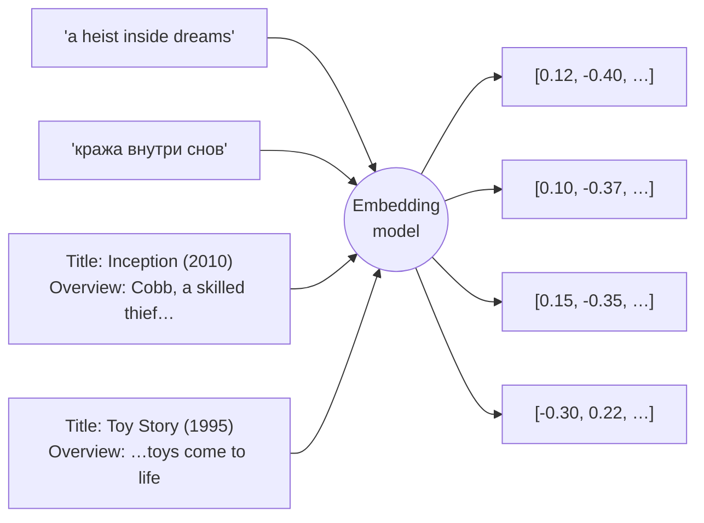
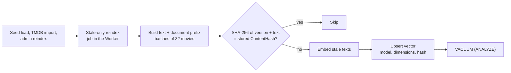

# 5. Embeddings

> [Docs](../README.md) › [Guide](README.md) › 5. Embeddings

An embedding turns a text into a list of numbers so that texts with similar meaning get similar numbers. It is the "R"
of RAG: how the store finds "a heist inside dreams" without the word *Inception*. This chapter explains what a vector
means, why the **text you embed** matters more than the index, and how FilmSearch keeps vectors in sync with the catalog.

## The business problem

Customers describe movies ("a man discovers his whole life is a TV show") and type in Russian or Swedish while most
overviews are in English. Keyword search finds the expected movie in the top 3 for 9 of 36 such queries. The store
needs search by meaning, across languages.

## Theory

### A vector is a position in "meaning space"

An embedding model maps a text to a vector of fixed length (768 numbers for EmbeddingGemma). It was trained so that a
query and a text that answers it end up close together, and unrelated texts far apart. Closeness is measured by the
**cosine similarity**: the cosine of the angle between two vectors, 1 for the same direction, about 0 for unrelated.



The query and the Inception document point in nearly the same direction; Toy Story points elsewhere. Search is then
"find the stored vectors with the highest cosine to the query vector" ([ch. 6](06-vector-search.md)).

The numbers themselves mean nothing to a person. What matters:

- **A model's vectors are comparable only with the same model's vectors.** Changing the model means re-embedding
  everything. That is why FilmSearch stores the model id with every vector, and why there is no embedding fallback to
  another provider ([ch. 14](14-resilience-and-shipping.md)).
- **Multilingual models** put translations close together. EmbeddingGemma: a Russian query and its English translation
  have cosine 0.84; unrelated text 0.19 ([I05 benchmark](../../evals/reports/2026-11-17_I05_model-benchmark.md)).
- **Task prefixes.** Many models were trained with instructions in front of the text: EmbeddingGemma wants
  `task: search result | query: ` for queries and `title: none | text: ` for documents. Using them did not change the
  ranking in the benchmark, but it doubled the gap between related and unrelated texts (unrelated cosine 0.19 instead of
  0.33), which matters for thresholds and fusion. Prefixes belong to the model, so they are part of the profile.
- **Similarity scores are relative.** "0.45" is a good match for EmbeddingGemma; another model's scale differs. Rank,
  don't threshold ([advanced: similarity metrics](README.md#advanced)).

### Asymmetric search

A query ("heist in dreams", 4 words) and a document (a 150-word profile) are different kinds of text. Query and document
prefixes tell the model which side it is embedding. This is called asymmetric retrieval, and it is the normal case in
search.

## What FilmSearch does

### The embedding text: what goes into the vector

[`MovieEmbeddingText`](../../src/FilmSearch.Core/Search/MovieEmbeddingText.cs) builds one deterministic text per movie:

```text
Title: Inception (2010)
Genres: Action, Science Fiction, Adventure
Director: Christopher Nolan
Cast: Leonardo DiCaprio, Joseph Gordon-Levitt, Elliot Page
Keywords: dream, subconscious, heist
Tagline: Your mind is the scene of the crime.
Overview: Cobb, a skilled thief who commits corporate espionage by infiltrating the subconscious…
```

Choices, each with a reason:

| Choice | Why |
|---|---|
| Title and year first | Anchor the movie; "Nolan's 2010 movie" queries |
| Genres, keywords | Describe the *kind* of movie, the most common query |
| Director, up to 5 cast members | "A Tom Hanks movie about…" |
| Overview | The plot, which most "a movie about…" queries describe |
| **No** rating, price, popularity | They are filters, not meaning, and they change daily |
| English labels in every locale | One template, the model sees the same structure |
| `Original title` only when it differs | Adds the Swedish or Japanese title for cross-language queries |

The template has a version (`movie-profile-v1`). A version change re-embeds every movie on the next reindex.

### One vector per movie, in English

The default is one vector per movie from the English text (`Search:Embeddings:Locales = ["en"]`). The multilingual
model maps Russian and Swedish queries close to English texts. Per-locale vectors are supported and were measured: they
moved two Russian movies from #2 to #1 and helped Swedish not at all, for three times the vectors
([I06 experiments](../../evals/reports/2026-11-17_I06_semantic-search-experiments.md), confirmed on the golden set in
[I08](../../evals/reports/2026-11-17_search_vectors-en-ru-sv.md)).

### Keeping vectors in sync with the catalog



[`MovieEmbeddingIndexer`](../../src/FilmSearch.Infrastructure/Search/Semantic/MovieEmbeddingIndexer.cs) hashes the exact
text sent (prefix included) with the template version. A second run over an unchanged catalog compares hashes only:
0 embedded, 1002 unchanged in 1.9 s. When the TMDB import updated 807 movies (vote counts moved), only 18 had a changed
embedding text, so only those were re-embedded ([I16 report](../../evals/reports/2026-11-18_I16_catalog-growth.md)).
Each batch is saved on its own, so a failed run continues where it stopped. The TMDB import runs the stale-only reindex
as its last phase and reports success only after it, so new movies are searchable in every mode when the job is done
([I16](../journal/m4-real-integrations.md#i16--tmdb-sync-and-worker), [spec 08 §4](../spec/08-data-ingestion.md#4-embeddings-pipeline)).
Keyword documents, in contrast, are updated inside the catalog transaction ([ch. 4](04-keyword-search.md)): a new movie
is findable by title at once and by meaning a few seconds later.

### Queries

Search code embeds through `ITextEmbedder`
([`ProfileTextEmbedder`](../../src/FilmSearch.AI/Embeddings/ProfileTextEmbedder.cs)): it adds the query prefix, checks
the returned dimension against the profile, turns provider failures into one exception type, and caches query vectors
per normalized text for a day (I19), so a popular query is embedded once.

## Evidence

36 plot queries (12 movies × en / ru / sv), expected movie in the top 3 ([I06 experiments](../../evals/reports/2026-11-17_I06_semantic-search-experiments.md)):

| Setup | en | ru | sv |
|---|---|---|---|
| Keyword (I04) | 4/12 | 4/12 | 1/12 |
| **Semantic, EmbeddingGemma 300M (multilingual), English vectors** | **12/12** | **12/12** | **8/12** |
| Semantic, nomic-embed-text v1.5 (English-only) | 9/12 | **0/12** | 1/12 |

"a heist inside dreams" → Inception #1; «фильм про мафиозную семью» → GoodFellas, The Godfather, A Bronx Tale.
**An English-only model found none of the Russian queries**: for this store a multilingual model is not optional.

On the 105-query golden set: Recall@10 keyword 0.30 → semantic 0.87 ([baseline](../../evals/reports/2026-11-17_search_baseline.md)).
A larger hosted model, Qwen3-Embedding-8B, reached 0.92, mostly by closing the gap in Russian (0.86 → 0.94) and Swedish
(0.82 → 0.90), at 577 ms p50 per new query instead of 60 ms
([I20 report](../../evals/reports/2026-11-19_search_i20-openrouter-qwen3-embedding-8b.md)).

Swedish is the weakest language with the small model. Failed Swedish queries were pulled toward Swedish-language
films (Persona, The Seventh Seal), probably by the `Original title` line that puts Swedish words into exactly those
documents: the embedded text shapes the result in ways you have to read failures to see.

## Pitfalls

- **Tuning the index before the text.** Recall of HNSW was ≥ 0.999 ([ch. 6](06-vector-search.md)); the text, the
  model's languages and sync decided quality.
- **Forgetting the prefix on one side.** Query and document prefixes must match the model's training.
- **Embedding prices or ratings.** They change and they are filters. Changing data in the text triggers re-embedding.
- **Mixing models.** Vectors of two models in one comparison give garbage silently. Store the model with the vector.
- **Testing Cyrillic with `curl -d` on Windows.** The text is mangled before it reaches the API; send a UTF-8 file.

---

**Previous:** [4. Keyword search](04-keyword-search.md) · **Next:** [6. Vector search in PostgreSQL](06-vector-search.md) ·
**See also:** [Spec 05 §3](../spec/05-search.md#3-semantic-search) · [Journal: I06](../journal/m2-smart-search.md#i06--embeddings-and-semantic-search) ·
[Advanced: choosing an embedding model](README.md#advanced)
