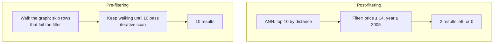

# 6. Vector search in PostgreSQL

> [Docs](../README.md) › [Guide](README.md) › 6. Vector search

With every movie embedded, search becomes "find the vectors nearest to the query vector, among movies that pass the
filters". This chapter covers exact and approximate search, how filters interact with an approximate index, and how
FilmSearch stores vectors of several models in one table. The deeper trade-offs are in the
[advanced chapters](advanced/README.md).

## The business problem

"A heist inside dreams, under $4, not older than 2005" must return the right movies in well under a second, with the
filter respected even when it removes most of the catalog. The catalog will grow (TMDB import), and the project wants to
try other embedding models without a migration.

## Theory

### Exact search

Compare the query with every stored vector, sort by distance, take the top k. Always correct; cost grows linearly with
the catalog. For 1000 movies × 768 dimensions that is under a million multiplications: a few milliseconds.

### Approximate nearest neighbours (ANN)

For millions of vectors, indexes trade a little recall for a lot of speed. **HNSW** (Hierarchical Navigable Small
World) builds a layered graph in which each vector links to its near neighbours; a query enters at the top layer and
greedily walks toward the query, keeping a candidate list of size `ef_search`. Bigger `ef_search` = better recall,
slower query. `m` (links per node) and `ef_construction` (candidates while building) set the graph's quality.
**IVFFlat** clusters vectors and searches only the nearest clusters; it is cheaper to build but needs data before
training and degrades as data drifts.

Recall of an ANN index is measured **against exact search**: of the exact top 10, how many did the index return?

### Distance

pgvector offers `<->` (L2), `<#>` (negative inner product) and `<=>` (cosine distance = 1 − cosine similarity). For
text embeddings cosine is the usual choice; for normalized vectors all three give the same order
([advanced: similarity metrics](advanced/similarity-metrics.md)).

### Filters: before or after?



Post-filtering an approximate top k can empty the page. FilmSearch filters **inside** the vector query, and pgvector 0.8
`hnsw.iterative_scan = relaxed_order` keeps walking the graph while the filter rejects candidates.

## What FilmSearch does

### One table, untyped column, a partial index per dimension

pgvector can only index a column of a fixed dimension (`vector(768)`). The project wanted models of different sizes side
by side (EmbeddingGemma 768, Qwen3-Embedding 1024), so [ADR-0008](../adr/0008-vector-storage-per-dimension.md) chose:

- `search.movie_embeddings(movie_id, model, dimensions, kind, locale, content_hash, vector)` with an **untyped**
  `vector` column;
- one **partial expression HNSW index per dimension**, created by the indexer when a model of a new size is indexed
  ([`VectorIndex`](../../src/FilmSearch.Infrastructure/Search/Semantic/VectorIndex.cs)):

```sql
CREATE INDEX IF NOT EXISTS ix_movie_embeddings_vector_768 ON search.movie_embeddings
USING hnsw ((vector::vector(768)) vector_cosine_ops) WITH (m = 16, ef_construction = 64)
WHERE dimensions = 768;
```

The query repeats the same expression and predicate so the planner can use the index; EF Core composes the catalog
filters and `ORDER BY distance LIMIT n` around this raw SQL:

```sql
SELECT movie_id, (vector::vector(768) <=> @query) AS distance
FROM search.movie_embeddings
WHERE dimensions = 768 AND model = @model AND kind = 'Profile'
```

Per query, [`SemanticRetriever`](../../src/FilmSearch.Infrastructure/Search/Semantic/SemanticRetriever.cs) sets
`hnsw.ef_search` = rows requested × indexed locales, clamped to 40–1000, and `hnsw.iterative_scan = relaxed_order`. Similarity is `1 − distance`.
The list is cut at 100 (`Search:Semantic:MaxResults`). "Similar movies" uses the same query with a movie's own vector.

Switching models: reindex with the new profile (vectors are added next to the old ones), switch
`AI:ActiveEmbeddingProfile`, delete the old model's vectors (`DELETE /api/admin/embeddings?model=…`). No migration.

### Housekeeping after bulk changes

After the indexer changes vectors it runs `VACUUM (ANALYZE)`. The reason is one of the most instructive findings of the
project, below.

## Evidence

Every movie's vector used as a query (1002 "similar movies" queries), HNSW top 10 compared with the exact top 10
([I06 experiments](../../evals/reports/2026-11-17_I06_semantic-search-experiments.md)):

| Vectors in the table | Exact scan | HNSW `ef_search` 10 | `ef_search` 40 (default) |
|---|---|---|---|
| 3006 (en + ru + sv) | 12.3 ms / query | recall 0.9996, 0.15 ms | 0.9998, 0.32 ms |
| 1002, right after deleting 2004 vectors | 3.4 ms | **0.4655** | 0.9991 |
| 1002, after `VACUUM` | 3.5 ms | 0.9999 | **1.0000**, 0.22 ms |

What this shows:

1. **At this size HNSW is practically exact** (recall ≥ 0.999 from `ef_search` 40). Approximation is not a quality
   concern for a store of 1000–3000 movies.
2. **Dead entries cost recall.** Deleted and re-embedded rows stay in the graph until vacuum; a scan spends its
   candidates on them and returned on average **4.8 rows instead of 10**. Hence `VACUUM (ANALYZE)` after every reindex.
3. **Statistics matter after a bulk load.** Before `ANALYZE` the planner estimated 1 row for the freshly filled table.
4. **The planner prefers the exact scan** at 1000 rows, although HNSW is 10–40× faster per query. Both are far below the
   20–30 ms of embedding the query, so the choice was left to the planner. An integration test switches off
   `enable_seqscan` and `enable_sort` to prove the index *can* be used by the real query shape.

End to end, a semantic search through the API took 75–81 ms (median), most of it embedding the query. With the query
vector cached (I19) a repeated query skips the model call.

## Why pgvector

The filters live in the catalog tables, and the vector query joins them in one SQL statement with one transaction and
one backup. A dedicated vector database (Qdrant, Pinecone, Weaviate) would need the filter fields copied into its
payload and kept in sync with prices and availability. It becomes worth it at tens of millions of vectors, heavy
write load, or when search must scale separately from the store ([ADR-0001](../adr/0001-postgresql-pgvector.md)).

## Pitfalls

- **Measuring the index instead of the system.** A 3 ms query next to a 25 ms embedding call is not the bottleneck.
- **Post-filtering ANN results.** Strict filters return empty pages. Pre-filter and use iterative scans.
- **Bulk deletes without vacuum.** Recall silently halves.
- **Over 2000 dimensions.** HNSW on `vector` supports at most 2000; larger models need `halfvec`, truncation
  (Matryoshka models such as Qwen3-Embedding allow it: the project uses 1024 of its dimensions) or an exact scan.

---

**Previous:** [5. Embeddings](05-embeddings.md) · **Next:** [7. Hybrid search](07-hybrid-search.md) ·
**See also:** [ADR-0008](../adr/0008-vector-storage-per-dimension.md) · [Spec 05 §3](../spec/05-search.md#3-semantic-search) ·
[Journal: I06](../journal/m2-smart-search.md#i06--embeddings-and-semantic-search) · [Advanced: pgvector indexes](advanced/pgvector-indexes.md) · [Advanced: vector storage](advanced/vector-storage.md)
