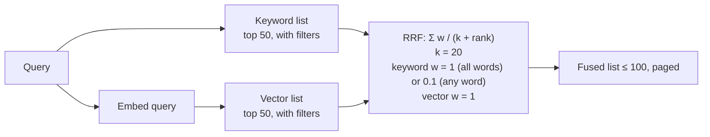

# 7. Hybrid search

> [Docs](../README.md) › [Guide](README.md) › 7. Hybrid search

Keyword search is right when the words are right; semantic search is right when the meaning is right. Hybrid search runs
both and fuses the lists. This chapter explains Reciprocal Rank Fusion, shows how the textbook setting made FilmSearch's
search *worse*, and how two measured changes fixed it.

## The business problem

The store has one search box. The customer does not choose "title search" or "description search": they type
"the dark knight", "nolan dream", or «вор крадёт секреты, проникая в сны людей». One mode must serve all of them.

| Query kind (I07 manual set) | Keyword MRR@10 | Semantic MRR@10 |
|---|---|---|
| Titles and names | **0.95** | 0.83 |
| English plot descriptions | 0.15 | **0.87** |

Neither mode wins everywhere; their failures are on different queries. That is the condition for fusion to help.

## Theory: Reciprocal Rank Fusion

The keyword score (`ts_rank_cd`) and the cosine similarity are on different, incomparable scales. Normalizing them is
fragile. **RRF** ignores scores and uses only ranks (Cormack et al., 2009):

```text
score(movie) = Σ over lists that contain it:  weight_list / (k + rank_in_list)
```

- A movie found by both lists gets two contributions.
- `k` flattens the curve. With k = 60, rank 1 gives 1/61 ≈ 0.0164 and rank 10 gives 1/70 ≈ 0.0143: almost the same.
  A movie at moderate ranks in both lists beats a movie at rank 1 in one. A smaller k trusts the top of each list more.
- Weights let one list count less.



## What FilmSearch does

[`ReciprocalRankFusion`](../../src/FilmSearch.Infrastructure/Search/Hybrid/ReciprocalRankFusion.cs) is about 40 lines:

```csharp
for (var list = 0; list < ranks.Length; list++)
{
    if (ranks[list] is { } rank)
    {
        score += lists[list].Weight / (k + rank);
    }
}
// ties: better best rank, then more lists, then movie id (deterministic)
```

[`MovieSearch`](../../src/FilmSearch.Infrastructure/Search/MovieSearch.cs) runs the keyword query while the query
embedding is computed, then the vector query, both with the same pre-filters, 50 candidates each
(`Search:Hybrid:CandidatesPerList`). Hybrid is the default mode of `POST /api/search` and of the assistant's
`search_movies` tool. Debug output per result: `keywordRank`, `keywordMatch`, `vectorRank`, `similarity`, `fusedScore`
([screenshot](../images/screenshots/search-scores.png)).

### The weight depends on how the keyword query matched

Recall the "any word" fallback of [ch. 4](04-keyword-search.md): when no movie contains every word, the keyword query is
relaxed to `a or b or c`. For a title ("the dark knight") all words match and the keyword list is excellent. For a
description ("a man discovers that his whole life is a TV show") the relaxed list ranks every overview with "man" or
"life": mostly noise. So the keyword list gets weight **1.0** when all words matched and **0.1** when relaxed
(`KeywordWeight`, `RelaxedKeywordWeight`).

## Evidence: the textbook default was wrong

46 manual queries ([I07 report](../../evals/reports/2026-11-17_I07_hybrid-and-query-understanding.md)), MRR@10:

| Mode | en plots | ru plots | sv plots | titles, names |
|---|---|---|---|---|
| keyword | 0.15 | 0.22 | 0.11 | 0.95 |
| semantic | 0.87 | 0.78 | 0.74 | 0.83 |
| hybrid, k = 60, equal weights (as first specified) | **0.51** | 0.76 | **0.43** | 1.00 |
| **hybrid, k = 20, relaxed keyword weight 0.1** | **0.87** | **0.92** | **0.74** | **1.00** |

With k = 60 a noise movie at keyword #1 and vector #30 scored 1/61 + 1/90 ≈ 0.0275, beating the right movie at vector #1
and absent from the keyword list (1/61 ≈ 0.0164). Hybrid was worse than semantic alone on descriptions. The tuned
setting is the only one in an offline grid (k ∈ {60, 30, 20, 10} × all-words weight ∈ {1, 0.7, 0.5} × relaxed weight ∈ {1 … 0}) that is at least as good as both
single modes in every group. Weight 0 for the relaxed list lost the Russian gain: Russian overviews do contain the words
of Russian queries.

The tuning set was small and also the test set, so I08 re-checked on the 105-query golden set
([baseline](../../evals/reports/2026-11-17_search_baseline.md) and one-parameter experiments):

| Hybrid setting (one change at a time) | Recall@10 | MRR@10 | nDCG@10 |
|---|---|---|---|
| **Default: k 20, keyword weight 1.0, relaxed 0.1** | **0.873** | **0.788** | **0.786** |
| [k 60](../../evals/reports/2026-11-17_search_hybrid-rrf-k60.md) | 0.869 | **0.732** | 0.750 |
| [k 10](../../evals/reports/2026-11-17_search_hybrid-rrf-k10.md) | 0.873 | 0.787 | 0.785 |
| [keyword weight 0.5](../../evals/reports/2026-11-17_search_hybrid-keyword-weight-0.5.md) | 0.873 | 0.792 | 0.788 |
| [keyword weight 0.3](../../evals/reports/2026-11-17_search_hybrid-keyword-weight-0.3.md) | 0.873 | 0.797 | 0.789 |

k = 60 is clearly worse; nothing else beats the default by more than one query, so **no default changed**. On the golden
set hybrid and semantic are close overall (0.873 vs 0.865 Recall@10): the golden set is mostly descriptions. Hybrid's
value is that it does not lose titles and names (title typos: 0.73 vs 0.70) while keeping the semantic quality.

Latency: hybrid 78 ms p50 in process vs 58 ms for semantic: the keyword query runs while the query is being embedded.

## Variants considered

- **Score normalization** (min-max of each list, then a weighted sum): needs comparable score distributions, which
  differ per query. RRF needs nothing.
- **"Movies like X"** steers the vector list with the named movie's vector: `AverageVector` (default) averages the
  normalized query and movie vectors; `ExtraList` adds the movie's neighbours as a third RRF list. Equal on 10 manual
  queries; the average needs one vector query instead of one per title ([ch. 8](08-query-understanding.md)).
- **Reranking** (a cross-encoder or an LLM over the fused top 20) is the next step when fusion is not enough. It is a
  stretch goal ([spec 05 §6](../spec/05-search.md#6-reranking-stretch)).
- **Degradation.** When the query cannot be embedded, hybrid returns the keyword list with `degraded: true`
  ([ch. 14](14-resilience-and-shipping.md)).

## Pitfalls

- **Copying k = 60 from a paper.** It was tuned for other data. Fusion parameters are a measurement, not a constant.
- **Trusting every list equally.** A list you know is noisy (relaxed keyword) should count less.
- **Tuning and testing on the same queries.** The 46-query result was optimistic; the golden set is the referee.
- **Fusing without debug output.** Without per-list ranks you cannot see *why* a movie moved.

---

**Previous:** [6. Vector search](06-vector-search.md) · **Next:** [8. Query understanding](08-query-understanding.md) ·
**See also:** [Spec 05 §4](../spec/05-search.md#4-hybrid-search) · [Journal: I07](../journal/m2-smart-search.md#i07--hybrid-search-and-query-understanding) ·
[Advanced: tuning fusion](advanced/fusion-tuning.md)
