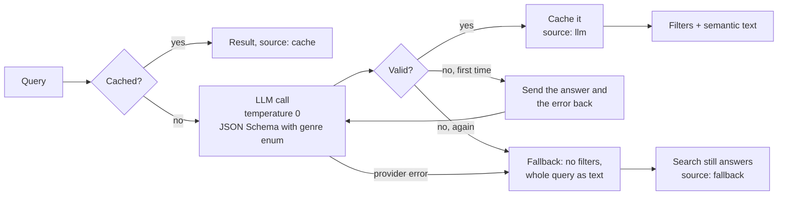
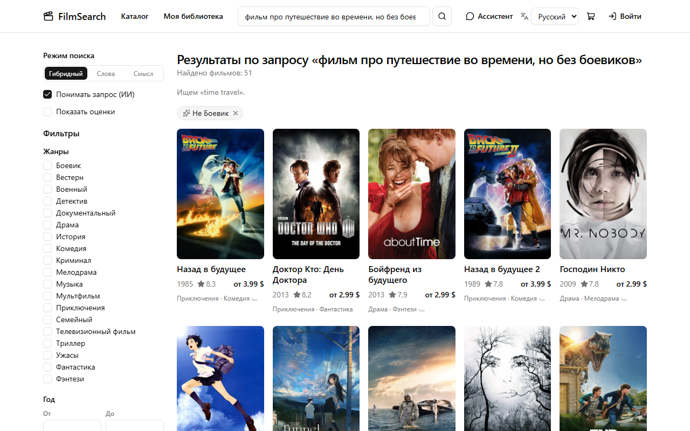

# 8. Query understanding

> [Docs](../README.md) › [Guide](README.md) › 8. Query understanding

"Фильмы 90-х про космос с рейтингом выше 7, без ужасов" is a topic plus four constraints. Embeddings capture the topic
and ignore the constraints: a vector cannot say "not horror". Query understanding (QU) asks a language model to split
the query into **filters** and a **semantic text**, as JSON that code can trust. It is the first place where a model's
output changes what the store does, so it is also the first place for validation, retries and fallbacks.

## The business problem

Customers type constraints in words: decades, ratings, prices, languages, genres they do *not* want. Semantic search
handles "no horror" badly: the word "horror" pulls horror movies *closer*. On the golden set, 17% of the top 10 of
negative queries ("not about World War II", "no horror") had the excluded genre. The store needs the constraints as
hard filters, extracted from free text in three languages.

## Theory: structured output

Asking for JSON in the prompt is not enough: small models add prose, rename fields or invent values. **Structured
output** sends a JSON Schema with the request (`response_format: { type: "json_schema", … }`); providers that support
**constrained decoding** (LM Studio, OpenAI) only allow tokens that keep the output valid against the schema. Even then:

- The schema guarantees the *shape*, not the *meaning*: `yearFrom: 3000` is valid JSON.
- Not every provider enforces the schema; some only "try".
- A model can still return an empty answer or time out.

So the robust pattern is **schema → validate → retry once with the error → fallback**:



## What FilmSearch does

### The output type is the schema

[`QueryUnderstandingOutput`](../../src/FilmSearch.AI/QueryUnderstanding/QueryUnderstandingOutput.cs) is a C# record; the
JSON Schema is generated from it with `AIJsonUtilities.CreateJsonSchema`, every property required and no extra
properties. The type and the schema cannot drift apart:

```csharp
internal sealed record QueryUnderstandingFiltersOutput(
    [property: Description("Genre slugs the user asks for.")]        IReadOnlyList<string> GenresInclude,
    [property: Description("Genre slugs the user does not want.")]   IReadOnlyList<string> GenresExclude,
    [property: Description("First release year, inclusive.")]       int? YearFrom,
    [property: Description("Last release year, inclusive.")]        int? YearTo,
    [property: Description("Minimum user rating, 0-10.")]           decimal? MinRating,
    [property: Description("Maximum price in cents.")]              long? MaxPriceMinor,
    [property: Description("ISO 639-1 code of the original language.")] string? Language);
```

At run time the genre arrays get an `enum` of the catalog's genre slugs. The model *cannot* return "Russian" for a
genre or a slug the store does not have. In the I05 benchmark this was the difference between 0/10 and 10/10 for the
small model ([ch. 3](03-language-models.md)).

### The service

[`QueryUnderstandingService`](../../src/FilmSearch.AI/QueryUnderstanding/QueryUnderstandingService.cs):

1. **Prompt** `query-understanding.v2` ([file](../../src/FilmSearch.AI/Prompts/query-understanding.v2.md)): instructions
   and the genre slugs with their names in en / ru / sv in the system message; the user's query as the user message.
   Untrusted text never goes into the instructions.
2. **Temperature 0**: extraction, not creativity.
3. **Validation** ([`QueryUnderstandingValidator`](../../src/FilmSearch.AI/QueryUnderstanding/QueryUnderstandingValidator.cs)):
   known genres, include ∩ exclude empty, years 1870–2100 and from ≤ to, rating 0–10, price ≥ 0, ISO language, ≤ 5
   titles.
4. **One retry** with the model's own answer and the error ("Your answer is invalid: … Answer again with only the
   corrected JSON").
5. **Fallback**: no filters, the whole query as semantic text. A provider error falls back at once. Search always
   answers.
6. **Cache** per normalized query (case, whitespace, ё/е), prompt id and profile, bounded, for a day. Fallbacks are not
   cached, so the model is asked again after an outage.

The prompt version is a span tag and part of the response (`understoodQuery.promptVersion`), so every result can be
traced to the prompt that produced it.

### Using the result

- Filters merge with filters set in the UI (explicit UI filters win; excluded genres add up) and go **into the SQL** of
  both retrievers (pre-filtering, [ch. 6](06-vector-search.md)).
- Both retrievers search for the **semantic text** with the filter words removed ("outer space, astronauts, space
  travel"), not the raw query, so "рейтинг" does not pollute full-text search.
- `similarToTitles` ("movies like Alien") is resolved to movie ids by keyword search; the named movies are excluded from
  the results, and their vectors steer the vector query (averaged with the query vector).
- The UI shows the understood filters as **chips the customer can remove** (`FR-SRCH-4`). AI output that changes
  results must be visible and reversible.



## Prompt as code: v1 → v2

Prompts are versioned files (`query-understanding.v1.md`, `.v2.md`); a meaningful change is a new version, and the old
one stays for comparison. Manual checks of v1 found ([I07 report](../../evals/reports/2026-11-17_I07_hybrid-and-query-understanding.md)):

- "the godfather" was read as "movies like The Godfather", so the movie itself was **excluded**. v2: only an explicit
  "like X / похожие на / som" is a similarity request; bare titles go into the semantic text.
- "time travel" got the genre `science-fiction`. A guessed genre becomes a hard filter and hides good matches (a
  time-travel romance). Rule since v2: **genres only when the user names a genre**.

## Evidence

40 labelled queries × 3 repeats, Gemma 4 E4B locally ([QU baseline](../../evals/reports/2026-11-17_qu_baseline.md)):

| Valid JSON (no fallback) | Retries | Exact match, all fields | Excluded genres P / R | p50 |
|---|---|---|---|---|
| **100%** | 0% | 83% | 1.000 / 1.000 | 3.8 s |

The errors were systematic, not random: "efter 2000" → `yearFrom: 2011` (the model copied the prompt's example "after
2010 → 2011"); "до 1970 года" → `yearTo: 1970` instead of 1969; "anime" did not become `animation`. Reading the
mismatches is how you find which example in the prompt is misleading.

On search ([baseline](../../evals/reports/2026-11-17_search_baseline.md)), hybrid + QU against plain hybrid:

| | Recall@10 | MRR@10 | Excluded-genre rate | p50 |
|---|---|---|---|---|
| hybrid | 0.873 | 0.788 | 0.171 | 78 ms |
| hybrid + QU | 0.862 | 0.820 | **0.000** | 3865 ms |

QU removed every ruled-out genre and improved the ranking on negative queries (MRR 0.57 → 0.91), at the cost of ~4 s on
a local model. Whether that is worth it is a product decision: with the cache, a repeated query costs nothing; a cloud
model makes it ~1 s; the UI can show keyword results first. The assistant does not use QU at all: its model fills the
same filters as tool arguments ([ch. 10](10-agents-and-tools.md)).

## Pitfalls

- **Descriptions instead of enums.** "en, ru or sv" in a description is a suggestion; an `enum` is a rule.
- **Trusting valid JSON.** Validate meaning (ranges, known values, consistency) in code.
- **Caching failures.** A cached fallback keeps a provider outage alive after the provider is back.
- **Guessing constraints.** An invented filter is worse than a missing one: it silently hides results. The evaluation
  counts an invented filter as wrong.
- **Expecting temperature 0 to be deterministic.** "movies about space, no horror" got `science-fiction` in 2 of 3 runs.

---

**Previous:** [7. Hybrid search](07-hybrid-search.md) · **Next:** [9. RAG: grounded answers](09-rag-grounded-answers.md) ·
**See also:** [Spec 05 §5](../spec/05-search.md#5-query-understanding-qu) · [Journal: I07](../journal/m2-smart-search.md#i07--hybrid-search-and-query-understanding) ·
[Prompts](../../src/FilmSearch.AI/Prompts/README.md)
