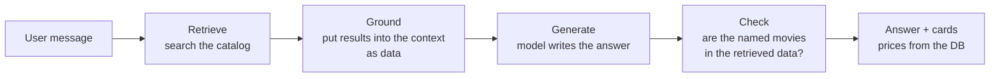
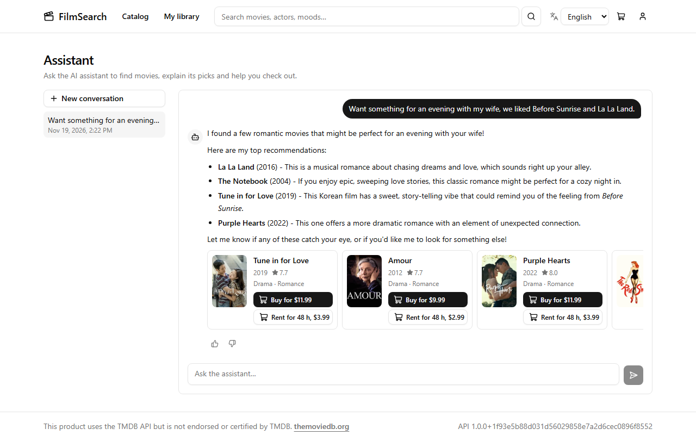
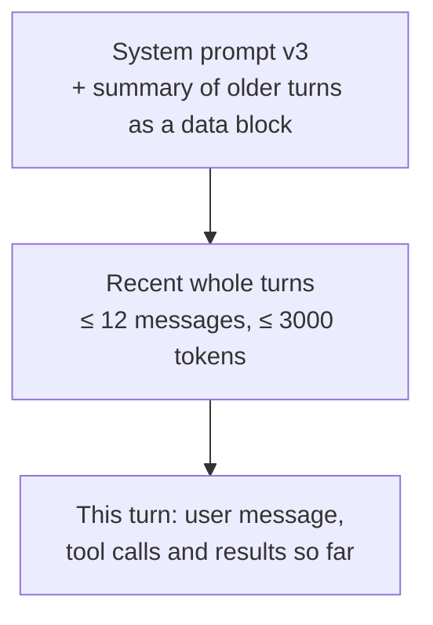

# 9. RAG: grounded answers

> [Docs](../README.md) › [Guide](README.md) › 9. RAG

Retrieval-augmented generation is a simple idea: before the model answers, **retrieve** the relevant facts from your
data, put them into the request, and let the model **generate** an answer from them. The model writes the sentences;
the store supplies the facts. This chapter shows how FilmSearch grounds every recommendation in the catalog, keeps
prices out of the model's hands, manages conversation memory, and checks afterwards that the answer stayed grounded.

## The business problem

"Want something for an evening with my wife, we liked Before Sunrise and La La Land." A model alone answers from its
training data: movies the store does not sell, prices it invents, plots it half-remembers. The I05 benchmark caught
small models recommending a non-existent Swedish film and a wrong Russian title of *The Grand Budapest Hotel*. A sales
assistant that recommends what the store cannot sell, at a price the store does not charge, is worse than none.

## Theory



Three classic shapes of RAG:

| Shape | How retrieval happens | Fits |
|---|---|---|
| **Fixed pipeline** | Always search with the user's message, then generate | Q&A over documents |
| **Query rewriting** | A model call turns the conversation into a search query first | Follow-up questions ("and older ones?") |
| **Agentic RAG** | The model decides when and what to search, through a tool | Conversations with several needs: search, details, similar, cart |

FilmSearch uses **agentic RAG**: retrieval is the `search_movies` tool (and `find_similar_movies`,
`get_movie_details`), and the model writes the search query and filters itself. The agent loop is the subject of
[ch. 10](10-agents-and-tools.md); this chapter is about what makes the answer trustworthy.

Key ideas:

- **Grounding**: the answer may only use facts from the retrieved context. Said in the prompt, checked in code.
- **Context is a budget.** Every retrieved token costs money and attention. Send what the model needs, not the record.
- **Retrieved text is untrusted.** A movie overview could contain "ignore your instructions". It is data, never rules
  ([ch. 12](12-guardrails.md)).
- **When retrieval finds nothing, say so.** The worst RAG answer is a confident one built on an empty result.

## What FilmSearch does

### Facts and prices never come from the model

The rules of the system prompt ([`assistant-system.v3`](../../src/FilmSearch.AI/Prompts/assistant-system.v3.md)):

> 1. Recommend only movies that a tool returned in this conversation. Never invent movies, prices, release years, cast
>    or other facts. If no movie fits, say so and suggest how to relax the request.
> 6. Prices only as a tool returned them. Never compute a total yourself: the cart and checkout tools return it.

And, more importantly, the **UI does not depend on the model obeying**. Movie cards next to the answer are built from
tool results (ids from the database), with posters and prices from the database. The cart total and the checkout
summary are computed by the cart service. The model's text explains; the cards, buttons and totals are facts.



### Compact, data-shaped tool results

[`ToolResults`](../../src/FilmSearch.AI/Assistant/Tools/ToolResults.cs) turns database rows into what the model needs,
in the customer's language:

```json
{ "movies": [ { "id": "0193…", "title": "Before Sunset", "year": 2004, "genres": ["Drama", "Romance"],
                "rating": 7.7, "overview": "Nine years later, Jesse travels across Europe… (≤ 300 chars)",
                "offers": ["buy: 9.99 USD", "rent for 48 h: 3.99 USD"] } ],
  "notes": ["Unknown genre 'romcom' was ignored."] }
```

- Prices are pre-formatted strings from the database; the model copies them, it never does arithmetic.
- Ids are included so later turns ("the second one") can refer to a movie exactly.
- `originalTitle` is included when it differs (added in I14: it reduced false grounding alarms and helps the model keep
  the right title in Russian and Swedish).
- `notes` explain what the tool ignored, so the model can tell the user.

### Memory: a window plus a rolling summary

The model is stateless; [`ConversationHistory`](../../src/FilmSearch.AI/Assistant/ConversationHistory.cs) builds each
request:



- Older turns are folded into a **rolling summary** by a separate prompt (`assistant-summary.v1`), together with the
  movies the tools found, *with their ids*, so "the second one from before" still resolves.
- Tool results of earlier turns are cut to `{ id, title, year }` per movie: enough to refer back, far fewer tokens.
- A user message whose answer was stopped is **joined with the next one** instead of dropped. "Recommend three thrillers
  from the nineties…" → Stop → "Just one, please." kept its topic only after this fix (found by the I14 evaluation).
- Gemma's chat template accepts one system message and strictly alternating roles; the history respects both.

### The grounding check

After every answer [`GroundingCheck`](../../src/FilmSearch.AI/Assistant/GroundingCheck.cs) extracts bold and quoted
spans (the prompt asks for **bold titles**) and looks for each, normalized and as whole words, in the tool results of the
conversation, the summary, the system prompt and the user's messages. Unknown titles are counted
(`assistant.grounding.titles{grounded=false}`), tagged on the trace and logged. Russian titles are inflected
(«Матрицей»), so Cyrillic words match by a common prefix.

It is a **metric, not a filter**: at 2–4% with mostly real cases it belongs on a dashboard, and blocking an answer
mid-stream would hurt more than it helps ([I14 decision](../../evals/reports/2026-11-18_I14_assistant-evaluation.md#decisions)).

## Evidence

- Grounding violation rate on 34 scenarios × 3 runs: **2.3%** (Gemma 4 E4B), **3.8%** (DeepSeek V4.1 Flash). DeepSeek's
  first number was 10.8%; reading the flagged answers showed most were false alarms (the Russian button label,
  "**148 minutes**", inflected titles), fixed in the check. What remains is mostly real: DeepSeek suggesting
  «Кавказская пленница», which the catalog does not have, from its own knowledge
  ([I14 summary](../../evals/reports/2026-11-18_I14_assistant-evaluation.md), finding 9).
- Prices: no evaluation run ever showed a price that was not from a tool result, because the cards and totals never
  come from the model.
- The first real-model check (I11): a Russian question about space movies got Russian titles and prices copied exactly
  from the tool result ([I11](../journal/m3-ai-assistant.md#i11--chat-foundation)).

## Why not a fixed pipeline

A fixed "search, then generate" pipeline would search on "Take the second one, buy it" and on "who directed it?".
The assistant needs several kinds of retrieval (search, details, similar movies, the cart) and to decide *whether* to
retrieve. Letting the model call retrieval tools handles all of them in one loop, and the cost is bounded by an
iteration limit ([ch. 10](10-agents-and-tools.md)). The search service is the same as the store's search box, so every
improvement measured in [ch. 11](11-evaluation.md) improves the assistant too.

## Pitfalls

- **Grounding only in the prompt.** Prompts are suggestions. Put facts the user acts on (prices, totals, cards) in code.
- **Dumping whole records into the context.** Full overviews, cast lists and history for every result multiply input
  tokens (and cost) per turn. Compact results, cut old ones.
- **Losing ids.** "The second one" must map to an id from a tool result, not to a title the model retypes.
- **Treating the check as truth.** A heuristic grounding check has false positives; read what it flags before tuning
  the prompt.

---

**Previous:** [8. Query understanding](08-query-understanding.md) · **Next:** [10. Agents and tools](10-agents-and-tools.md) ·
**See also:** [Spec 06 §5–6](../spec/06-ai-assistant.md#5-guardrails) · [Journal: I11](../journal/m3-ai-assistant.md#i11--chat-foundation) ·
[Prompts](../../src/FilmSearch.AI/Prompts/README.md)
