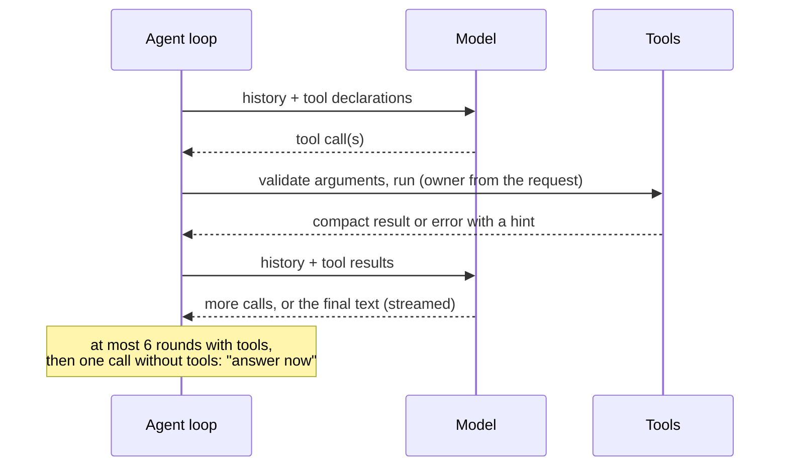
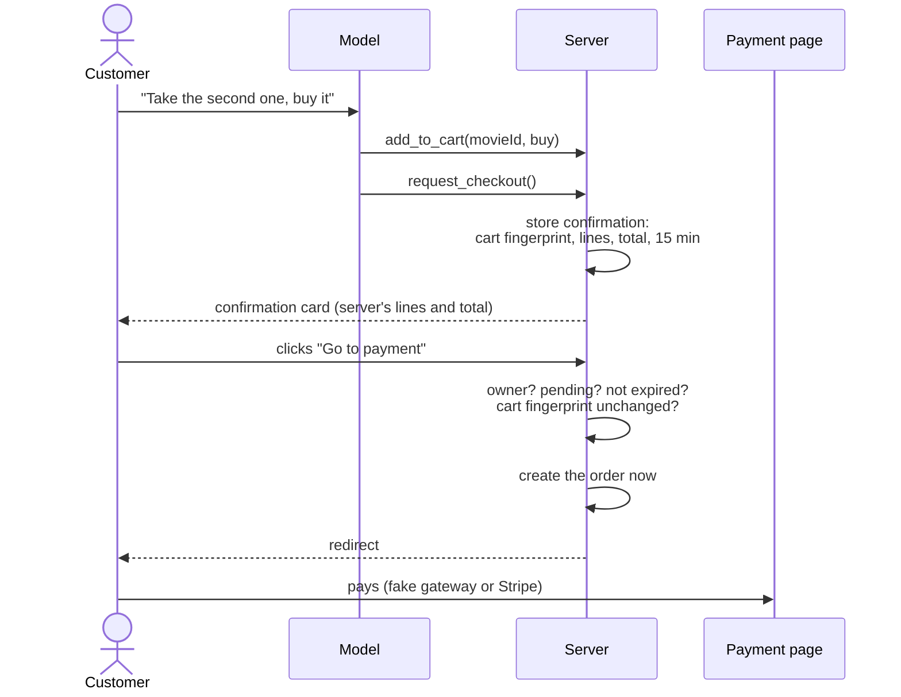
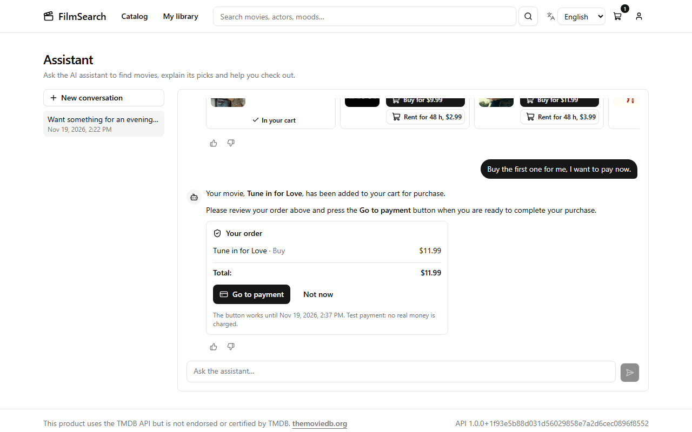

# 10. Agents and tools

> [Docs](../README.md) › [Guide](README.md) › 10. Agents and tools

An agent is a model in a loop: it can call functions (tools), see their results, and decide what to do next until it
can answer. FilmSearch's sales assistant has seven tools: four to find movies, three to change the cart, and one way
to ask for a checkout that **only a person can approve**. This chapter shows the loop, how to design tools a small model
can use, and where the safety boundary must be.

## The business problem

"We liked Before Sunrise and La La Land" → search → three suggestions → "Take the second one, buy it" → the movie in
the cart and a payment button. Each step is a different action in a different module. The assistant must act on the
customer's behalf, quickly, without ever spending their money on its own.

## Theory: tool calling and the agent loop

A tool is declared with a name, a description and a **JSON Schema** of its arguments. The model does not run anything:
it returns a structured **tool call** (`search_movies({"query": "romantic, dialogue-driven", "yearFrom": 1990})`), your
code runs it and sends the result back as a `tool` message, and the model continues.

Design questions every agent has to answer:

| Question | FilmSearch's answer |
|---|---|
| Who runs the loop? | Our own code over `IChatClient` ([ADR-0006](../adr/0006-agent-own-loop-first.md)), to see and control every step |
| How many rounds? | `Assistant:MaxToolIterations` = 6, then a forced final answer |
| Parallel calls? | Accepted, but run one after another in the model's order (they share a `DbContext`; "add, then checkout" must see the new line) |
| Bad arguments? | Become an `{ "error": … }` result that says how to fix the call; never fail the turn |
| Who is the user? | From the request's cookie, **never** from a tool argument |
| Side effects with money? | The model can only *request*; a person approves exactly what the server shows |

## What FilmSearch does

### The loop

[`AgentLoop`](../../src/FilmSearch.AI/Assistant/AgentLoop.cs) streams each model call, forwards text deltas to the
browser as they arrive, collects tool calls, runs them, and loops. Every tool run becomes events for the UI:
`tool.started` / `tool.completed` (chips like "Searching the catalog…"), `movies` (cards), `cart.updated`,
`confirmation.required`. [`AssistantChat`](../../src/FilmSearch.AI/Assistant/AssistantChat.cs) wraps a turn: budgets,
history, the grounding check, storing the answer with tokens, cost, model, prompt version and trace id. The endpoint
sends events as server-sent events ([spec 04](../spec/04-api.md)).

A framework (`FunctionInvokingChatClient`, Semantic Kernel, Microsoft Agent Framework) would run this loop for you. The
own loop is about 250 lines and made the problems in this chapter visible: parallel calls on one `DbContext`, spans that
did not nest, the exact place to stop. It can be swapped for a framework later.

### Seven thin tools

| Tool | Calls | Side effect |
|---|---|---|
| `search_movies` | `IMovieSearch` (hybrid, flat filter arguments) | cards |
| `get_movie_details` | `ICatalogReader` | — |
| `find_similar_movies` | `IMovieSearch.FindSimilarAsync` | cards |
| `view_cart` | `ICartService.GetAsync` | — |
| `add_to_cart` | `ICartService.AddItemAsync` | cart line (`addedBy: assistant`) |
| `remove_from_cart` | `ICartService.RemoveItemAsync` | — |
| `request_checkout` | `ICheckoutConfirmations.RequestAsync` | a **pending confirmation**, nothing else |

Each is an [`AssistantTool<TArgs>`](../../src/FilmSearch.AI/Assistant/Tools/AssistantTool.cs): the JSON Schema comes from a
C# argument record, arguments are validated before the tool runs, and the tool calls the same service as the HTTP
endpoint. No business logic lives in a tool.

### Tool design for small models

Lessons from the I05 benchmark and the I14 evaluation:

- **Flat arguments.** `search_movies(query, genresInclude, yearFrom, …)`, not a nested `filters` object: small models
  filled nested objects badly ([I11](../journal/m3-ai-assistant.md#i11--chat-foundation)).
- **Enums for closed sets.** Genre slugs and `offerType` (`buy` / `rent`) are enums in the schema.
- **Descriptions that say where values come from.** `movieId`: "Id of the movie, exactly as a tool returned it."
- **Errors that teach.** Gemma passed titles and IMDb ids as `movieId`, then asked the user for "the ID". The error now
  says: use `search_movies` with the title first, or `view_cart` for a movie in the cart, and never ask the user for an
  id. Missing or wrong values name the property and the allowed values.
- **Results the model cannot get wrong.** Prices as formatted strings, totals from the cart service ([ch. 9](09-rag-grounded-answers.md)).

### Human in the loop: the checkout confirmation

- `request_checkout` creates **no order and no payment**. It stores a confirmation bound to a **fingerprint of the
  cart** (lines, offers, prices) and the UI shows the server's summary with a button.
- The order is created only by `POST /api/chat/conversations/{id}/confirmations/{confirmationId}` after the click.
  Any change of the cart in between invalidates the button (`cartChanged`); the assistant has to ask again.
- An abandoned confirmation costs nothing: no order waits to expire.
- A reflection test proves that no tool depends on `ICheckoutService` or `IPaymentGateway`. The boundary is in the
  dependency graph, not in the prompt.

### The prompt's sales rules

Prompt v2 and v3 ([file](../../src/FilmSearch.AI/Prompts/assistant-system.v3.md)) encode the flow: "the second one" is
the second movie of the last list, by its id; "buy it" means `add_to_cart` **and** `request_checkout` in the same
answer, without asking "shall I check out?"; "add it, I'll keep looking" means `add_to_cart` only; if buy or rent is not
said, ask once with both prices; never say something is paid.

## Evidence

[I14 summary](../../evals/reports/2026-11-18_I14_assistant-evaluation.md), 34 multi-turn scenarios × 3:

| | Gemma 4 E4B (local) | DeepSeek V4.1 Flash |
|---|---|---|
| Pass rate, prompt v2 → v3 | 63% → **78%** | 83% → **92%** |
| `confirmation` check (checkout shown when it should be) | 77% → 90% | |
| Orders created without a click | **0** | **0** |
| Tool iteration limit hit | 0 | 0 |
| Turn latency p50 | 21.6 s | 3.2 s |

Fixes that came from reading failed cases: the id-from-title error message, "do not ask again after *buy it*", excluded
genres into `genresExclude` (`cards` check 82% → 100%), joining a stopped message with the next one. Open: "add the
first one" without buy or rent still adds the buy offer for both models; Gemma cannot remove a cart line by title.

## Pitfalls

- **Safety in the prompt.** "Never pay without asking" in a prompt is a wish. A tool that cannot reach the gateway is a
  guarantee.
- **Owner in the arguments.** If a tool takes `userId`, a prompt injection can name another user.
- **Parallel tool calls on shared state.** Run them in order unless they are truly independent.
- **Crashing on bad arguments.** The model will send titles as ids. Return an error it can act on.
- **No iteration limit.** A confused model can loop; every round costs a full context of input tokens.

---

**Previous:** [9. RAG: grounded answers](09-rag-grounded-answers.md) · **Next:** [11. Evaluation](11-evaluation.md) ·
**See also:** [Spec 06 §2–4](../spec/06-ai-assistant.md#2-agent-loop-own-implementation-first) · [ADR-0006](../adr/0006-agent-own-loop-first.md) ·
[Journal: I12](../journal/m3-ai-assistant.md#i12--agent-tools-cart-checkout-confirmation) · [Journal: I13](../journal/m3-ai-assistant.md#i13--chat-ui)
