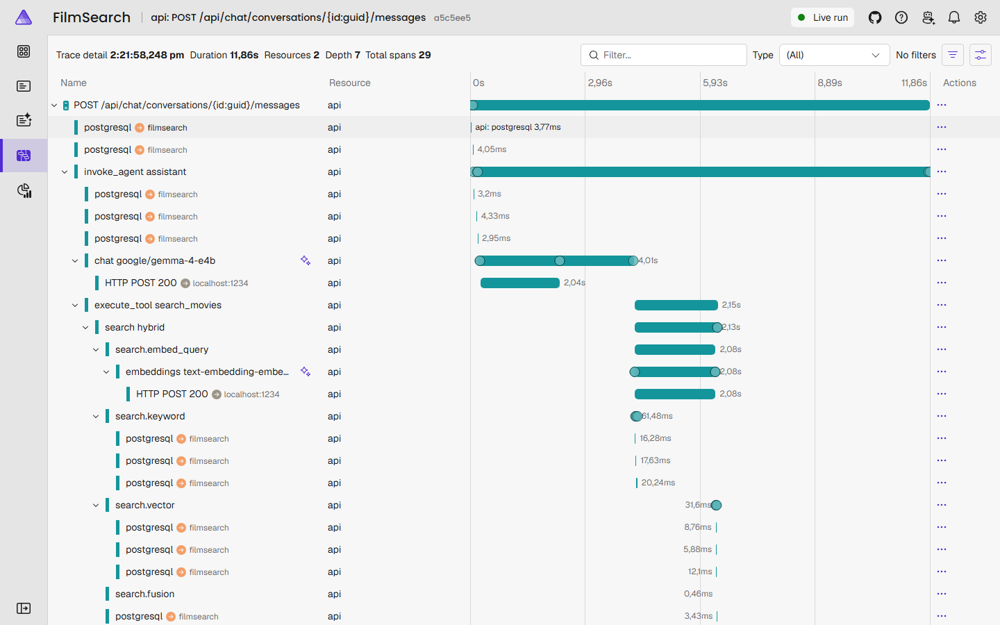
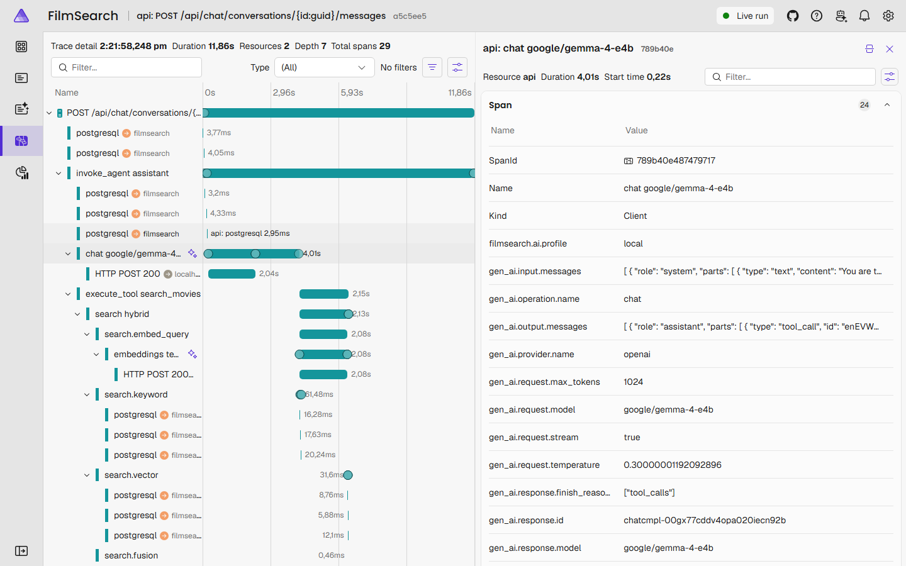

# 13. Observability and cost

> [Docs](../README.md) › [Guide](README.md) › 13. Observability and cost

A chat turn of the assistant is two to four model calls, several tool calls, a hybrid search with its own embedding
call, and a dozen SQL queries. When a customer says "the answer was wrong" or the bill doubles, you need to see that turn
from the inside. This chapter covers GenAI traces, the metrics that matter for an AI product, token and cost
accounting, and the one cheap trick that ties it all together: storing the trace id with every answer.

## The business problem

Three questions an operator of an AI store gets every week:

1. "This answer was bad" (a 👎). *What did the model see, which tools ran, what did search return?*
2. "The assistant is slow today." *Is it the model, the embedding provider, or the database?*
3. "What does a conversation cost, and who is spending?" *Per answer, per owner, per day.*

Logs alone do not answer them: one turn is many calls across components, and the interesting data (tokens, prompt
version, tool arguments) is AI-specific.

## Theory

- **Traces** show one request as a tree of spans with timings and tags. OpenTelemetry has **GenAI semantic
  conventions**: `chat <model>` spans with `gen_ai.usage.input_tokens` / `output_tokens`, `execute_tool <name>`,
  `invoke_agent <name>`, `embeddings <model>`. Tools that understand them (Aspire dashboard, Langfuse) show model calls
  as first-class steps.
- **Metrics** are counters and histograms over time: turns by outcome, latency per prompt version, tool errors,
  grounding violations, tokens and cost. They tell you *when* something changed.
- **Content** (prompts, completions, tool arguments) is the most useful and the most sensitive part of a trace. Record
  it where you may (development), not by default.
- **Cost** = input tokens × input price + output tokens × output price, per model. Providers do not always return usage
  for streamed responses; compute it yourself from a price table.

## What FilmSearch does

### One turn as one trace

```text
POST /api/chat/conversations/{id}/messages
└─ invoke_agent assistant                 conversation id, prompt id, total tokens and cost, grounding counts
   ├─ chat google/gemma-4-e4b             model call 1: tokens, filmsearch.ai.cost_usd
   ├─ execute_tool search_movies          name, call id, ok
   │  └─ search hybrid                    mode, results, degraded
   │     ├─ search.embed_query → embeddings …
   │     ├─ search.keyword → postgresql   match all / any, hits
   │     ├─ search.vector → postgresql
   │     └─ search.fusion                 rrf_k, fused
   ├─ chat google/gemma-4-e4b             model call 2 writes the answer
   └─ postgresql …                        the stored answer
```



The chat and embedding spans come from the `Microsoft.Extensions.AI` OpenTelemetry middleware on every client
([ch. 3](03-language-models.md)); the agent and tool spans from [`AgentLoop`](../../src/FilmSearch.AI/Assistant/AgentLoop.cs);
the search stages from [`SearchTelemetry`](../../src/FilmSearch.Infrastructure/Search/SearchTelemetry.cs).

A .NET detail that cost a day: inside an async iterator `Activity.Current` is reset after every `yield`, so the spans of
a streamed turn did not nest under the turn span. The turn now runs as a plain async method that writes events to a
channel, and the SSE endpoint reads the channel ([I11](../journal/m3-ai-assistant.md#i11--chat-foundation)).

Prompt and tool content is added to spans only when `AI:EnableSensitiveData` is on (Development).



### Every answer stores its trace id

`assistant.messages` stores per answer: input and output tokens, estimated cost, latency, model, prompt version, the
fallback profile if one answered, and the **trace id** of the turn. A 👎 in `assistant.message_feedback` joins to it, so
a complaint leads straight to the exact model calls, tool arguments and SQL of that turn. This was the cheapest and most
useful observability change of the project ([I18](../journal/m5-production-ready.md#i18--observability-and-cost-tracking)).

### Metrics (meter `FilmSearch`)

| Metric | Read it as |
|---|---|
| `assistant.turns{outcome, prompt}`, `assistant.turn.duration` | Success rate and latency per prompt version |
| `assistant.tool_calls{tool, ok}` | Tools that fail or get invalid arguments |
| `assistant.iteration_limit_hits` | The model loops on tools |
| `assistant.grounding.titles{grounded}` | Answers that name movies no tool returned ([ch. 9](09-rag-grounded-answers.md)) |
| `assistant.feedback{rating}` | User satisfaction |
| `ai.tokens`, `ai.cost_usd` (by model, operation) | Spend |
| `ai.fallbacks` | Answers from the fallback profile ([ch. 14](14-resilience-and-shipping.md)) |
| `cache.lookups{cache, hit}` | Query vector and QU cache hit rates |
| `search.requests`, `search.latency` (by mode, `degraded`) | Search health; keyword fallbacks during an outage |

### Cost control

Tokens of all model calls of a turn are summed, priced from `AI:Pricing` with the model that actually answered, stored
on the answer and on the conversation. Budgets are checked **before** a model call ([ch. 12](12-guardrails.md)): per
conversation, per owner per day, and service-wide in the demo. Numbers from the evaluations:

| | Input tokens per turn | Cost per turn |
|---|---|---|
| Gemma 4 E4B, local | ≈ 5 600 | $0 (electricity) |
| DeepSeek V4.1 Flash, OpenRouter | ≈ 7 000 | ≈ $0.0004 |

Input tokens dominate (system prompt, tool declarations, history, tool results), which is why tool results are compact,
old tool results are cut to ids and titles, and long conversations are summarized. Prompt v3 cost about 16% more input
tokens than v2 for +15 points of pass rate: a trade-off you can only make with both numbers.

### Langfuse, optional

[Langfuse](https://langfuse.com) is an open-source LLM observability tool: traces as conversations, sessions, prompt
versions, scores. The AppHost can start it self-hosted (`Langfuse:Enabled`). Only AI traces go there: a filtering
exporter passes spans of AI work, their children and the request root, not every HTTP and SQL span of the store. User
ratings become `user_feedback` scores on the trace. The step-by-step queries are in the
[observability runbook](../runbooks/observability.md).

## Evidence

- From a 👎 to the trace in one SQL query plus one click ([runbook](../runbooks/observability.md#find-a-turn)).
- The I19 outage drill was read from traces: 10.2 s for the first failing embedding call (three refused connections of
  ~2 s each to `localhost` on Windows, plus backoff), then ~0.2 s while the circuit was open
  ([I19](../journal/m5-production-ready.md#i19--resilience-caching-rate-limiting)).
- The evaluation runner records the turn span of every case, so evaluation reports include tokens and latency per run
  ([ch. 11](11-evaluation.md)).

## Pitfalls

- **Content in production traces.** Prompts contain user text. Switch content recording per environment.
- **Exporting everything to an LLM tool.** HTTP and SQL spans drown the AI steps and cost storage. Filter.
- **Cost from provider usage only.** Streamed responses may have none. Keep a price table and compute.
- **Per-conversation budgets only.** A new conversation resets them. Budget per owner and per service.
- **Process-wide meters in tests.** Parallel tests counted each other's measurements; record only the meters of one
  app's `IMeterFactory` ([I18](../journal/m5-production-ready.md#i18--observability-and-cost-tracking)).

---

**Previous:** [12. Guardrails](12-guardrails.md) · **Next:** [14. Resilience and shipping](14-resilience-and-shipping.md) ·
**See also:** [Observability runbook](../runbooks/observability.md) · [Spec 10 §3](../spec/10-ops-security.md#3-observability) ·
[Journal: I18](../journal/m5-production-ready.md#i18--observability-and-cost-tracking)
