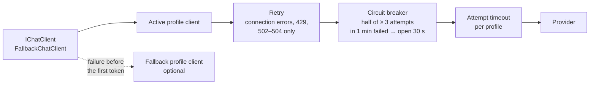
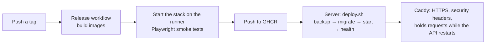

# 14. Resilience and shipping

> [Docs](../README.md) › [Guide](README.md) › 14. Resilience and shipping

AI providers fail in their own ways: a local model is **slow** rather than down, a hosted one returns 429 when you are
popular, an embedding model cannot be swapped for another during an outage. This last chapter covers how FilmSearch
keeps working when the model does not, how caching makes it cheaper and faster, and what it takes to ship the whole
thing as containers with a spending cap.

## The business problem

The store must sell movies when the model server is off, slow, or out of credit. A demo on the public internet must not
turn into a surprise bill. And a release must be repeatable: build, migrate, start, check, roll back.

## Theory: AI failures are different

| Failure | Typical cause | Retry? |
|---|---|---|
| Connection refused | Local server not started | Yes, it is cheap: nothing ran |
| 429, 502, 503, 504 | Provider overloaded, rate limit | Yes, with backoff; honor `Retry-After` |
| **Timeout** | The model is still generating (LM Studio keeps the request in its queue) | **No**: a retry doubles the load and the wait |
| 500 | A bug or a bad request | No |
| Failure in the middle of a stream | Network, provider | No: the user has already seen half an answer |

A **circuit breaker** stops calling a provider that keeps failing, so the next requests fail at once instead of each
waiting for its own timeouts. A **fallback** answers from somewhere else: another chat model, or a non-AI path.

The non-AI path matters most. Embeddings cannot fall back to another model: another model's query vector is not
comparable with the stored movie vectors ([ch. 5](05-embeddings.md)). The fallback for semantic search is keyword search.

## What FilmSearch does

### A pipeline per profile

[`AiHttpResilience`](../../src/FilmSearch.AI/Providers/AiHttpResilience.cs) builds a Polly pipeline on each profile's
named HTTP client, so a slow chat model does not open the breaker of the embedding model on the same LM Studio server.
The SDK's own retries are off. Decision and alternatives (SDK retries, an LLM gateway): [ADR-0011](../adr/0011-ai-resilience-and-fallback.md).

[`FallbackChatClient`](../../src/FilmSearch.AI/Providers/FallbackChatClient.cs) (optional, `AI:FallbackChatProfile`)
sends a failed call to the fallback profile, but only if nothing was streamed yet. The answer is flagged as a fallback,
its tokens are priced with the fallback's model, and `ai.fallbacks` counts the switches.

### Degraded, not broken

| Component down | What the customer gets |
|---|---|
| Embeddings | Hybrid and semantic search return keyword results with `degraded: true`; a query embedded before the outage stays semantic from the cache |
| Chat model, query understanding | The query is searched as typed, without extracted filters (`source: fallback`) |
| Chat model, assistant | The chat says the assistant is unavailable (`providerUnavailable`); the store works |
| Any AI provider, health | Health checks report **Degraded**, not Unhealthy: the orchestrator does not restart a working store |

### Caching

| Cache | Key | Lifetime | Why it is safe |
|---|---|---|---|
| Query vectors | profile, model, normalized text (case, whitespace, ё/е) | 1 day, ≤ 10 000 entries | A vector depends only on the text and the model |
| Query understanding | normalized query, prompt id, profile | 1 day, ≤ 10 000 entries | Depends on the query, prompt, model and genres; fallbacks are not cached |

Both are bounded memory caches with hit metrics (`cache.lookups`). They are exact-match caches. A **semantic cache**
(reuse the answer of a *similar* query) and provider **prompt caching** (cheaper repeated prompt prefixes) are further
options; the system prompt and tool declarations are a stable prefix that prompt caching would discount.

### Payments are not AI, but the same rule applies

Stripe calls get their own pipeline: retry only GET / HEAD or requests with an `Idempotency-Key`. The standard handler
retried every POST, which could create two Checkout Sessions ([I19](../journal/m5-production-ready.md#i19--resilience-caching-rate-limiting)).

## Shipping

[ADR-0012](../adr/0012-deployment-docker-compose-vps.md) chose Docker Compose on one host: a pet project needs a demo,
not a cluster. What shipping an AI app added on top of a normal web app:

- **Models are configuration.** The demo runs chat and embeddings on OpenRouter; `CHAT_PROFILE=local` uses LM Studio on
  the Docker host. No model weights in the images (API 282 MB, Worker 275 MB, chiseled and non-root; web 93 MB).
- **A spending cap.** `Assistant:MaxTotalTokensPerDay` across all owners, and a separate provider key with a credit
  limit. Anonymous visitors are unlimited in number; the cap is not.
- **The environment is named `Demo`**, not Production: production behavior, but the fake payment gateway is allowed
  (Production refuses it, a safety rule from I09). Stripe keys must be test keys; live keys are refused at startup.
- **Migrations as a step** (`FilmSearch.Worker migrate`) with the app's own advisory lock, before the new API starts.
- **Re-embedding is a deploy concern.** Changing the embedding model or the embedding text means a reindex job before
  switching the active profile ([ch. 6](06-vector-search.md)).

Steps and rollback: [deploy runbook](../../deploy/README.md).

## Evidence

- **Outage drill** with LM Studio stopped ([I19](../journal/m5-production-ready.md#i19--resilience-caching-rate-limiting)):
  a cached query stayed semantic (167 ms); a new query degraded to keyword after 10.2 s (refused `localhost`
  connections take ~2 s each on Windows), then the breaker opened and calls took ~0.2 s; 31 s after
  `lms server start` search was semantic again.
- **Retry rules from a real bug**: a timed-out local call was sent three times while the model was still generating
  the first one.
- **Embeddings in the demo** ([I20 report](../../evals/reports/2026-11-19_search_i20-openrouter-qwen3-embedding-8b.md)):
  Qwen3-Embedding-8B on OpenRouter, semantic Recall@10 0.865 → 0.917, but p50 577 ms / p95 4.6 s per new query (60 ms
  locally). The query vector cache hides most of it for repeated queries.
- **Release workflow** runs six Playwright smoke tests against the composed stack before an image is pushed.

## Pitfalls

- **"Retry more."** For a slow model, retries make it slower. Retry only what never reached the model.
- **No non-AI path.** If search needs the embedding model, an outage takes search down. Keep keyword search.
- **Falling back mid-stream.** The user sees two answers spliced together. Switch only before the first token.
- **Caching fallbacks.** An outage outlives itself.
- **A public demo without a total budget.** Per-user limits do not cap the number of users.

## Where to go from here

The core chapters end here: a store whose search finds movies by meaning in three languages, an assistant that sells
from the catalog and never moves money on its own, numbers for every decision, and a way to see, limit and ship it.

- The [advanced chapters](README.md#advanced) go deeper into similarity metrics, choosing an embedding model, pgvector
  indexes, vector storage, fusion tuning and LLM judges.
- The [journal](../journal/README.md) tells what really happened, problem by problem.
- The [roadmap's stretch goals](../plan/roadmap.md#stretch-goals-after-m5-or-when-a-topic-is-interesting) list what is
  next: reranking, user preference memory, an MCP server, fine-tuning.

---

**Previous:** [13. Observability and cost](13-observability-and-cost.md) · **Back to:** [Guide contents](README.md) ·
**See also:** [ADR-0011](../adr/0011-ai-resilience-and-fallback.md) · [ADR-0012](../adr/0012-deployment-docker-compose-vps.md) ·
[Deploy runbook](../../deploy/README.md) · [Journal: M5](../journal/m5-production-ready.md)
