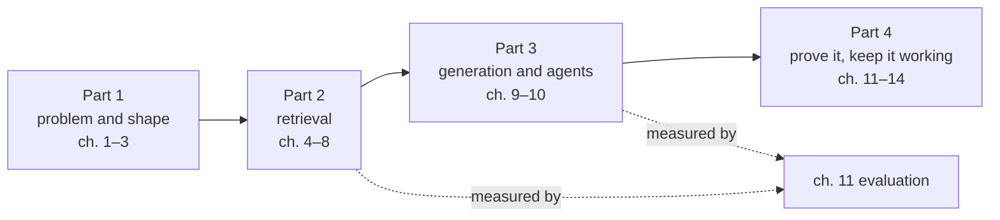

# Guide: building an AI store, RAG from zero to production

> [Docs](../README.md) › Guide

A textbook built around one complete example. Each chapter starts with a business problem of a movie store, explains
the theory needed to solve it, shows what FilmSearch does and why, and ends with the evidence: tests, evaluation
reports, traces. Links lead to the [plan](../plan/roadmap.md) (what we intended), the [journal](../journal/README.md)
(what happened) and the code.

> [!NOTE]
> Status: the core chapters 1–14 are written. The advanced chapters are written in session 3 of
> [I21](../plan/iterations/I21-documentation.md); until then the chapters link to the evaluation reports and ADRs that
> hold the same material.

## How to read it

Read chapters 1–3 first: the problem, the architecture, and what a language model request is. Then either follow the
order (retrieval, generation, proving it works), or jump to the chapter of the question you have. Every chapter has the
same parts:

1. **The business problem**: what fails for a customer without it.
2. **Theory**: what you need to know, independent of FilmSearch.
3. **What FilmSearch does**: the design, with links to the code.
4. **Why**: the decision and its alternatives (ADRs).
5. **Evidence**: numbers from the evaluation reports, journal entries, traces.
6. **Pitfalls**: what went wrong here, so it does not go wrong for you.

A chapter ends with "Previous / Next" and links to the spec, the journal and the plan of the same topic.

## Who it is for

Developers who know a web stack and want to build products on top of language models. No machine learning background
is needed. The examples are in C# and SQL, but the ideas carry over to any stack.

## Contents

### Part 1. The problem and the shape of the solution
1. **[The business problem.](01-business-problem.md)** Why customers leave a store, what search and a sales assistant must achieve, how to
   measure it. *(I00, spec 00–01)*
2. **[Architecture of an AI product.](02-architecture.md)** A modular monolith, where AI fits, local-first models behind an abstraction.
   *(I01, I05, ADR-0001, 0002, 0005)*
3. **[Language models for engineers.](03-language-models.md)** Messages, tokens, temperature, streaming, context windows, cost; choosing a model
   by measuring it. *(I05, model benchmark report)*

### Part 2. Retrieval
4. **[Keyword search is still the baseline.](04-keyword-search.md)** PostgreSQL full-text search in three languages, its strengths and limits.
   *(I04)*
5. **[Embeddings.](05-embeddings.md)** What a vector means, the text you embed, multilingual models, query and document prefixes. *(I06)*
6. **[Vector search in PostgreSQL.](06-vector-search.md)** pgvector, exact vs approximate search, filtering. *(I06, ADR-0008)*
7. **[Hybrid search.](07-hybrid-search.md)** Reciprocal Rank Fusion, weights, when each half wins. *(I07)*
8. **[Query understanding.](08-query-understanding.md)** Free text to filters with structured output, validation, retry, fallback, caching. *(I07)*

### Part 3. Generation and agents
9. **[RAG: grounded answers.](09-rag-grounded-answers.md)** Retrieve → ground → generate; why the catalog, not the model, owns facts and prices.
   *(I11)*
10. **[Agents and tools.](10-agents-and-tools.md)** The agent loop, tool design, side effects, human confirmation before money moves. *(I12, I13)*

### Part 4. Proving it works and keeping it working
11. **[Evaluation.](11-evaluation.md)** Golden sets, Recall@k, MRR, nDCG, scenario checks, LLM as a judge, variance. *(I08, I14)*
12. **[Guardrails.](12-guardrails.md)** Prompt injection, grounding checks, budgets, abuse limits. *(I14, I19)*
13. **[Observability and cost.](13-observability-and-cost.md)** GenAI traces, token and cost accounting, feedback, Langfuse. *(I18)*
14. **[Resilience and shipping.](14-resilience-and-shipping.md)** Retries, circuit breakers, fallback models, degraded modes, caching, containers,
    spending limits. *(I19, I20)*

### Advanced
- Similarity metrics and normalization: cosine, dot product, L2, and how to compare embedding models.
- Choosing an embedding model: dimensions, languages, prefixes, local vs hosted (evaluation reports).
- pgvector indexes: exact scan, HNSW, IVFFlat, parameters, filtering and the query planner.
- Storing vectors: one column per dimension vs an untyped column with partial indexes (ADR-0008), half precision,
  quantization.
- Tuning fusion: RRF k, weights, candidates per list (evaluation reports).
- LLM as a judge: rubrics, bias, a different model family, cost.

---

**Start reading:** [1. The business problem](01-business-problem.md) · **See also:** [Journal](../journal/README.md) · [Handbook](../handbook/README.md) · [Learning path](../learning-path.md) ·
[Evaluation reports](../../evals/reports/) · [Docs hub](../README.md)
