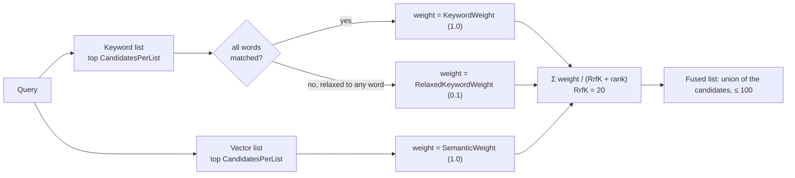

# Fusion tuning

> [Docs](../../README.md) › [Guide](../README.md) › [Advanced](README.md) › Fusion tuning

[Chapter 7](../07-hybrid-search.md) showed that Reciprocal Rank Fusion with the paper's k = 60 made FilmSearch's hybrid
search worse than semantic search alone, and that k = 20 with a low weight for the relaxed keyword list fixed it. This
chapter takes the formula apart: what each knob does in numbers, what the I07 and I08 experiments changed, how to run
your own sweep with the evaluation runner, and how not to fool yourself with a small golden set.

## The question

Hybrid search has five numbers in `Search:Hybrid`: `RrfK`, `KeywordWeight`, `RelaxedKeywordWeight`, `SemanticWeight`,
`CandidatesPerList`. Which matter, which values are right for this catalog, and when must they be tuned again?

## Theory

### The formula, knob by knob

```text
score(movie) = Σ over the lists that contain the movie:  weight_list / (k + rank_in_list)
```



**k sets how much rank 1 is worth compared with lower ranks.** Contribution of one list with weight 1:

| k | rank 1 | rank 5 | rank 10 | rank 30 | rank 50 | rank 1 / rank 10 |
|---|---|---|---|---|---|---|
| 10 | 0.0909 | 0.0667 | 0.0500 | 0.0250 | 0.0167 | 1.82× |
| 20 | 0.0476 | 0.0400 | 0.0333 | 0.0200 | 0.0143 | 1.43× |
| 60 | 0.0164 | 0.0154 | 0.0143 | 0.0111 | 0.0091 | 1.15× |

With k = 60 being in both lists matters much more than being first in one. That suits lists of similar quality. When
one list is often noise, a large k lets the noise in.

**A weight scales one list.** It answers "how much do I trust this list for this query?". FilmSearch decides per query:
a keyword list where every word matched (titles, names) is trustworthy, a list relaxed to "any word" (descriptions) is
mostly noise.

**When does noise win?** Take a noise movie at keyword rank 1 (weight *w*) and vector rank *r*, and the right movie at
vector rank 1 that the keyword list does not contain. The noise movie wins when *w*/(k+1) + 1/(k+r) > 1/(k+1), that
is when *r* < (k+1)/(1−*w*) − k:

| Keyword list weight *w* | k = 10 | k = 20 | k = 60 |
|---|---|---|---|
| 1.0 | noise wins at **any** vector rank | any | any |
| 0.1 | vector rank ≤ 2 | ≤ 3 | ≤ 7 |

With full weight, a keyword #1 always beats a vector #1 that has no keyword match, whatever k is: the weight, not k,
is the main fix for descriptions. With weight 0.1, k decides how near the top the noise must already be to win.

**Candidates per list** bound what fusion can see: a movie at keyword rank 51 and vector rank 60 is not in either list.
More candidates cost SQL time and rarely change the top 10, because deep ranks contribute little (rank 50 at k = 20 is
0.0143 against 0.0476 for rank 1). FilmSearch never varied this number.

**Why not normalize scores instead?** `ts_rank_cd` and cosine similarity live on different, query-dependent scales
([similarity metrics](similarity-metrics.md#scores-are-relative)); RRF needs no calibration. Its cost: it ignores
confidence, so a list whose best cosine is 0.2 counts as much as one whose best is 0.8.

## What FilmSearch does

- [`HybridSearchOptions`](../../../src/FilmSearch.Infrastructure/Search/Hybrid/HybridSearchOptions.cs): `RrfK` 20,
  `KeywordWeight` 1.0, `RelaxedKeywordWeight` 0.1, `SemanticWeight` 1.0, `CandidatesPerList` 50 (values in
  [`appsettings.json`](../../../src/FilmSearch.Api/appsettings.json)).
- [`MovieSearch`](../../../src/FilmSearch.Infrastructure/Search/MovieSearch.cs) picks the keyword weight from the
  keyword retriever's match (`all` or `any`), takes 50 candidates from each list with the same filters, and fuses them
  with [`ReciprocalRankFusion`](../../../src/FilmSearch.Infrastructure/Search/Hybrid/ReciprocalRankFusion.cs). Ties:
  better best rank, then more lists, then movie id, so a run is deterministic.
- "Movies like X" with `SimilarTitles = ExtraList` adds each named movie's neighbours as a third list with
  `SimilarTitleWeight`; the default `AverageVector` changes the query vector instead (I07: equal on 10 manual queries).
- Debug output per result (`keywordRank`, `keywordMatch`, `vectorRank`, `similarity`, `fusedScore`) shows why a movie
  moved.

## Evidence

**I07, 46 manual queries, offline grid** of k ∈ {60, 30, 20, 10} × all-words weight ∈ {1, 0.7, 0.5} × relaxed weight ∈
{1, 0.5, 0.3, 0.2, 0.1, 0} (72 settings) over the same result lists. The chosen setting was the only one at least as
good as both single modes in every group; relaxed weight 0 lost the Russian gain, because Russian overviews do contain
the words of Russian queries ([I07 report](../../../evals/reports/2026-11-17_I07_hybrid-and-query-understanding.md)).

**I08, the 105-query golden set, one change at a time**, hybrid MRR@10:

| Setting | All | en | ru | sv | nDCG@10 |
|---|---|---|---|---|---|
| Semantic only, for reference | 0.794 | 0.894 | 0.769 | 0.719 | 0.784 |
| **Default** (k 20, keyword 1.0, relaxed 0.1) | **0.788** | 0.808 | 0.833 | 0.721 | 0.786 |
| [k 60](../../../evals/reports/2026-11-17_search_hybrid-rrf-k60.md) | 0.732 | 0.717 | 0.783 | 0.695 | 0.750 |
| [k 10](../../../evals/reports/2026-11-17_search_hybrid-rrf-k10.md) | 0.787 | 0.851 | 0.788 | 0.721 | 0.785 |
| [keyword weight 0.5](../../../evals/reports/2026-11-17_search_hybrid-keyword-weight-0.5.md) | 0.792 | 0.822 | 0.833 | 0.721 | 0.788 |
| [keyword weight 0.3](../../../evals/reports/2026-11-17_search_hybrid-keyword-weight-0.3.md) | 0.797 | 0.837 | 0.833 | 0.721 | 0.789 |

([baseline](../../../evals/reports/2026-11-17_search_baseline.md))

- k = 60 is clearly worse everywhere, worst on plot, constraint and cross-language queries. The I07 choice holds on a
  2.3× larger set.
- k = 10 does not change the total; it **moves** quality between languages (English up, Russian down). A total hides
  that; the per-locale table shows it.
- Keyword weight 0.3 is the best setting of the sweep, by about one query. The golden set has no exact-title queries,
  the case the full weight was kept for (titles and names MRR 1.00 in I07). **No default changed.**
- The keyword list costs English plot queries rank (semantic 0.894 → hybrid 0.808) and helps Russian (0.769 → 0.833).

**Fusion depends on the lists.** With Qwen3-Embedding-8B the vector list is stronger, and the same fusion settings make
hybrid slightly *worse* than semantic on MRR (0.914 vs 0.921; negative queries 0.741 vs 0.833) while better on Recall@10
(0.927 vs 0.917) and person queries ([I20 report](../../../evals/reports/2026-11-19_search_i20-openrouter-qwen3-embedding-8b.md)).
Retuning `RrfK` for Qwen3 is an open follow-up. A larger catalog (I16, +182 movies) did not call for a change: after
judging the new results, the metrics were within 0.004 ([I16](../../../evals/reports/2026-11-18_I16_catalog-growth.md)).

## How to experiment yourself

A one-parameter sweep (each run starts a fresh database and embeds the seed, about a minute plus the queries):

```bash
for k in 10 15 20 30 60; do
  dotnet run --project evals/FilmSearch.Evals -- --suite search --label hybrid-rrf-k$k --modes hybrid \
    --set Search:Hybrid:RrfK=$k
done
```

Two parameters at once, and the one knob never measured:

```bash
for k in 15 20 30; do for w in 0.05 0.1 0.2; do
  dotnet run --project evals/FilmSearch.Evals -- --suite search --label hybrid-k$k-relaxed$w --modes hybrid \
    --set Search:Hybrid:RrfK=$k --set Search:Hybrid:RelaxedKeywordWeight=$w
done; done
dotnet run --project evals/FilmSearch.Evals -- --suite search --label hybrid-candidates-100 --modes hybrid \
  --set Search:Hybrid:CandidatesPerList=100
```

Search runs are deterministic (no LLM in `hybrid` mode), so `--repeat 1` is enough. Compare the by-locale and by-tag
tables with the baseline, then open the per-case table for the queries that moved. Write the conclusion by hand and
commit the report, including the settings that lost.

## Overfitting a small golden set

- **Tuning and testing on the same queries is optimistic.** The I07 numbers came from 72 settings tried on 46 queries;
  some setting will look good by chance. I08 re-checked on a larger, separate set and confirmed the direction (k = 60
  is bad), not the exact optimum.
- **Know the size of one query.** With 105 cases, one query moving from rank 2 to rank 1 changes mean MRR by
  0.5 / 105 ≈ 0.005; from a miss to rank 1 by ≈ 0.0095. The best sweep result (+0.009) is one or two queries.
- **Look for the reason before changing a default.** The 0.3 weight looked better because the set lacks the query kind
  that needs 1.0. The fix is a better dataset (add exact-title cases), then rerun.
- **Hold out a part.** For serious tuning, split the golden set: tune on one half, report on the other, or add new
  cases after tuning and check that the gain survives.
- **Watch every group.** A change that raises the mean by moving quality from Russian to English is a product
  decision, not an improvement.

## Pitfalls

- **Copying k = 60.** The paper's data is not your data.
- **Equal trust in every list.** A list you know is noisy should weigh less, per query if you can tell.
- **Tuning once.** A new embedding model, a new keyword strategy or a different query mix changes the best setting.
- **Reading only the total.** k = 10 had the same total and a different store for Russian customers.

---

**Previous:** [Vector storage](vector-storage.md) · **Next:** [LLM as a judge](llm-as-judge.md) ·
**See also:** [7. Hybrid search](../07-hybrid-search.md) · [11. Evaluation](../11-evaluation.md) ·
[Spec 05 §4](../../spec/05-search.md#4-hybrid-search) · [Journal: I07](../../journal/m2-smart-search.md#i07--hybrid-search-and-query-understanding) ·
[Journal: I08](../../journal/m2-smart-search.md#i08--search-evaluation-harness) · [Evaluations README](../../../evals/README.md)
