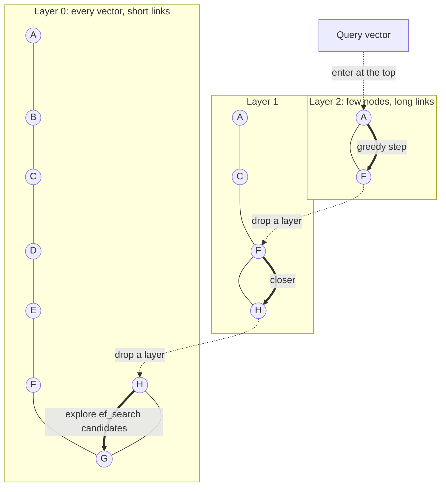

# pgvector indexes

> [Docs](../../README.md) › [Guide](../README.md) › [Advanced](README.md) › pgvector indexes

[Chapter 6](../06-vector-search.md) introduced exact and approximate search and showed that HNSW was practically exact
on the seed. This chapter goes into the knobs: how HNSW and IVFFlat work, what `m`, `ef_construction`, `ef_search`,
`lists` and `probes` do, how filters and iterative scans interact, why the query planner ignores the index at 1000 rows,
why deleted rows cost recall, and how to measure recall yourself.

## The question

The catalog has 1000–1200 movies today; a TMDB import can grow it ([I16](../../journal/m4-real-integrations.md#i16--tmdb-sync-and-worker)).
When does the store need an approximate index, which one, with which settings? And since an approximate index can
return the wrong rows without any error, how do you know it returns the right ones?

## Theory

### Exact scan

Distance to every row, sort, top k: rows × dimensions multiply-adds per query (0.8 million for 1000 × 768, 7.7 billion
for 10 million). Always correct; the only option without an index or above an index's dimension limit.

### HNSW

HNSW (Hierarchical Navigable Small World) is a graph. Every vector is a node linked to up to `m` near neighbours (twice
that on the bottom layer). Upper layers hold fewer nodes and long links, like motorways; the bottom layer holds every
node. A search enters at the top, walks greedily toward the query, drops a layer, and repeats; on the bottom layer it
keeps a candidate list of size `ef_search` and returns the best of it.



| Parameter | When | Default | Effect |
|---|---|---|---|
| `m` | build | 16 | Links per node. More: better recall, bigger index, slower build. |
| `ef_construction` | build | 64 | Candidates considered while linking a new node. More: better graph, slower build. |
| `hnsw.ef_search` | query | 40 (max 1000) | Candidate list while searching. More: better recall, slower query. **Also the most rows one scan can return.** |

The last point is easy to miss: with `ef_search = 40`, `ORDER BY … LIMIT 100` returns at most 40 rows, and any row a
`WHERE` clause rejects is one row fewer. HNSW can be built on an empty table and updated row by row; the build is fastest
when the graph fits in `maintenance_work_mem`.

### IVFFlat

IVFFlat clusters the vectors with k-means into `lists` clusters when the index is built; a query compares the query
with the cluster centres and scans only the `ivfflat.probes` nearest clusters (default 1). pgvector's guidance is
`lists` ≈ rows / 1000 up to a million rows (√rows above) and `probes` ≈ √lists as a starting point.

| | HNSW | IVFFlat |
|---|---|---|
| Build | slower, more memory | faster, smaller |
| Empty table | fine | **no**: the centres are trained on the data present at build time |
| Data drift (many new rows) | the graph absorbs them | recall drops until you rebuild |
| Speed / recall trade-off | usually better | worse at the same recall |
| Query knob | `hnsw.ef_search` | `ivfflat.probes` |

FilmSearch uses HNSW and never measured IVFFlat; the catalog grows through imports, which suits a graph better than
clusters trained once.

### Filtering and iterative scans

A vector query with a filter ("under $4, after 2005") walks the index in distance order and drops rows that fail the
filter. Without help, a strict filter leaves fewer than k rows, because the scan stops after `ef_search` candidates.
pgvector 0.8 added **iterative scans**: when the candidates run out, the scan continues the walk.

| `hnsw.iterative_scan` | Behaviour |
|---|---|
| `off` (default) | One scan, at most `ef_search` rows before filtering |
| `relaxed_order` | Keeps walking; rows may come slightly out of distance order, so sort them again |
| `strict_order` | Keeps walking and keeps exact order; slower |

The walk stops at `hnsw.max_scan_tuples` (20 000 by default), so a filter that matches almost nothing can still
return fewer rows. IVFFlat has `ivfflat.iterative_scan = relaxed_order` and `ivfflat.max_probes`. For a very selective
filter (30 movies of 1994), the planner may skip the vector index altogether and compute the exact distance for the
30 rows found by a B-tree index, which is both exact and fast.

### Dead tuples, VACUUM and the planner

PostgreSQL never updates a row in place: an update writes a new row and marks the old one dead. A dead row stays in
the HNSW graph until `VACUUM` removes it; a scan still spends one of its `ef_search` slots on it and throws it away.
Separately, the planner picks the plan with the lowest *estimated* cost: for a small table an exact scan plus a sort
is estimated cheaper than starting an HNSW scan, even when the index is faster in reality.

## What FilmSearch does

- The indexer creates `ix_movie_embeddings_vector_<dimensions>` with `m = 16, ef_construction = 64` (the defaults,
  written out to show the knobs) the first time a model of that size is indexed
  ([`VectorIndex.CreateSql`](../../../src/FilmSearch.Infrastructure/Search/Semantic/VectorIndex.cs)).
- Every vector query runs in a transaction with `SET LOCAL hnsw.ef_search` = rows wanted, clamped to 40…1000, and
  `hnsw.iterative_scan = relaxed_order`; the rows are sorted again in memory
  ([`SemanticRetriever`](../../../src/FilmSearch.Infrastructure/Search/Semantic/SemanticRetriever.cs)). Catalog filters
  are inside the same SQL (pre-filtering).
- After a reindex that changed or deleted vectors, the indexer runs `VACUUM (ANALYZE) search.movie_embeddings`
  ([`MovieEmbeddingIndexer`](../../../src/FilmSearch.Infrastructure/Search/Semantic/MovieEmbeddingIndexer.cs)).
- The planner's choice is left alone. The integration test `Vector_query_can_use_the_hnsw_index`
  ([`SemanticSearchApiTests`](../../../tests/FilmSearch.IntegrationTests/SemanticSearchApiTests.cs)) runs `EXPLAIN` on
  the exact SQL that EF Core sends, once as is and once with `enable_seqscan` **and** `enable_sort` off, and asserts an
  `Index Scan using ix_movie_embeddings_vector_768`. Switching off only `enable_seqscan` is not enough: the B-tree index
  on `(model, locale)` plus a sort is the next cheapest plan.

## Evidence

Every movie's vector as a query (1002 queries), HNSW top 10 vs exact top 10, recall@10
([I06 experiments](../../../evals/reports/2026-11-17_I06_semantic-search-experiments.md#1-hnsw-vs-exact-search)):

| Vectors | Exact scan | `ef_search` 10 | `ef_search` 40 (default) | `ef_search` 100 |
|---|---|---|---|---|
| 3006 (en + ru + sv) | 12.3 ms / query | 0.9996, 0.15 ms | 0.9998, 0.32 ms | 0.9998, 0.51 ms |
| 1002, right after deleting 2004 | 3.4 ms | **0.4655** | 0.9991 | 0.9999 |
| 1002, after `VACUUM` | 3.5 ms | 0.9999 | **1.0000**, 0.22 ms | 1.0000, 0.37 ms |

- After the bulk delete, a scan at `ef_search` 10 returned **4.8 rows instead of 10** on average: the dead entries
  used up the candidate list. `VACUUM` restored it.
- The planner estimated ≈ 460–600 for the exact scan and ≈ 1640 to start the HNSW scan, although HNSW was 10–40× faster.
  One reason its cost model misses: a 768-float vector is 3 KB, above PostgreSQL's 2 KB TOAST threshold, so every vector
  is stored out of line and fetched separately by a sequential scan. Before `ANALYZE` it even estimated 1 row for the
  freshly filled table.
- Both plans are far below the 20–30 ms of embedding the query, which is why nothing was forced.

**`ef_search` caps the rows a scan returns** (measured on a development database with 1231 vectors while writing this
chapter, with the script below; the query excludes the movie itself, which acts as a filter that rejects one row):

| `ef_search` | `iterative_scan` | Rows returned (of 12 310) | Recall@10 vs exact |
|---|---|---|---|
| 10 | off | 11 053 | 0.8977 |
| 10 | `relaxed_order` | 12 310 | 0.9992 |
| 40 | off | 12 310 | 0.9995 |

The "low recall" of the first row is not a worse graph: one rejected row per query leaves 9 results. The same happens to
a price filter, only more so. Iterative scans or a larger `ef_search` fix it.

## How to experiment yourself

Open psql in the AppHost container (`docker exec -it filmsearch-postgres psql -U postgres -d filmsearch`; the password
is in the AppHost user secrets). Recall of HNSW against exact search, in a transaction that changes nothing:

```sql
BEGIN;
SET LOCAL enable_indexscan = off;                       -- 1. exact top 10 per movie
CREATE TEMP TABLE exact_top ON COMMIT DROP AS
SELECT q.movie_id AS query_id, n.movie_id FROM search.movie_embeddings q
CROSS JOIN LATERAL (SELECT e.movie_id FROM search.movie_embeddings e
    WHERE e.dimensions = 768 AND e.model = q.model AND e.kind = 'Profile' AND e.movie_id <> q.movie_id
    ORDER BY e.vector::vector(768) <=> q.vector::vector(768) LIMIT 10) n
WHERE q.dimensions = 768 AND q.kind = 'Profile';
RESET enable_indexscan;
SET LOCAL enable_seqscan = off; SET LOCAL enable_sort = off;   -- 2. only the HNSW index can order rows now
SET LOCAL hnsw.ef_search = 10; SET LOCAL hnsw.iterative_scan = off;
CREATE TEMP TABLE ann_top ON COMMIT DROP AS
SELECT q.movie_id AS query_id, n.movie_id FROM search.movie_embeddings q
CROSS JOIN LATERAL (SELECT e.movie_id FROM search.movie_embeddings e
    WHERE e.dimensions = 768 AND e.model = q.model AND e.kind = 'Profile' AND e.movie_id <> q.movie_id
    ORDER BY e.vector::vector(768) <=> q.vector::vector(768) LIMIT 10) n
WHERE q.dimensions = 768 AND q.kind = 'Profile';
SELECT round(count(a.movie_id)::numeric / count(*), 4) AS recall_at_10
FROM exact_top x LEFT JOIN ann_top a USING (query_id, movie_id);
ROLLBACK;
```

Change `ef_search` and `iterative_scan` and rerun; prefix the second `CREATE` with `EXPLAIN` to see
`Index Scan using ix_movie_embeddings_vector_768`. Dead tuples and the last vacuum:

```sql
SELECT n_live_tup, n_dead_tup, last_vacuum, last_autovacuum FROM pg_stat_user_tables WHERE relname = 'movie_embeddings';
```

An index at 100 000 rows was never measured here; import more movies (I16) and rerun the script and the search suite.

## Pitfalls

- **`LIMIT 100` with the default `ef_search` 40** returns 40 rows. Set `ef_search` to at least the limit.
- **Post-filtering in application code.** Filter in the SQL and use iterative scans.
- **Bulk changes without `VACUUM`.** Recall halves silently; nothing fails.
- **Forcing the index in production.** `enable_seqscan = off` is a test tool; at 1000 rows the planner's plan is fine.
- **Assuming the index file shrinks.** After vacuum it does not (I06: 12 MB stays 12 MB). On the development database
  the live index was 12 MB for 1231 vectors, a fresh build 4.9 MB; `REINDEX INDEX CONCURRENTLY` reclaims the space.
- **Tuning `m` and `ef_construction` before measuring recall.** At this size the defaults are already exact.

---

**Previous:** [Choosing an embedding model](choosing-an-embedding-model.md) · **Next:** [Vector storage](vector-storage.md) ·
**See also:** [6. Vector search](../06-vector-search.md) · [Spec 05 §3](../../spec/05-search.md#3-semantic-search) ·
[I06 experiments](../../../evals/reports/2026-11-17_I06_semantic-search-experiments.md) ·
[Journal: I06](../../journal/m2-smart-search.md#i06--embeddings-and-semantic-search)
