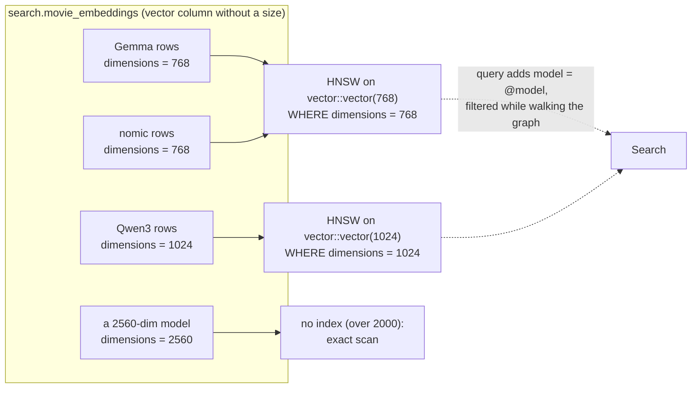

# Vector storage

> [Docs](../../README.md) › [Guide](../README.md) › [Advanced](README.md) › Vector storage

Where do vectors live when the project wants several models of different sizes side by side, how much space do they
take at 1000, 100 000 and 10 million movies, and how do you make them smaller? This chapter walks through
[ADR-0008](../../adr/0008-vector-storage-per-dimension.md), the pgvector types and limits, half precision, binary
quantization, Matryoshka truncation and the content hash that keeps unchanged movies from being embedded again.

## The question

FilmSearch compared EmbeddingGemma (768 dimensions), nomic (768) and Qwen3-Embedding (1024), and FR-DATA-4 requires
that a new model can be indexed while the old one keeps serving search. pgvector indexes only a column of a fixed size.
How do you store vectors of any size in one schema, without a migration per model, and still have an index?

## Theory

### pgvector types and limits

| Type | Bytes per vector | Max dimensions in an HNSW / IVFFlat index | Use |
|---|---|---|---|
| `vector` (float32) | 4 × d + 8 | 2000 | the default |
| `halfvec` (float16) | 2 × d + 8 | 4000 | half the space, usually little recall loss |
| `bit` | d / 8 + 8 | 64 000 | binary quantization, Hamming distance |
| `sparsevec` | 8 × non-zeros + 16 | 1000 non-zero elements | sparse models (learned keyword weights) |

A column typed `vector(768)` accepts only 768 numbers; a column typed `vector` accepts any length, but an index needs
to know the length. pgvector's answer for mixed sizes is an **expression index** on a cast (`vector::vector(768)`),
**partial** to the rows that have that length (`WHERE dimensions = 768`).

### Three ways to store several models

| Option | For | Against |
|---|---|---|
| One fixed `vector(N)` column | plain EF Core LINQ, one ordinary index | every model must have N dimensions; changing N is a migration and a rewrite |
| A table or column per dimension | fixed types, ordinary indexes | a migration for every new size; duplicated queries or generated code |
| **One untyped column + a partial expression index per dimension** (chosen) | any model fits, side by side, no migration | the vector query is raw SQL that must repeat the index expression; the index is invisible to EF Core migrations |



Two models of the same size share one graph; the query filters by `model` while it walks it, which is one more reason
for iterative scans ([pgvector indexes](pgvector-indexes.md#filtering-and-iterative-scans)).

### Making vectors smaller

- **Matryoshka truncation.** A model trained with MRL keeps working when you keep only the first *k* numbers
  ([choosing a model](choosing-an-embedding-model.md#dimensions-and-matryoshka-truncation)). Fewer dimensions: less
  storage, faster distances, and an index becomes possible above 2000. A model not trained this way breaks.
- **Half precision (`halfvec`).** Each number in 2 bytes instead of 4. Embedding values are small and the precision
  lost is far below the noise of the model; the index takes half the memory. It can be an expression index over the
  existing column: `(vector::vector(768)::halfvec(768))` with `halfvec_cosine_ops`.
- **Binary quantization.** Keep only the sign of each number (`binary_quantize`, 1 bit per dimension) and compare by
  Hamming distance: 32× smaller than float32. Recall drops, so search the bits for a longer candidate list and re-rank
  it with the full vectors (two-stage search).
- **TOAST.** PostgreSQL stores values over about 2 KB out of line in a TOAST table. A 768-float vector (3 KB) is always
  there, so an exact scan reads two places. `SET STORAGE PLAIN` keeps vectors in the row; I06 listed it as a candidate,
  it was never measured.

### Storage math

Raw vector bytes only (4 × d + 8 and so on), decimal units; one vector per movie. Text, hash and row overhead come on
top. Index sizes are extrapolated from fresh HNSW builds over 1231 EmbeddingGemma vectors (`m` 16, `ef_construction`
64) on a development database while writing this chapter: float32 4.9 MB, halfvec 2.4 MB, bit 0.5 MB, so about
4 KB, 2 KB and 0.4 KB per vector. Nothing above 1231 rows was measured.

| Representation | Per vector | 1000 movies | 100 000 | 10 million | HNSW index at 10 million (estimate) |
|---|---|---|---|---|---|
| `vector(768)` (EmbeddingGemma) | 3 080 B | 3.1 MB | 308 MB | 30.8 GB | ≈ 40 GB |
| `vector(1024)` (Qwen3 truncated) | 4 104 B | 4.1 MB | 410 MB | 41 GB | larger than 768 |
| `vector(4096)` (Qwen3 full size) | 16 392 B | 16.4 MB | 1.6 GB | 164 GB | **none**: over the 2000 and 4000 limits |
| `halfvec(768)` | 1 544 B | 1.5 MB | 154 MB | 15.4 GB | ≈ 20 GB |
| `bit(768)` (binary quantized) | 104 B | 0.1 MB | 10.4 MB | 1.04 GB | ≈ 4 GB |

Multiply by the number of locales embedded (three with en + ru + sv) and add every model kept side by side. For
FilmSearch's catalog the question does not arise: the whole table is a few megabytes. It becomes real around a few
million vectors, when the index stops fitting in memory.

### The content hash

Re-embedding costs time (local) or money (hosted). Each row stores the exact text sent to the model and
`content_hash` = SHA-256 of the template version plus that text (document prefix included). A reindex builds every
movie's text again, hashes it, and embeds only rows whose hash (or dimension) differs. A change of the template, the
prefix or the movie's describing fields re-embeds that movie; a price change does not, because prices are not in the
text.

## What FilmSearch does

- Table `search.movie_embeddings`: `movie_id`, `model`, `dimensions`, `kind`, `locale`, `text`, `content_hash`, `vector`
  (untyped), unique per (movie, model, kind, locale)
  ([`MovieEmbedding`](../../../src/FilmSearch.Infrastructure/Search/Semantic/MovieEmbedding.cs)).
- The migration creates the 768 index; the indexer runs `CREATE INDEX IF NOT EXISTS` for any new size, and logs a
  warning and relies on an exact scan above 2000 dimensions
  ([`MovieEmbeddingIndexer`](../../../src/FilmSearch.Infrastructure/Search/Semantic/MovieEmbeddingIndexer.cs),
  [`VectorIndex`](../../../src/FilmSearch.Infrastructure/Search/Semantic/VectorIndex.cs)).
- The query repeats the expression and the predicate (`vector::vector(768) <=> @query … WHERE dimensions = 768`), with
  the dimension inlined as an integer from configuration and the vector and model as parameters. EF Core composes the
  catalog filters around it and PostgreSQL flattens the subquery, so the index stays usable (checked by a plan test).
- Qwen3-Embedding-8B is stored at 1024 dimensions through MRL truncation by the provider (`dimensions` parameter); no
  `halfvec` or binary quantization is used.
- The reverse path is documented: if one model stays for good, a migration can type the column `vector(N)`, drop the
  expression indexes and turn the query into plain LINQ (ADR-0008, "Reverse").

## Evidence

- Index 12 MB for 3006 vectors, table 5 MB for 1002 vectors; the index file does not shrink after `VACUUM`
  ([I06](../../../evals/reports/2026-11-17_I06_semantic-search-experiments.md)).
- Development database while writing this chapter: heap 1.1 MB, TOAST 4.9 MB for 1231 vectors (the vectors are out
  of line), live index 12 MB (left from earlier reindexes) against 4.9 MB for a fresh build.
- Content hash: a second reindex of an unchanged catalog embedded 0 and skipped 1002 in 1.9 s (I06). The TMDB import
  updated 807 movies but only 18 had a changed embedding text: 198 texts embedded (180 new + 18 changed), 984 unchanged,
  14 s ([I16 report](../../../evals/reports/2026-11-18_I16_catalog-growth.md)).
- Model switches without migrations: nomic added and removed next to EmbeddingGemma (I06); the running demo stack was
  switched to Qwen3 at 1024 dimensions by a reindex and a configuration change
  ([I20 plan](../../plan/iterations/I20-deployment.md)).

## How to experiment yourself

Sizes of the table, its TOAST part and the indexes:

```sql
SELECT pg_size_pretty(pg_relation_size('search.movie_embeddings')) AS heap,
       pg_size_pretty(pg_relation_size(reltoastrelid)) AS toast
FROM pg_class WHERE oid = 'search.movie_embeddings'::regclass;
SELECT indexname, pg_size_pretty(pg_relation_size(('search.' || indexname)::regclass))
FROM pg_indexes WHERE schemaname = 'search' AND tablename = 'movie_embeddings';
```

Half precision and binary indexes over the same column (a sketch, not used by FilmSearch; the statements were checked
on pgvector 0.8.7 inside `BEGIN … ROLLBACK`):

```sql
CREATE INDEX ix_emb_half_768 ON search.movie_embeddings
USING hnsw ((vector::vector(768)::halfvec(768)) halfvec_cosine_ops) WHERE dimensions = 768;

CREATE INDEX ix_emb_bit_768 ON search.movie_embeddings
USING hnsw ((binary_quantize(vector::vector(768))::bit(768)) bit_hamming_ops) WHERE dimensions = 768;

-- two-stage search: 40 candidates by Hamming distance, re-ranked by the full vectors
SELECT movie_id FROM (
    SELECT movie_id, vector FROM search.movie_embeddings WHERE dimensions = 768 AND model = @model
    ORDER BY binary_quantize(vector::vector(768))::bit(768) <~> binary_quantize(@query) LIMIT 40) candidates
ORDER BY vector::vector(768) <=> @query LIMIT 10;
```

Measure recall of such a variant against the exact top 10 with the script in
[pgvector indexes](pgvector-indexes.md#how-to-experiment-yourself), then run the search suite. Neither was measured
in this project.

## Pitfalls

- **Query and index expressions that differ.** `vector::vector(768)` in the index and `vector <=> @q` in the query is
  an exact scan. Keep both in one place, as `VectorIndex` does.
- **Forgetting the partial predicate** (`WHERE dimensions = 768`) in the query: the index does not apply.
- **Index DDL at run time** needs the database user to own the table (ADR-0008 "Watch").
- **Choosing a 4096-dimension model** without a plan: no HNSW index for `vector` or `halfvec` at that size.
- **Re-embedding everything on every import.** Hash the exact text, prefix and template version included.

---

**Previous:** [pgvector indexes](pgvector-indexes.md) · **Next:** [Fusion tuning](fusion-tuning.md) ·
**See also:** [ADR-0008](../../adr/0008-vector-storage-per-dimension.md) · [6. Vector search](../06-vector-search.md) ·
[5. Embeddings](../05-embeddings.md) · [Spec 08 §4](../../spec/08-data-ingestion.md#4-embeddings-pipeline) ·
[Journal: I06](../../journal/m2-smart-search.md#i06--embeddings-and-semantic-search)
