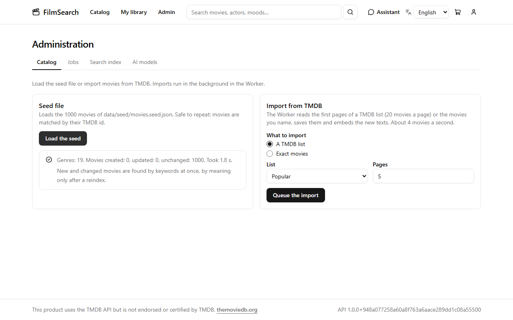
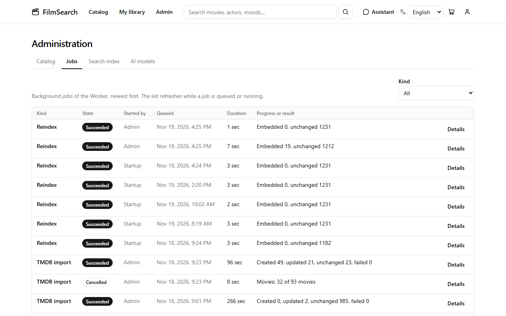

# Administrator guide

> [Docs](../README.md) › [Handbook](README.md) › Administrator

This page is for the person who runs the store's content and day-to-day settings: loads and imports movies, keeps the
search index in step with the catalog, watches background jobs, switches the payment provider and answers "my payment
did not arrive". Most of it is done in the **admin pages** of the web app; the same actions are an HTTP API for
scripts (`curl` or a `.http` file). Starting and
deploying the system is the [operator's](operator.md) job; changing models and prompts is the
[AI engineer's](ai-engineer.md).

**Contents:** [Admin pages](#admin-pages) · [Admin account](#the-admin-account) · [Admin API](#the-admin-api) · [Jobs](#background-jobs) ·
[Payment provider](#switch-the-payment-provider) · [Budgets and rate limits](#budgets-and-rate-limits) · Recipes:
[add 500 movies](#add-500-movies-from-tmdb), [switch the embedding model](#switch-the-embedding-model),
[a job is stuck](#a-job-is-stuck), [a payment did not arrive](#a-customer-says-the-payment-did-not-arrive)

## Admin pages

Sign in with the [admin account](#the-admin-account): the header gets an **Admin** link to `/admin` (since I22,
[ADR-0013](../adr/0013-admin-pages-in-the-store-app.md)). Other users who open `/admin` see "No access", visitors go to
the sign-in page. The pages are views over the [admin API](#the-admin-api), which checks the role on every call, and
they speak English, Russian and Swedish like the store. Configuration (AI profiles, budgets, the payment provider) is
shown but not changed here: that is the [operator's](operator.md) job.

| Page | What you do there |
|---|---|
| **Catalog** (`/admin`) | Load the seed file (the result shows created, updated and unchanged movies); queue a TMDB import of a list (popular or top rated, N pages) or of exact TMDB ids. When an import is already queued or running, the page links to that job |
| **Jobs** (`/admin/jobs`) | All background jobs, newest first, filtered by kind; progress while a job runs (refreshed every 2 s), counters when it succeeded, the error when it failed; **Cancel** for a queued or running job; **Details** for parameters, progress, result, attempts, worker and heartbeat |
| **Search index** (`/admin/embeddings`) | The active embedding profile and model, stored vectors per model and locale, the current or last reindex; queue a reindex (profile, only changed texts or all, locales); delete the vectors of a model that is not active |
| **AI models** (`/admin/ai`) | Chat and embedding profiles: model, whether a key is set, tools, which one is active or the fallback; send one message to a chat profile and see the answer, tokens and estimated cost (also a trace in the Aspire dashboard) |





More: [job details](../images/screenshots/admin-job.png) ·
[search index](../images/screenshots/admin-embeddings.png) · [AI models](../images/screenshots/admin-ai.png).

## The admin account

On startup the API creates the role `admin` and one account from configuration ([local setup](local-setup.md#admin-account)):

| Setting | Development | Demo (`deploy/.env`) |
|---|---|---|
| `Auth:Admin:Email` | `admin@filmsearch.local` (`appsettings.Development.json`) | `ADMIN_EMAIL` |
| `Auth:Admin:Password` | API user secrets: `dotnet user-secrets set Auth:Admin:Password "<long password>" --project src/FilmSearch.Api` | `ADMIN_PASSWORD` |

- Without a password the API starts without an admin (log warning "No admin account: Auth:Admin:Password is not set").
- An account that already exists with that email gets the role only if its password is the configured one.
- The password is used only to **create** the account. Changing the setting later does not change the password of an
  existing admin, and there is no password reset yet.
- Sign-in locks for 5 minutes after 5 wrong passwords.

**Sign in** in the web app (`/login`) or with the API. The auth cookie (`fs_auth`, 14 days) is `Secure`, so use HTTPS:

```bash
API=https://localhost:7180          # local API; demo: https://<host> (Caddy proxies /api)
curl -s -c admin.cookies -H "Content-Type: application/json" \
  -d '{"email":"admin@filmsearch.local","password":"<password>"}' $API/api/auth/login
curl -s -b admin.cookies $API/api/auth/me      # {"authenticated":true,...,"roles":["admin"]}
```

Every later example sends `-b admin.cookies`. Without a signed-in user the admin endpoints answer 401, for a user
without the role 403. Signed in as admin in the browser, GET endpoints such as `/api/admin/jobs` also open directly in
the address bar of the web app.

## The admin API

The admin pages call these endpoints; use them directly for scripts and automation. The OpenAPI document
(`/openapi/v1.json`, Development) lists them under the tag `Admin`. Contract: [spec 04, Admin](../spec/04-api.md#admin-role-admin-401-without-a-user-403-without-the-role).

| Request | What it does | Answer |
|---|---|---|
| `POST /api/admin/ingestion/seed` | Loads `data/seed/movies.seed.json` (1000 movies) in the API; upsert by TMDB id, so it is safe to repeat | 200 `{ genres, created, updated, unchanged, elapsedMilliseconds }`, about 10 s |
| `POST /api/admin/ingestion/tmdb` | Queues a TMDB import: `{ "list": "topRated" \| "popular", "pages": 1–500 }` (20 movies per page) or `{ "tmdbIds": [27205, …] }` (up to 5000) | 202 with the job; 409 with the running import |
| `GET /api/admin/jobs?kind=&limit=` | Jobs, newest first; `kind` = `tmdbImport` or `embeddingReindex`; `limit` 1–100 (20) | 200 list |
| `GET /api/admin/jobs/{id}` | State, progress, result, error, attempts, timestamps of one job | 200; 404 |
| `POST /api/admin/jobs/{id}/cancel` | Cancels a queued job at once, a running one at its next heartbeat (2 s) | 200 the job |
| `GET /api/admin/embeddings` | Active embedding profile, model and dimensions; vector counts per model and locale; the current or last reindex job | 200 |
| `POST /api/admin/embeddings/reindex` | Queues a reindex: `{ "profile"?, "onlyStale": true, "locales"?: ["en","ru","sv"] }` | 202 with the job; 409 while one runs; 400 unknown profile or locale |
| `DELETE /api/admin/embeddings?model=<model id>` | Deletes every vector of a model that is not the active one | 200 `{ model, deleted }`; 400 for the active model |
| `GET /api/admin/ai/profiles` | Chat and embedding profiles: names, models, dimensions, whether a key is set, the active and fallback ones (no endpoints, no keys) | 200 |
| `POST /api/admin/ai/chat` | Sends one message to a chat profile (`{ "message": "Hi", "profile": "openrouter" }`; the active one when empty) | 200 `{ profile, model, text, inputTokens, outputTokens, estimatedCostUsd }`; 503 when the provider is down |

Examples:

```bash
curl -s -b admin.cookies -X POST $API/api/admin/ingestion/seed
curl -s -b admin.cookies -H "Content-Type: application/json" -d '{"list":"popular","pages":5}' $API/api/admin/ingestion/tmdb
curl -s -b admin.cookies -H "Content-Type: application/json" -d '{"tmdbIds":[27205,157336]}' $API/api/admin/ingestion/tmdb
curl -s -b admin.cookies "$API/api/admin/jobs?kind=tmdbImport&limit=5"
curl -s -b admin.cookies -H "Content-Type: application/json" -d '{}' $API/api/admin/embeddings/reindex
curl -s -b admin.cookies -H "Content-Type: application/json" -d '{"message":"Say hi"}' $API/api/admin/ai/chat
```

The TMDB import needs a TMDB key: `Tmdb:ApiKey` in the API user secrets (the Worker shares them; v4 read access token
or v3 key), `TMDB_API_KEY` in the demo. The seed load does not queue embeddings by itself: after a seed load that
created or changed movies, queue a reindex (`{}` embeds only the changed texts).

The **daily import** is not an endpoint but a setting: `Tmdb:Schedule:Enabled` = true makes the Worker queue one
import a day after `Tmdb:Schedule:TimeUtc` (03:00) of `List` / `Pages` (popular, 5 pages); its jobs have the trigger
`schedule`. Ask the operator to switch it on ([configuration](configuration.md)).

## Background jobs

The API only writes a job row; the **Worker** runs it, one job at a time per Worker process
([spec 08 §3](../spec/08-data-ingestion.md#3-tmdb-import-i16)). States: `queued` → `running` → `succeeded`, `failed` or
`cancelled`. Only one job of each kind can be queued or running.

| Job | Phases (`progress.phase`) | Result | How long |
|---|---|---|---|
| `tmdbImport` | `genres` → `listing` → `movies` (details, 4 in parallel, saved in chunks of 100) → `embeddings` (stale-only reindex) | `movies`, `created`, `updated`, `unchanged`, `skipped` (adult or untitled), `notFound`, `failed`, `errors` (first 20), `requests`, `embeddings` | The client sends at most 40 TMDB requests per 10 s (`Tmdb:RequestsPerWindow`): about 4 movies a second. 50 pages (987 movies, 1040 requests): 258 s, then 14 s of embeddings ([I16](../../evals/reports/2026-11-18_I16_catalog-growth.md)) |
| `embeddingReindex` | counters `total`, `processed`, `embedded`, `unchanged` (movie texts × locales) | `profile`, `model`, `dimensions`, `locales`, `movies`, `embedded`, `unchanged`, `deleted` (vectors of dropped locales) | Whole seed: from about 30 s (LM Studio on the dev machine) to a few minutes (LM Studio from the containers), about a minute on OpenRouter; a stale-only run after a small change takes seconds |

An import ends only after the embeddings, so a `succeeded` import is searchable in every mode. If the embedding provider
is down, the import ends `failed` with its counters: the movies are saved and keyword search finds them; a reindex
catches up. Both jobs are idempotent: running one again only does what is left.

A job whose Worker died (no heartbeat for `Jobs:LeaseSeconds` = 60 s) is taken over by a Worker again, at most
`Jobs:MaxAttempts` = 3 times, then failed. A Worker that stops normally puts its job back in the queue.

## Switch the payment provider

`Payments:Provider` = `Fake` (default: the simulated page inside the API) or `Stripe` (Stripe Checkout in test mode).
The operator changes it and restarts the API; details in [local setup](local-setup.md#payments-stripe-test-mode) and
[spec 07 §4](../spec/07-payments.md#4-stripe-test-mode-i15).

- Stripe needs `Stripe:SecretKey` (only `sk_test_…`: a live key stops the API at startup), `Stripe:WebhookSecret`
  (`whsec_…`) and absolute return URLs (`Commerce:WebBaseUrl`; the AppHost and `PUBLIC_URL` set it).
- **Webhook:** Stripe tells the store about payments by calling `POST /api/payments/webhooks/stripe`. Locally `stripe
  listen … --forward-to https://localhost:7180/api/payments/webhooks/stripe` must run (events
  `checkout.session.completed`, `checkout.session.async_payment_succeeded`, `checkout.session.async_payment_failed`,
  `checkout.session.expired`). On a server: a webhook endpoint `https://<host>/api/payments/webhooks/stripe` in the
  Stripe dashboard (test mode) with the same events; its signing secret is `STRIPE_WEBHOOK_SECRET`.
- With a Stripe key set, webhooks of Stripe sessions are still accepted after switching back to `Fake`. The fake gateway is refused in the `Production` environment (the demo runs as `Demo`).

## Budgets and rate limits

Settings, changed by the operator ([configuration](configuration.md)); the product owner decides the values.

| Limit | Setting | Development | Demo |
|---|---|---|---|
| Tokens per conversation | `Assistant:MaxConversationTokens` | 300 000 | 100 000 |
| Tokens per visitor in 24 h | `Assistant:MaxOwnerTokensPerDay` | 1 000 000 | 200 000 |
| Tokens of all visitors in 24 h | `Assistant:MaxTotalTokensPerDay` | 0 (off) | 5 000 000 |
| Searches per minute per IP | `RateLimiting:Search` | 60 | 30 |
| Chat messages per minute per visitor | `RateLimiting:Chat` | 20 | 10 |
| New conversations per minute per IP | `RateLimiting:NewConversation` | 10 | 5 |

The 24-hour budgets are rolling windows: there is no reset button; a customer who hit one can chat again when older
answers leave the window. Refusals show up in `assistant.turns{outcome=…Exceeded}` and as a warning log naming the
budget; rate-limited requests get 429 and appear in `aspnetcore.rate_limiting.requests`
([observability runbook](../runbooks/observability.md#budgets-nfr-5)).

## Add 500 movies from TMDB

In the admin pages: **Catalog** → *Import from TMDB* → list and pages (or exact movies) → **Queue the import** →
**Open the job**. The steps below say what to choose and what to check; the API calls are for scripts.

1. Check the key is set (`Tmdb:ApiKey`) and note the catalog size: `curl -s "$API/api/movies?pageSize=1"` → `total`.
2. Pick a source. An import reads the **first** N pages of a list. The seed already holds most of the top-rated list:
   50 pages of `topRated` gave 987 movies, of which 180 were new. For about 500 new movies take more pages (e.g.
   `{"list":"topRated","pages":100}`, about 2000 movies, about 9 minutes) or the `popular` list; or pass the exact
   `tmdbIds` you want.
3. Queue it and keep the job id from the answer (`id`, also in the `Location` header). 409 means an import is already
   queued or running: follow that one first.
4. Follow it: `curl -s -b admin.cookies $API/api/admin/jobs/<id>`: `state`, `progress.phase`, `progress.fetched` of
   `progress.movies`.
5. Read the result: `created` is what you added; `failed` > 0 → read `errors`; `embeddings` must be there.
6. Check: `total` of the catalog grew, and `GET /api/admin/embeddings` shows a vector count per model equal to the
   number of movies. If the job failed in the `embeddings` phase, queue a reindex with `{}`.

## Switch the embedding model

In the admin pages: **Search index** → *Reindex* with the new profile; after the switch, the trash button next to the
old model deletes its vectors.

The search index stores vectors per model, so the new model is built next to the old one and search switches only when
the active profile changes ([spec 08 §4](../spec/08-data-ingestion.md#4-embeddings-pipeline)). The profile itself
(endpoint, model, dimensions, prefixes) is configuration owned by the AI engineer, who also runs the search evaluation
for the new model.

1. Build the new vectors: `curl -s -b admin.cookies -H "Content-Type: application/json" -d '{"profile":"nomic"}'
   $API/api/admin/embeddings/reindex` and follow the job until `succeeded`.
2. The operator sets `AI:ActiveEmbeddingProfile` to the new profile and restarts the API and the Worker.
3. `GET /api/admin/embeddings`: `activeModel` is the new one and its counts are complete.
4. When you will not switch back: `DELETE /api/admin/embeddings?model=text-embedding-embeddinggemma-300m` (the old model
   id as listed in `sets`).

In the demo the [deploy runbook](../../deploy/README.md#operate) does it in one step: change `EMBEDDING_PROFILE`,
`docker compose up -d`; the API queues the reindex with the new model on startup. Until it ends, semantic results
cover only the movies embedded so far.

## A job is stuck

In the admin pages: **Jobs** → **Details** of the job shows the fields below; **Cancel** is on both pages.

1. `GET /api/admin/jobs?limit=10`: look at `state`, `heartbeatAt`, `attempts`, `progress`.
2. **`queued` and never starts:** the Worker is not running or is busy with another job (one at a time). Check the
   `worker` resource in the Aspire dashboard, or `docker compose ps worker` and `docker compose logs -f worker` in the
   demo.
3. **`running`, heartbeat older than a minute:** the Worker died; another Worker takes it over (up to 3 attempts). With
   no Worker running, start one.
4. **`running`, fresh heartbeat, no progress:** it waits for TMDB (rate limit, retries) or the embedding provider. Look
   at the Worker logs and traces. A hung LM Studio is cleared with `lms unload --all` and loading the model again.
5. **Cancel** if needed: `POST /api/admin/jobs/<id>/cancel`. Movies and vectors saved so far stay; running the job again
   continues where it stopped.
6. **`failed`:** read `error` and `result.errors`; fix the cause (key, provider) and queue it again.

## A customer says the payment did not arrive

1. Find the order. Its id is in the address of the page the customer came back to (`/checkout/success?orderId=…`).
   Otherwise look it up by email in the database (local: `docker exec -it filmsearch-postgres psql -U postgres -d
   filmsearch`; demo: `docker compose exec postgres psql -U filmsearch -d filmsearch`):

   ```sql
   SELECT o.id, o.status, o.created_at, o.expires_at, o.paid_at, p.provider, p.status AS payment, p.provider_session_id
   FROM commerce.orders o JOIN identity.users u ON u.id = o.owner_id
   LEFT JOIN commerce.payments p ON p.order_id = o.id
   WHERE u.email = 'customer@example.com' ORDER BY o.created_at DESC LIMIT 5;
   ```

2. **`Paid`:** the movies are entitlements (`commerce.entitlements`). My library needs sign-in: a guest who paid sees
   them after signing in or registering in the same browser.
3. **`PendingPayment` or `Failed`:** the store never got a successful webhook (the success page alone never marks an
   order paid). Look at `commerce.payment_events` (`received_at`, `processed_at`, `error`) and the metric
   `payments.webhooks`: `rejected` = wrong webhook secret, `error` = processing failed (the provider retries).
   - Stripe: is `stripe listen` running locally, is the dashboard endpoint configured with the four events? Check the
     session in the Stripe dashboard; a declined card sends no event. Resend a missed event from the dashboard or with
     `stripe events resend evt_…`: it is never applied twice.
   - Fake: the webhook comes 1–3 s after **Pay**; sessions live in the API's memory, so a restart between opening the
     page and paying loses the session. The customer checks out again.
4. **`Expired`:** not paid within 30 minutes; the cart is still there. A success that arrives later still marks the
   order paid (money was taken).

There is no admin endpoint to mark an order paid or to refund it, and refunds are not built yet. Do not edit order rows
by hand: fix the webhook delivery and let the event be resent.

---

**See also:** [Customer](customer.md) · [Product owner](product-owner.md) · [Operator](operator.md) ·
[Developer](developer.md) · [AI engineer](ai-engineer.md) · [Configuration](configuration.md) ·
[Local setup](local-setup.md) · [Guide: embeddings](../guide/05-embeddings.md) ·
[Guide: resilience and shipping](../guide/14-resilience-and-shipping.md) ·
[Journal: I16 Worker and TMDB](../journal/m4-real-integrations.md#i16--tmdb-sync-and-worker) ·
[Spec 08 Data ingestion](../spec/08-data-ingestion.md) · [Spec 07 Payments](../spec/07-payments.md)
