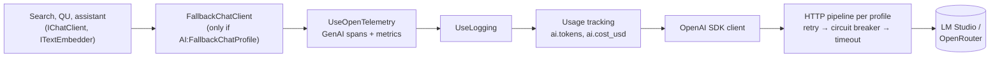
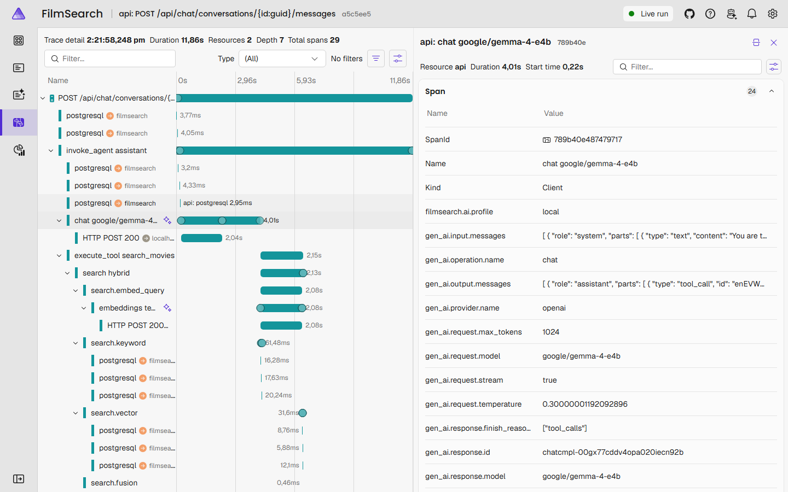

# AI engineer guide

> [Docs](../README.md) › [Handbook](README.md) › AI engineer

For the person who chooses models, writes prompts and tunes search: how the AI layer is built, which settings move
behavior, which prompts exist, how quality is measured and what the numbers are today, and the process that keeps a
change from silently making things worse. The *why* behind each part is in the [guide](../guide/README.md) (chapters
3–14); this page is about *where* and *how*. Every setting is in the [configuration reference](configuration.md).

**Contents:** [AI architecture](#ai-architecture) · [Profiles](#chat-and-embedding-profiles) ·
[Prompts](#versioned-prompts) · [Search parameters](#search-parameters) · [Query understanding](#query-understanding) ·
[Assistant tools and guardrails](#assistant-tools-and-guardrails) · [Evaluation suites](#evaluation-suites) ·
[Current numbers](#current-numbers) · [The safe change process](#the-safe-change-process) ·
[Playground and LM Studio](#playground-and-lm-studio) · [Observing a turn](#observing-a-turn)

## AI architecture

Business code depends only on `IChatClient` and `IEmbeddingGenerator<string, Embedding<float>>` from
Microsoft.Extensions.AI ([ADR-0002](../adr/0002-ai-abstraction-meai.md)). Every provider is an OpenAI-compatible API
(LM Studio, OpenRouter), created by `AiClientFactory` in `src/FilmSearch.AI/Providers` with the OpenAI SDK; no provider
type leaves that factory.



- Each profile is a keyed service (`[FromKeyedServices("openrouter")] IChatClient`); the unkeyed one is the active
  profile, wrapped by the fallback client when a fallback is configured.
- Search embeds through `ITextEmbedder` (`FilmSearch.Core`), which adds the profile's query / document prefix and caches
  query vectors per profile, model and normalized text.
- The assistant runs its own agent loop (`AgentLoop`, [ADR-0006](../adr/0006-agent-own-loop-first.md)), not a
  framework: up to `Assistant:MaxToolIterations` model calls with tools, then one call without tools.
- Startup validates the `AI` section (`AiOptionsValidator`): unknown active profile, missing key of an active or fallback
  profile, a fallback without tools, out-of-range resilience values all stop the app with a clear message.

Background: [guide 3: Language models](../guide/03-language-models.md), [guide 2: Architecture](../guide/02-architecture.md).

## Chat and embedding profiles

Profiles live in `AI:ChatProfiles:<name>` and `AI:EmbeddingProfiles:<name>` of `src/FilmSearch.Api/appsettings.json`.
Switching a model is a config change only.

| Setting | Development | Demo | Meaning |
|---|---|---|---|
| `AI:ActiveChatProfile` | `local` (`google/gemma-4-e4b` in LM Studio) | `openrouter` (`deepseek/deepseek-v4.1-flash-1017`) | Chat model of the assistant and query understanding |
| `AI:FallbackChatProfile` | empty | empty | Profile that answers when the active one fails before streaming anything; must support tools; its answers are marked |
| `AI:ActiveEmbeddingProfile` | `local` (`text-embedding-embeddinggemma-300m`, 768 dims) | `openrouter` (`qwen/qwen3-embedding-8b`, 1024 dims) | Model of the movie vectors and query vectors |

Configured profiles: chat `local`, `openrouter`; embeddings `local`, `nomic` (`text-embedding-nomic-embed-text-v1.5`),
`openrouter`. Per profile:

- **Connection:** `Endpoint`, `Model`, `ApiKey` (cloud keys only in user secrets / environment), `ModelsPath` (model list
  for the health check; `/embeddings/models` on OpenRouter).
- **Chat defaults:** `Temperature` (0.3), `MaxOutputTokens` (1024), `ReasoningEffort` (`None`: Gemma 4 and Qwen 3.5
  think before answering unless told not to; thinking multiplies latency of tool calls and JSON), `SupportsTools`.
- **Embedding:** `Dimensions`, `QueryPrefix`, `DocumentPrefix` (task prefixes the model was trained with; EmbeddingGemma
  `task: search result | query: ` / `title: none | text: `, nomic `search_query: ` / `search_document: `, Qwen3 an
  instruction for queries only).
- **Resilience** ([ADR-0011](../adr/0011-ai-resilience-and-fallback.md)): `TimeoutSeconds` (per attempt; 120 by
  default, 300 for the local chat model, 60 for embeddings), `MaxRetries` (2; only connection errors, 429, 502–504),
  `RetryDelayMs` (1000), `CircuitBreakSeconds` (30). One pipeline per profile, so a slow chat model does not open the
  breaker of the embedding model on the same server.
- **Cost:** `AI:Pricing:<model id>` with `InputPerMTokUsd` / `OutputPerMTokUsd`; a model without an entry has no cost
  estimate (model ids with `:` cannot be keys).

**Changing the embedding model** is more than a switch: the stored vectors belong to the old model. Reindex with the new
profile (`POST /api/admin/embeddings/reindex` with `{ "profile": "nomic" }`), switch `AI:ActiveEmbeddingProfile`, then
delete the old vectors (`DELETE /api/admin/embeddings?model=…`). Vectors of several models and dimensions live in one
table with a partial HNSW index per dimension ([ADR-0008](../adr/0008-vector-storage-per-dimension.md),
[guide 5](../guide/05-embeddings.md), [guide 6](../guide/06-vector-search.md)). The embedding text is versioned too
(`MovieEmbeddingText.Version` = `movie-profile-v1`); changing it re-embeds every movie.

## Versioned prompts

Prompts are embedded files `src/FilmSearch.AI/Prompts/<name>.vN.md`, loaded by `PromptLibrary` (latest version unless
pinned). The prompt id (`name.vN`) is logged, tagged on spans (`filmsearch.prompt.id`) and stored with the results
(assistant messages, search responses). Rules: [Prompts/README.md](../../src/FilmSearch.AI/Prompts/README.md).

| Prompt | Versions | Current | Pin with |
|---|---|---|---|
| `assistant-system` | v1 (search only), v2 (cart and checkout rules), v3 | v3 (I14: search a named movie before using its id, ask buy or rent, checkout without asking again, `genresExclude`, payment button label in en / ru / sv, refusals in the user's language) | `Assistant:PromptVersion` |
| `assistant-summary` | v1 | v1 (rolling summary of older turns) | `Assistant:SummaryPromptVersion` |
| `query-understanding` | v1, v2 | v2 (bare titles and names are searches, not "similar to") | `Search:QueryUnderstanding:PromptVersion` |
| `assistant-judge` (evals only) | v1 | v1, in `evals/FilmSearch.Evals/Prompts/` | — |

A meaningful change is a new file `vN+1`, never an edit of the old one: old versions stay for comparison and pinning.
Put only instructions in a prompt; user text, movie data and tool results go into messages, never into the template.

## Search parameters

`Search:*` in appsettings; tuned with the I07 manual queries and the I08 golden set
([guide 7](../guide/07-hybrid-search.md)).

| Key | Value | Effect |
|---|---|---|
| `Search:Hybrid:RrfK` | 20 | RRF constant; larger flattens rank differences (60 is the textbook value; 20 won in I07) |
| `Search:Hybrid:KeywordWeight` | 1.0 | Weight of the keyword list when all query words matched |
| `Search:Hybrid:RelaxedKeywordWeight` | 0.1 | Weight when the keyword query was relaxed to any word (mostly noise for plot descriptions) |
| `Search:Hybrid:SemanticWeight` | 1.0 | Weight of the vector list |
| `Search:Hybrid:CandidatesPerList` | 50 | Candidates from each retriever before fusion |
| `Search:Hybrid:SimilarTitles` | `AverageVector` | "Movies like X": average the query vector with the named movies' vectors, or `ExtraList` (their neighbours as extra RRF lists) |
| `Search:Hybrid:SimilarTitleWeight`, `MaxSimilarTitles` | 1.0, 3 | Code defaults, not in appsettings |
| `Search:Semantic:MaxResults` | 100 | Length of the semantic result list |
| `Search:Embeddings:Locales` | `["en"]` | Languages the movie texts are embedded in; a multilingual model maps ru / sv queries to English texts |
| `Search:Embeddings:BatchSize` | 32 | Texts per embedding call |
| `AI:QueryEmbeddingCacheMinutes`, `…MaxEntries` | 1440, 10000 | Query vector cache |

## Query understanding

`QueryUnderstandingService` turns a search query into filters, a semantic query and "similar to" titles with one chat
call: structured output from the C# record `QueryUnderstandingOutput` (JSON Schema, genre `enum` filled at run time),
validation, one retry with the error, then a fallback to "no filters" ([spec 05 §5](../spec/05-search.md#5-query-understanding-qu),
[guide 8](../guide/08-query-understanding.md)). Settings under `Search:QueryUnderstanding`: `PromptVersion`,
`ChatProfile` (another profile than the active one, e.g. a cheaper model), `MaxOutputTokens` (400), `CacheMinutes`
(1440) and `CacheMaxEntries` (10000). It runs when a search request has `"understand": true` (the "understand the
query" switch of the search page; the evaluation measures it as `hybrid+qu`). The assistant's `search_movies` does not
use it: the model already passes filters as tool arguments. Fallbacks are not cached, so the model is asked again after
an outage.

## Assistant tools and guardrails

Seven tools in `src/FilmSearch.AI/Assistant/Tools`: `search_movies`, `get_movie_details`, `find_similar_movies`,
`view_cart`, `add_to_cart`, `remove_from_cart`, `request_checkout` ([spec 06 §3](../spec/06-ai-assistant.md#3-tools),
[guide 10](../guide/10-agents-and-tools.md)). They are thin adapters over module services; the owner comes from the
request, never from arguments; argument schemas come from C# records and invalid arguments get an error that tells the
model how to fix the call. `request_checkout` never pays: the user clicks the confirmation.

Guardrails ([spec 06 §5](../spec/06-ai-assistant.md#5-guardrails), [guide 12](../guide/12-guardrails.md)):
`GroundingCheck` matches bold and quoted titles of the answer against tool results (counted in
`assistant.grounding.titles`); prices and cards come only from the database; tool results are data; budgets and
`MaxToolIterations` cap cost; the input limit is 2000 characters. Memory: the last turns within
`Assistant:HistoryMaxMessages` (12) and `HistoryTokenBudget` (3000), older turns folded into a rolling summary
([guide 9](../guide/09-rag-grounded-answers.md)).

## Evaluation suites

The runner `evals/FilmSearch.Evals` uses the API's configuration and DI; each run starts a fresh `pgvector` container
with the seed ([evals/README.md](../../evals/README.md), [spec 09](../spec/09-evaluation.md), [guide 11](../guide/11-evaluation.md)).

```bash
dotnet run --project evals/FilmSearch.Evals -- --suite validate                     # datasets vs seed (also a unit test)
dotnet run --project evals/FilmSearch.Evals -- --suite search --label <name>        # keyword, semantic, hybrid, hybrid+qu
dotnet run --project evals/FilmSearch.Evals -- --suite search --label <name> --modes hybrid --set Search:Hybrid:RrfK=40
dotnet run --project evals/FilmSearch.Evals -- --suite qu --label <name>            # query understanding, --repeat 3
dotnet run --project evals/FilmSearch.Evals -- --suite assistant --label <name> --parallel 4 --judge-profile openrouter --judge-model openai/gpt-6-luna
dotnet run --project evals/FilmSearch.Evals -- --suite adversarial --label <name> --parallel 4 --judge-profile openrouter --judge-model openai/gpt-6-luna
```

| Suite | Dataset | Measures |
|---|---|---|
| `search` | `search.golden.jsonl` (105 queries, 35 per language) | Recall@5/10, MRR@10, nDCG@10, excluded-genre rate, latency, by locale and tag |
| `qu` | `qu.golden.jsonl` (40 queries) | Valid and retry rate, exact match, accuracy per field, genre precision / recall |
| `assistant` | `assistant.scenarios.jsonl` (34 multi-turn scenarios) | Deterministic checks per turn, pass rate ± deviation over repeats, grounding violation rate, LLM judge 1–5 |
| `adversarial` | `assistant.adversarial.jsonl` (20 cases) | Same, for injection, off-topic, prices, payment without the button, long input |
| `validate` | all | Dataset fields and ids against the seed |

`--set key=value` overrides any setting for one run, `--profile` / `--chat-profile` switch profiles, `--cases` picks
cases, `--no-judge` skips the judge. The judge should be a stronger model of another family than the assistant.

## Current numbers

| What | Configuration | Result | Report |
|---|---|---|---|
| Search, 4 modes (1182 movies after a TMDB import) | EmbeddingGemma 300M, QU with Gemma 4 E4B | Recall@10 keyword 0.287, semantic 0.855, hybrid 0.866, hybrid+qu 0.858 (MRR 0.814, excluded-genre rate 0) | [i16-after](../../evals/reports/2026-11-18_search_i16-after-1182-tmdb.md) |
| Search, demo embeddings (1000-movie seed) | Qwen3-Embedding-8B on OpenRouter | Recall@10 semantic 0.917, hybrid 0.927; semantic p50 577 ms (network) | [i20-openrouter](../../evals/reports/2026-11-19_search_i20-openrouter-qwen3-embedding-8b.md) |
| Query understanding | Gemma 4 E4B, `query-understanding.v2` | 100% valid, 83% exact match, p50 3.8 s | [qu baseline](../../evals/reports/2026-11-17_qu_baseline.md) |
| Assistant scenarios | `assistant-system.v3` | Gemma 4 E4B 78% ± 4 (grounding violations 2.3%, judge 4.00); DeepSeek V4.1 Flash 92% ± 2 (3.8%, 4.33) | [I14 summary](../../evals/reports/2026-11-18_I14_assistant-evaluation.md) |
| Assistant adversarial | `assistant-system.v3` | Gemma 88% ± 3, DeepSeek 98% ± 3; no run ever created an order without the click | [I14 summary](../../evals/reports/2026-11-18_I14_assistant-evaluation.md) |

Model choice of I05: [model benchmark](../../evals/reports/2026-11-17_I05_model-benchmark.md). Known open issues are at the
end of the I14 summary (Gemma declines some English off-topic questions in Swedish; "add it, I'll keep looking" in
Russian picks an offer without asking).

## The safe change process

Changes to prompts, models, embedding text or search parameters change behavior. AGENTS.md requires numbers:

1. **Baseline.** Run the affected suite on `main` with a clear label (or reuse the latest report if nothing changed since).
2. **Change** in one place: a new prompt version, a profile, a `Search:*` value. Try it first with `--set` without
   touching appsettings.
3. **Run** the same suite with the same dataset version (the report header shows its hash; a changed dataset is not
   comparable). Assistant suites: `--repeat 3` and look at the deviation, not only the mean.
4. **Report.** The runner writes `evals/reports/YYYY-MM-DD_<suite>_<label>.md` and `.json`; write the "Conclusion"
   section by hand and commit both.
5. **Record** the before / after numbers in the iteration's Result, and keep a change only if it does not lose on the
   metrics that matter for it (e.g. Recall@10 and MRR per locale for search, pass rate and grounding for the assistant).
   A real choice between alternatives gets an ADR.

## Playground and LM Studio

[tools/ai-playground](../../tools/ai-playground/README.md) uses the API's `AI` configuration and user secrets: `chat`,
`stream`, `tools`, `json`, `embed`, and the benchmarks `bench-chat` / `bench-embed` (`--chat-model`, `--reasoning`,
`--query-prefix`, `--raw` to see the HTTP traffic). Admins can call one profile through the API:
`POST /api/admin/ai/chat` with `{ "message": "Hi", "profile": "local" }`.

LM Studio tips ([AGENTS.md, local environment notes](../../AGENTS.md#local-environment-notes)):

- `lms server start`, `lms load <model> -y`, `lms ps`, `lms unload --all`, `lms server stop`. Unload and stop when done.
- Keep `ReasoningEffort: None` for Gemma 4 / Qwen 3.5, or every call thinks first.
- For `--parallel 4` evaluations load the chat model with `lms load google/gemma-4-e4b -c 32768 --parallel 4 -y`;
  otherwise turns fail with "Context size has been exceeded".
- A hung queue (requests of a killed process) is cleared with `lms unload --all` and loading again.
- On battery power models run on the CPU and calls time out. With the server stopped the first call of an outage takes
  about 10 s on Windows until the circuit opens.
- Do not build the solution while an evaluation runs: its DLLs are locked.

## Observing a turn

Every model call is a GenAI span `chat <model>` / `embeddings <model>` (activity source `FilmSearch.AI`) with
`gen_ai.usage.input_tokens` / `output_tokens`, `filmsearch.ai.profile` and `filmsearch.ai.cost_usd`; a turn is
`invoke_agent assistant` with `execute_tool <name>` children and the search stages below them. Prompt and completion
text is recorded only with `AI:EnableSensitiveData` (Development). `AI:LogRawHttp` (Development only) logs the raw
provider requests, never the keys. Optional Langfuse shows the same as LLM traces with sessions per conversation and
user ratings as scores. Recipes: [observability runbook](../runbooks/observability.md),
[guide 13](../guide/13-observability-and-cost.md).



---

**See also:** [Developer](developer.md) · [Operator](operator.md) · [Configuration reference](configuration.md) ·
[Administrator](administrator.md) · [Product owner](product-owner.md) · [Customer](customer.md) ·
[Guide](../guide/README.md) (chapters [3](../guide/03-language-models.md)–[14](../guide/14-resilience-and-shipping.md)) ·
[Evaluations](../../evals/README.md) · [Journal M2](../journal/m2-smart-search.md) · [Journal M3](../journal/m3-ai-assistant.md) ·
[Spec 05](../spec/05-search.md) · [Spec 06](../spec/06-ai-assistant.md) · [ADR-0002](../adr/0002-ai-abstraction-meai.md) ·
[ADR-0011](../adr/0011-ai-resilience-and-fallback.md)
