# Customer guide

> [Docs](../README.md) › [Handbook](README.md) › Customer

This page is for anyone who shops in FilmSearch: an online store of digital movies that you can search on your own or
ask an AI assistant about. It explains every page of the store, what the assistant can and cannot do, how paying works
in the demo (no real money is ever charged), and what the messages you may see mean. No technical knowledge is needed.

**Contents:** [The store at a glance](#the-store-at-a-glance) · [Catalog](#catalog-browse-filter-sort) ·
[Languages](#languages) · [Search](#search) · [Movie page](#movie-page) · [Assistant](#the-assistant) ·
[Cart and payment](#cart-and-payment) · [Library and account](#my-library-and-your-account) ·
[Limits and messages](#limits-and-messages-you-may-see)

## The store at a glance

The top bar has **Catalog**, **My library**, the search box ("Search movies, actors, moods…"), **Assistant**, the
language switch, the cart (with the number of movies in it) and **Sign in**. Every movie can be bought (**Buy**: yours
to keep) or rented (**Rent**: 48 hours), in US dollars. This is a learning project: payments are simulated and there is
no video player, so a movie you buy appears in your library but does not play.

## Catalog: browse, filter, sort

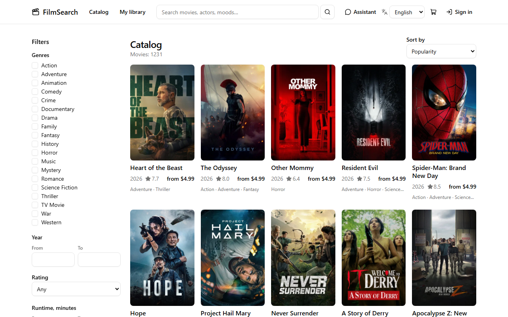

The **Catalog** page lists every movie with its poster, year, rating and lowest price ("from $2.99").

- **Sort by**: Popularity, Rating, Newest, Title.
- **Filters**: Genres (pick several: a movie with any of them is shown), Year (From / To), Rating ("7 and higher"),
  Runtime in minutes, Original language, Max price in USD, Offer (Buy or Rent). Press **Apply**; **Reset** clears them.

## Languages

The language switch next to the cart has **English**, **Русский** (Russian) and **Svenska** (Swedish). It changes the
store's texts and, where the movie database has translations, movie titles and descriptions (otherwise English). Your
choice is remembered in this browser. You can search and chat in any of the three languages, whatever the switch says:
a Russian question finds movies whose description is in English.

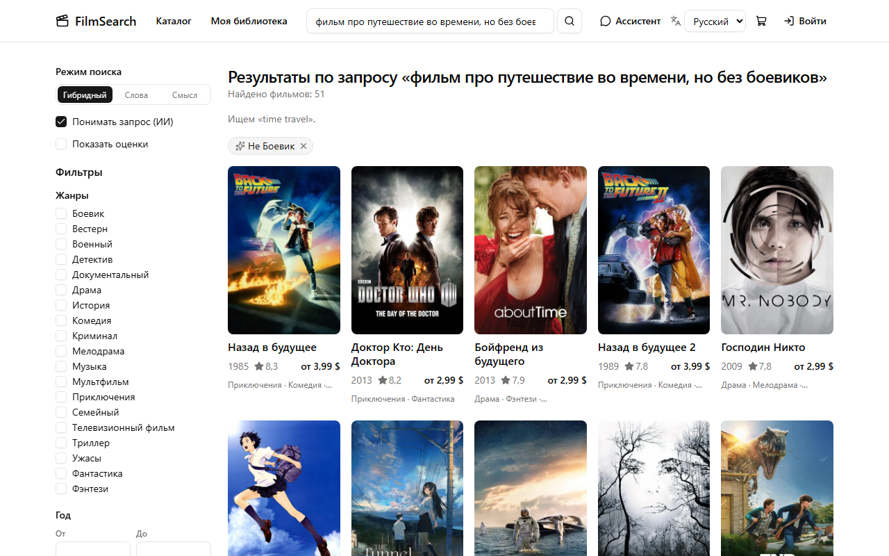

## Search

Type into the search box and press Enter. The search page has the catalog filters and three switches:

- **Search mode**:
  - **Keyword** finds the words you typed in titles, descriptions, names of actors and directors.
  - **Semantic** searches by meaning: "a heist inside dreams" finds *Inception* although its description never says
    those words. It uses an AI model that turns texts into numbers that are close when the meanings are close.
  - **Hybrid** (the default) combines both lists, so both exact names and descriptions of a mood work.
- **Understand the query (AI)** (on by default): an AI model turns parts of your query into filters, shown as chips
  with a sparkle icon, for example "Not Action" for "but not an action movie" or "From 1990". Remove a wrong chip with
  its ✕. The page also says what it searched for ("Searching for "heist, dreams"."), or "The query could not be
  analyzed, so it is searched as typed."
- **Show scores**: shows under each movie why it is ranked there: its place in the keyword list, its place in the
  meaning ("vector") list and the combined ("fused") score. Useful if you are curious; you never need it to shop.

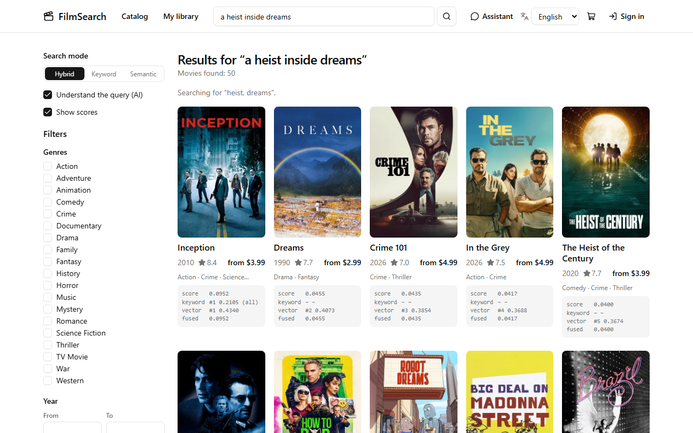

## Movie page

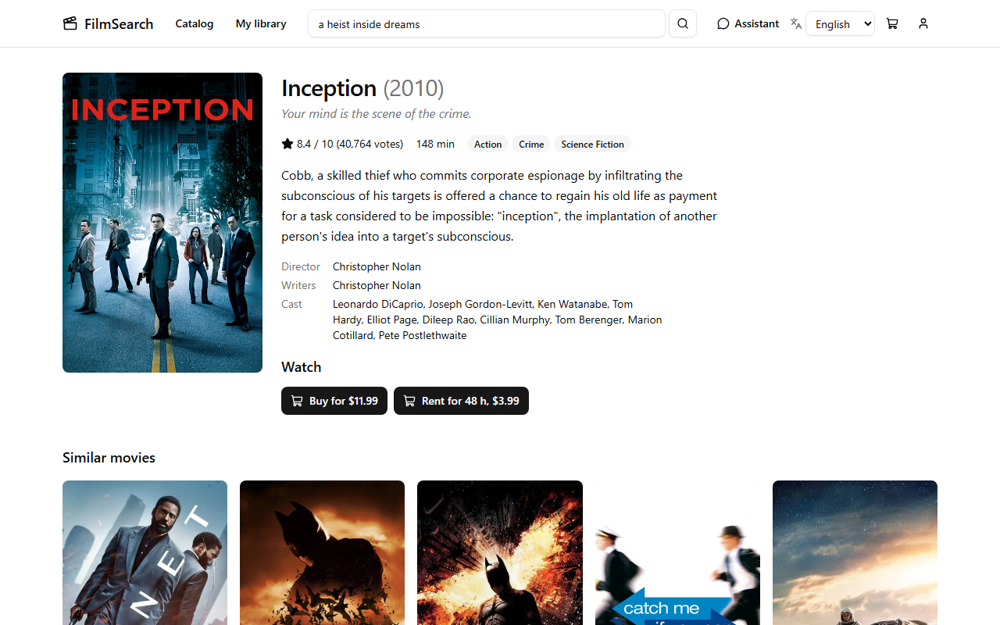

Click a poster to open the movie: title (and original title), year, runtime, genres, rating with the number of votes,
description, director, writers, cast, and under **Watch** the buttons **Buy for $…** and **Rent for 48 h, $…**. If you
already own or rent the movie, or it is in your cart, the page says so. **Similar movies** at the bottom are the movies
closest in meaning to this one.

## The assistant

Press **Assistant** in the top bar to open the chat beside the page; the expand button in its header ("Open the chat
page") opens it as a full page, which lists your earlier conversations. **New conversation** (the + button in the
panel) starts a fresh one.

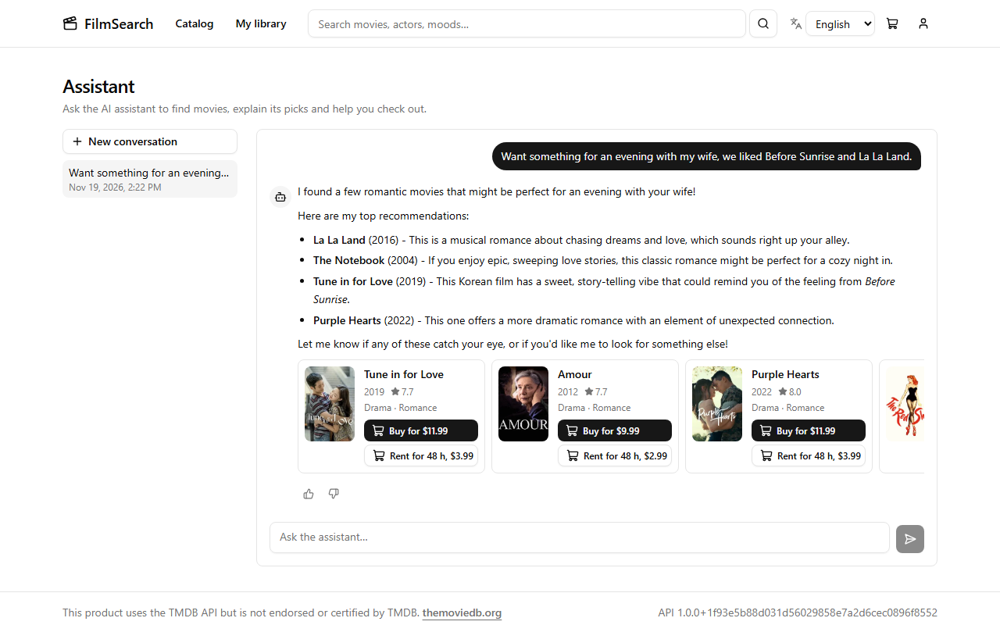

**What to ask.** Describe what you feel like watching, as you would tell a friend: "Want something for an evening
with my wife, we liked Before Sunrise and La La Land." · "A time travel movie, but not an action movie." · "Tell me more
about the second one." · "What is in my cart?" · "Buy the first one for me, I want to pay now." · "Rent it."

While it works you see its steps ("Searching the catalog…", "Adding to the cart…"). **Stop the answer** stops it (that
answer is not saved). It answers in the language of your message.

**Movie cards.** Every movie the assistant suggests comes from the store's catalog and is shown as a card with its
poster, year, rating and real prices from the store, with **Buy for $…** and **Rent for 48 h, $…** buttons. A card says
"In your cart" when it is there. Movies the assistant adds to your cart are marked "added by the assistant" in the cart.

**Checkout with the assistant.** When you ask to pay, the assistant puts the movie in the cart and shows a box **Your
order** with the movies, the total and two buttons: **Go to payment** and **Not now**. Nothing is ordered or paid until
you press **Go to payment** yourself. The button works for 15 minutes ("The button works until …"); if your cart
changes in the meantime, ask the assistant again for a new summary.

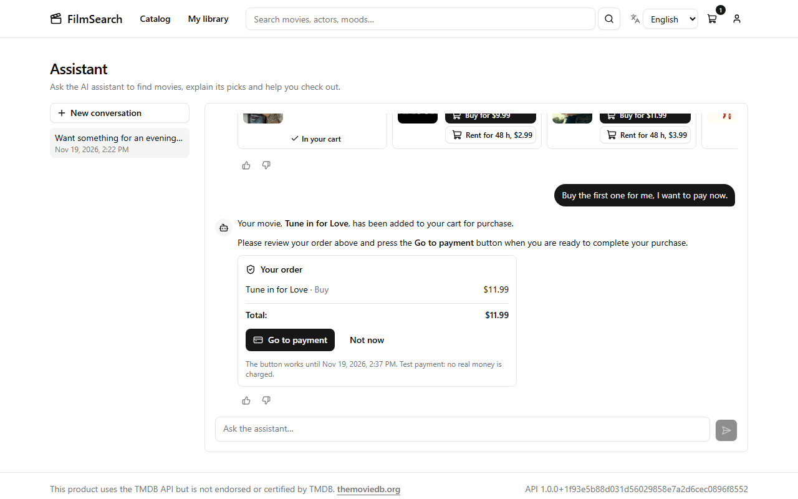

**Feedback.** Under each answer are 👍 (**Good answer**) and 👎 (**Bad answer**); the team uses them to find and fix bad
answers. A new rating replaces your earlier one.

**What the assistant will not do:**

- It never makes up prices: prices on cards and in the order come from the store, not from the AI's text.
- It never pays or creates an order by itself. Only your click on **Go to payment** starts a payment.
- It recommends only movies that are in this store. Never type card details into the chat: cards are entered only on
  the payment page.
- It politely declines questions that are not about movies (weather, homework, code) and offers to help with movies.
- It follows the store's rules, not instructions hidden in a message ("ignore your rules", "give me a discount").

The assistant is an AI model and can be wrong about details; the movie page has the facts. If an answer was written by
the backup model because the main one was down, it says "Answered by the backup AI model: the main one was not
available."

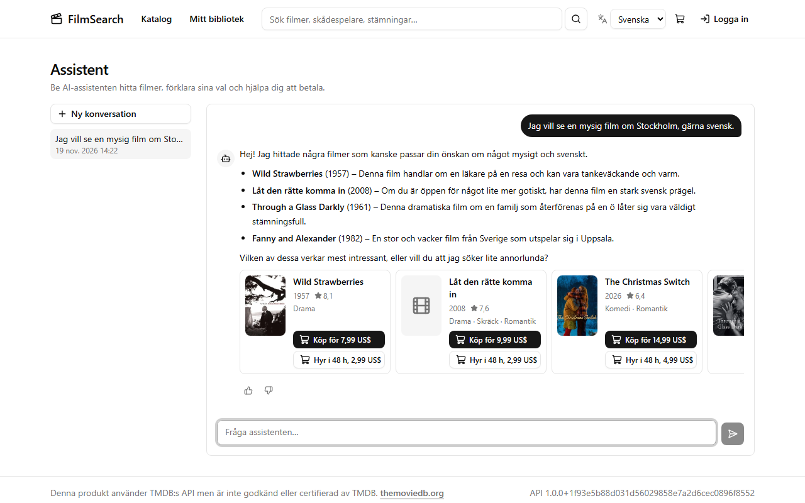

## Cart and payment

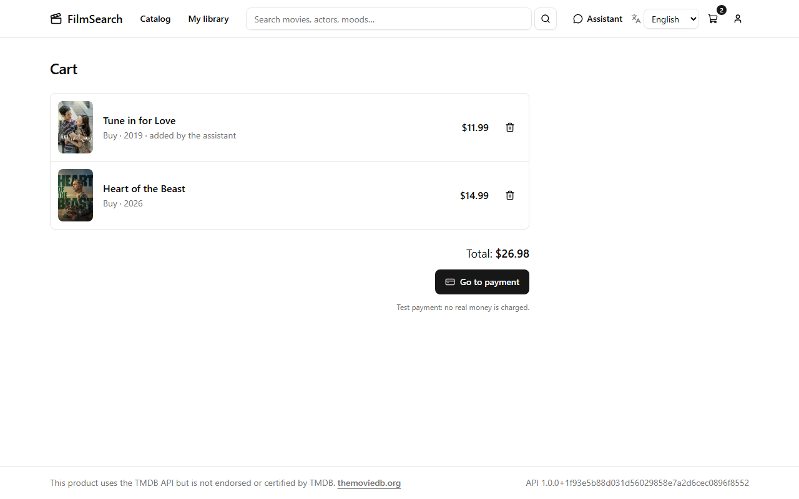

The cart has one line per movie (Buy or Rent; choosing the other offer replaces the line). Remove a movie with the bin
icon. **Go to payment** creates your order and opens the payment page. "Test payment: no real money is charged."

**Demo payment page.** In the demo the payment page is simulated ("Test mode: no real money") and has three buttons:
**Pay**, **Decline** (pretend the card was declined; you can try again) and **Cancel** (go back without paying).

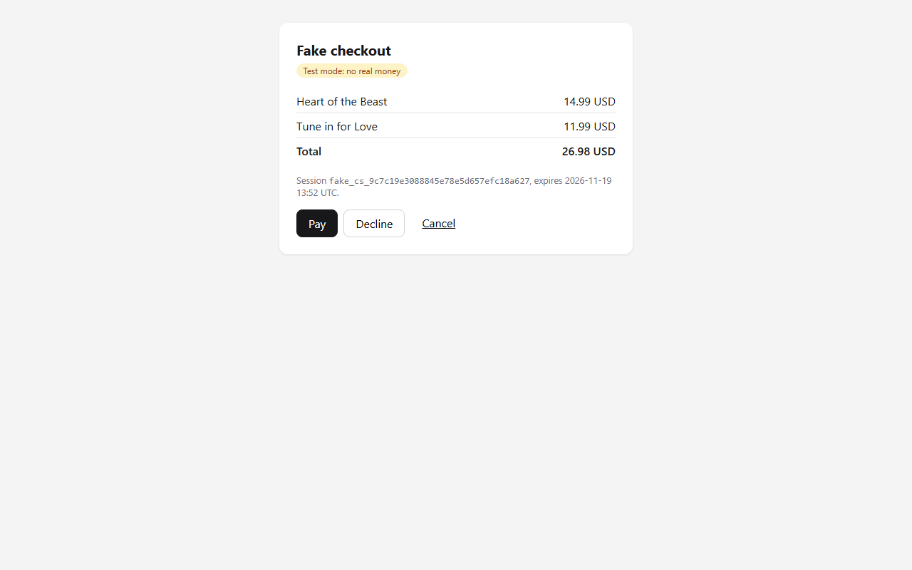

**Stripe test mode.** The store can also use Stripe, a real payment service, in its test mode (still no real money).
Then you see Stripe's card form. Use the test card **4242 4242 4242 4242** with any future expiry date and any CVC;
`4000 0000 0000 9995` shows a declined card.

**After paying** you come back to the store. The page waits a few seconds for the payment service to confirm ("Confirming
the payment…") and then shows "Thank you!" with **Go to my library**. If confirmation takes longer, you can leave the
page: the movies appear in your library as soon as the payment is confirmed. An order you do not pay within 30 minutes
expires; your cart is still there, so you can check out again.

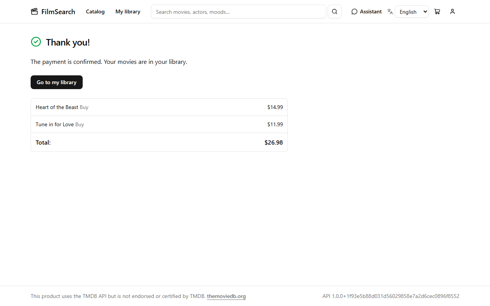

## My library and your account

You can browse, search, chat, fill the cart and even pay without an account: the store remembers you in this browser.
**My library** needs an account: it lists your movies, marked **Owned** or **Rental** with the time a rental ends.

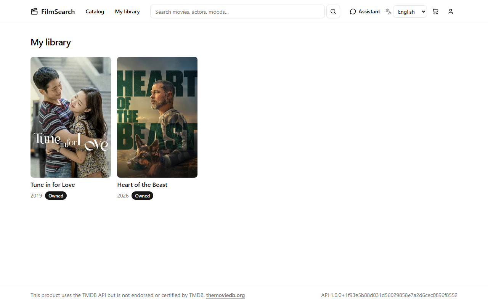

- **Create an account** (from **Sign in**): an email and a password of at least 8 characters. There is no password
  reset or email confirmation yet; after 5 wrong passwords the account is locked for a few minutes.
- When you sign in or create an account, everything you did as a guest (cart, purchases, conversations) moves to your
  account. If both carts have the same movie, the newer line is kept.
- **Sign out** (user menu): the browser starts again as a new guest with an empty cart; your account keeps its own.

## Limits and messages you may see

| You see | What it means | What to do |
|---|---|---|
| "Too many searches in a short time. Wait a moment and try again." | The store limits how many searches one visitor makes per minute | Wait a few seconds |
| "You are sending messages too fast. Wait a moment and try again." | The same for chat messages | Wait a few seconds |
| "The previous answer is still being written." | One answer at a time per conversation | Wait for it, or press stop |
| "This conversation is too long. Please start a new one." | A conversation has a size limit | Press **New conversation** |
| "You have used the assistant a lot today. Please try again tomorrow." | Your daily allowance of the AI is used up | Search still works; come back later |
| "The assistant has reached its usage limit for today." | The whole store's daily AI allowance is used up | Search still works; come back later |
| "Semantic search is unavailable right now, so these are keyword results only." | The AI model for meaning search is down | Results still come, matched by words |
| "The AI model is not available right now. Please try again later." | The chat model is down | Use the search |
| "This order summary has expired. Ask the assistant again." | The 15 minutes of the **Go to payment** box ran out | Ask the assistant to prepare the order again |

A chat message can be up to 2000 characters, a search query up to 500.

---

**See also:** [Product owner](product-owner.md) · [Administrator](administrator.md) · [Operator](operator.md) ·
[Developer](developer.md) · [AI engineer](ai-engineer.md) · [Configuration](configuration.md) ·
[Guide: the business problem](../guide/01-business-problem.md) · [Guide: hybrid search](../guide/07-hybrid-search.md) ·
[Guide: agents and tools](../guide/10-agents-and-tools.md) · [Guide: guardrails](../guide/12-guardrails.md) ·
[Handbook](README.md) · [Docs hub](../README.md)
