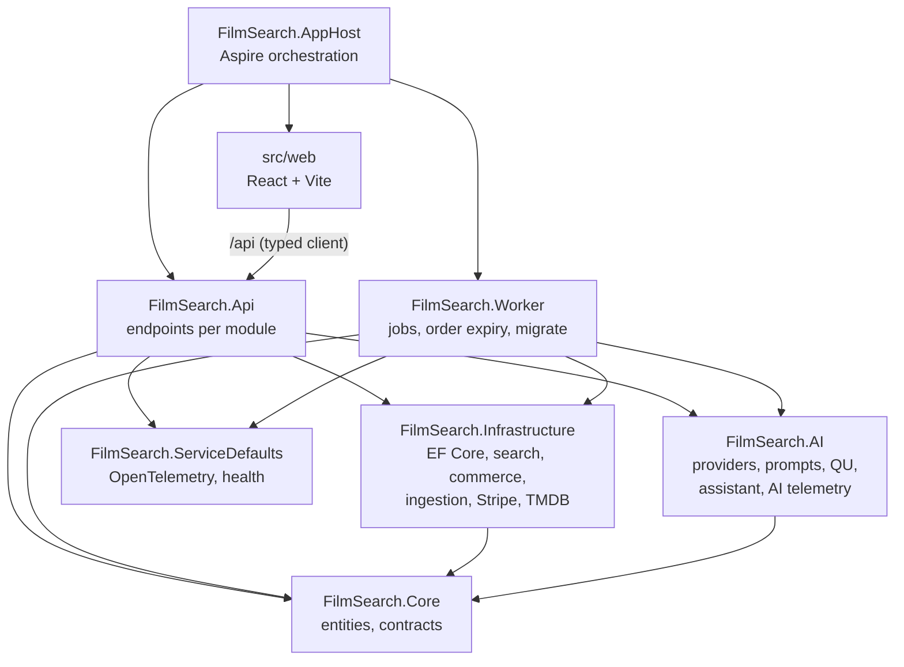

# Developer guide

> [Docs](../README.md) › [Handbook](README.md) › Developer

For a developer who changes FilmSearch's code: where things live, the rules the code follows, how it is tested, what
to run before a push, and a worked example of a feature that goes from the database to the UI. Installing the tools and
running the app is on the [local setup page](local-setup.md); the rules for AI agents working in the repository are in
[AGENTS.md](../../AGENTS.md), which this page follows. AI-specific work (models, prompts, evaluations) is on the
[AI engineer page](ai-engineer.md).

**Contents:** [Getting started](#getting-started) · [Code map](#code-map) · [Modules](#modules) ·
[Conventions](#conventions) · [Testing](#testing) · [Before you push](#before-you-push) ·
[Walkthrough: a new catalog filter](#walkthrough-a-new-catalog-filter) · [Where decisions are written](#where-decisions-are-written)

## Getting started

1. Prerequisites (.NET 10 SDK, Docker Desktop, Node 24, LM Studio for AI features) and the first run:
   [local setup](local-setup.md#prerequisites).
2. `dotnet run --project src/FilmSearch.AppHost` starts PostgreSQL, the API, the Worker and the web app; open the **web**
   URL from the Aspire dashboard. Without LM Studio the store and keyword search work; semantic search and the chat do not.
3. `dotnet test` (Docker running) and, in `src/web`, `npm test`. On Windows run Vitest from a path with an upper-case
   drive letter (`D:\Projects\...`): with `d:\` every test file fails with "Vitest failed to find the current suite".
4. Admin endpoints need the admin password in the API user secrets ([local setup](local-setup.md#admin-account)).

The work is organised in iterations ([roadmap](../plan/roadmap.md), one plan per iteration in
[docs/plan/iterations/](../plan/iterations/)); the [spec](../spec/00-overview.md) is the source of truth for behavior.
Everything happens on `main`: no feature branches and no pull requests (owner's decision).

## Code map



| Path | What lives there |
|---|---|
| `src/FilmSearch.Core` | Entities and module contracts, no EF Core / AI / Stripe packages: `Catalog/` (`Movie`, `MovieFilter`, `ICatalogReader`, `ICatalogWriter`), `Search/` (`IMovieSearch`, `ITextEmbedder`, `QueryUnderstanding`, `MovieEmbeddingText`), `Commerce/` (`Order`, `IPaymentGateway`, contracts), `Assistant/` (events, error codes, confirmations), `Ingestion/` (`IBackgroundJobs`, seed file), `Owners/` (`IOwnerContext`, `IOwnerMergeHandler`), `Localization/` |
| `src/FilmSearch.Infrastructure` | `Persistence/` (`AppDbContext`, configurations per module, `Migrations/`, `DatabaseSetup`), `Catalog/` (reader, writer, `MovieQueryExtensions`), `Search/` (`Keyword/`, `Semantic/` with `VectorIndex` and the indexer, `Hybrid/` with RRF, `MovieSearch`), `Commerce/` (cart, checkout, library, webhooks, expiry, `StripeGateway/`), `Assistant/` (conversation store, confirmations), `Identity/`, `Ingestion/` (seeder, TMDB importer, `Jobs/`), `Tmdb/` (client) |
| `src/FilmSearch.AI` | `Providers/` (profiles, `AiClientFactory`, resilience pipelines, fallback client), `Prompts/` (versioned `.md` files, `PromptLibrary`), `QueryUnderstanding/`, `Assistant/` (agent loop, `AssistantChat`, history, summarizer, `GroundingCheck`, `Tools/`), `Embeddings/`, `Caching/`, `Telemetry/` (metrics, usage and cost, Langfuse), `Health/` |
| `src/FilmSearch.Api` | `Program.cs` (small: registers modules), `Modules/{Admin,AppInfo,Assistant,Catalog,Commerce,Identity,Ingestion,Search}` with request classes and endpoints, `Commerce/FakeGateway/` (the fake payment page), `Owners/` (anonymous owner cookie), `RateLimiting/`, `Localization/`, `Hosting/` (data protection), `OpenApi/`, `appsettings*.json` (also used by the Worker), `Assistant.http` |
| `src/FilmSearch.Worker` | `WorkerHost` (same module registrations as the API plus `AddBackgroundWork`), `Program.cs` with the `migrate` command |
| `src/FilmSearch.ServiceDefaults` | OpenTelemetry (meters, sources, OTLP and Langfuse exporters), `/health` and `/alive` |
| `src/FilmSearch.AppHost` | PostgreSQL container, API, Worker, Vite app, optional Langfuse (`Langfuse.cs`) |
| `src/web` | `src/api/` (generated `schema.d.ts`, typed `client.ts`), `src/pages/` (`admin/` for the admin pages), `src/features/{admin,auth,cart,chat,checkout,filters,movies}`, `src/components/ui` (shadcn/ui), `src/i18n/locales/{en,ru,sv}.json`, `src/test/` (test helpers), `e2e/` (Playwright), `openapi/v1.json` (written by the API build) |
| `tests/FilmSearch.UnitTests` | `AI/`, `Assistant/`, `Catalog/`, `Commerce/` (with captured `StripeEvents/`), `Evals/`, `Owners/`, `Search/`, `Tmdb/` |
| `tests/FilmSearch.IntegrationTests` | One file per area (`CatalogApiTests`, `HybridSearchApiTests`, `AssistantApiTests`, `CommerceStripeTests`, `WorkerTests`, …) and `Infrastructure/` with the fixtures and fakes |
| `tests/fixtures` | `TmdbStub` and recorded TMDB responses, shared by unit and integration tests |
| `evals/FilmSearch.Evals` | Evaluation runner, `evals/datasets/` (golden sets), `evals/reports/` ([evals/README.md](../../evals/README.md)) |
| `tools/seed-builder` | Builds `data/seed/movies.seed.json` from TMDB ([data/seed/README.md](../../data/seed/README.md)) |
| `tools/ai-playground` | Console to try profiles, tools, structured output, embeddings; model benchmarks ([README](../../tools/ai-playground/README.md)) |
| `deploy/` | Dockerfiles, compose, Caddy, deploy scripts ([deploy/README.md](../../deploy/README.md)) |

Package versions are central in `Directory.Packages.props`; build rules in `Directory.Build.props`; the SDK and the
test runner (Microsoft.Testing.Platform) in `global.json`; the solution is `FilmSearch.slnx`.

## Modules

A module registers itself with one method per host, so `Program.cs` stays a list
([spec 02 §5](../spec/02-architecture.md#5-module-boundaries)):

| Module | API registration | Endpoints | Infrastructure | Exposes to other modules |
|---|---|---|---|---|
| AppInfo | `AddAppInfoModule()` | `MapAppInfoEndpoints()`: `/api/info` | — | — |
| Identity | `AddIdentityModule()` | `MapIdentityEndpoints()`: `/api/auth/*` | `AddIdentityInfrastructure` | `IOwnerContext` (via `AddOwnerContext`) |
| Catalog | `AddCatalogModule(config)` | `MapCatalogEndpoints()`: `/api/movies`, `/api/genres` | `AddCatalogInfrastructure` | `ICatalogReader`, `ICatalogWriter` |
| Search | `AddSearchModule(config)` | `MapSearchEndpoints()`: `/api/search`, `/api/movies/{id}/similar` | `AddSearchInfrastructure` | `IMovieSearch`, `IQueryUnderstanding`, `ITextEmbedder` |
| Ingestion | `AddIngestionModule(config)` | (admin endpoints) | `AddIngestionInfrastructure`; the Worker's `AddBackgroundWork` adds `AddTmdbClient` and the job runner | `IBackgroundJobs`, `ICatalogSeeder` |
| Commerce | `AddCommerceModule()` | `MapCommerceEndpoints()`: `/api/cart`, `/api/orders`, `/api/library`, webhooks, fake page | `AddCommerceInfrastructure` | `ICartService`, `ICheckoutService`, `ILibraryService`, `IPaymentGateway` |
| Assistant | `AddAssistantModule()` | `MapAssistantEndpoints()`: `/api/chat/*` | `AddAssistantInfrastructure`, `AddAssistant` | — (top-level consumer) |
| Admin | — | `MapAdminEndpoints()`: `/api/admin/*` (role `admin`) | — | — |

AI providers are registered by `builder.AddAiProviders()` (API and Worker). The Worker calls the same
`Add…Infrastructure` methods and `AddBackgroundWork`.

## Conventions

From [AGENTS.md, "Engineering rules"](../../AGENTS.md#engineering-rules):

- **Module boundaries.** A module uses another only through interfaces in `FilmSearch.Core`; no cross-module table
  access. Assistant tools are thin adapters over the same services the endpoints use.
- **.NET.** .NET 10, nullable on, warnings are errors, file-scoped namespaces, `sealed` by default. Minimal APIs with
  endpoint groups, `TypedResults`, Problem Details for errors, validation at the boundary (request classes with data
  annotations and `IValidatableObject`). Async all the way with `CancellationToken`. Options classes with
  `ValidateOnStart`.
- **Time and money.** `TimeProvider`, never `DateTime.UtcNow`. Money as integer minor units plus currency
  (`AmountMinor`, `PriceMax` in cents).
- **Query enums** (`sort`, `offerType`) are strings in the request class, parsed case-insensitively: minimal APIs bind
  enums case-sensitively. JSON enums are camelCase strings.
- **EF Core.** Migrations per change, named after the iteration (`I09_AddCommerce`); never edit an applied migration.
  `dotnet ef migrations add I22_… --project src/FilmSearch.Infrastructure --output-dir Persistence/Migrations`
  (`dotnet tool restore` once). Snake-case names, one schema per module (`catalog`, `search`, `commerce`,
  `assistant`, `ingestion`, …).
- **OpenAPI and the web client.** The API build writes `src/web/openapi/v1.json`; then `npm run gen:api` regenerates
  `src/api/schema.d.ts`. Commit both; CI fails when either is stale. Never hand-write DTO types. Doc comments of types
  and endpoints in the OpenAPI document must be **single-line** (a multi-line comment gives `\r\n` on Windows and fails
  the CI check).
- **Frontend.** TypeScript strict; calls through `api.useQuery("get", "/api/...")` from `src/api/client.ts` (sends
  `Accept-Language`); server state in TanStack Query; shadcn/ui, Tailwind v4, `lucide-react`; assistant markdown
  rendered without raw HTML.
- **i18n.** Every user-facing string goes to `en.json`, `ru.json` and `sv.json`; ESLint fails on letters in JSX text and
  in `alt` / `title` / `placeholder` / `aria-label` literals.
- **New packages** need a reason in the iteration Result (or an ADR). Secrets never go to files in the repository.
- **Commits:** one subject line, imperative, may start with the iteration id; only when the owner asks.

## Testing

| Layer | Tooling | Helpers worth knowing |
|---|---|---|
| Unit (`tests/FilmSearch.UnitTests`) | xUnit v3 on Microsoft.Testing.Platform, Shouldly | `AssistantHarness` (scripted model, in-memory store, fake search; `CreateTools()`), `AiTestHost` (real AI HTTP pipeline ending in `FakeProviderHandler`), `TmdbStub`, Stripe events captured with the Stripe CLI, `FakeTimeProvider` |
| Integration (`tests/FilmSearch.IntegrationTests`) | Testcontainers (`pgvector/pgvector:pg17`), `WebApplicationFactory<Program>` | `PostgresFixture` (one container per assembly, `CreateDatabaseAsync` for a database of your own), `FilmSearchApiFactory`, `CatalogApiFixture` (seed loaded once), `CommerceFixtureBase` / `CommerceTimeFixture` / `StripeCommerceFixture`, `HashingEmbeddingGenerator`, `ScriptedChatClient` (`Chat.Script`, `Chat.ScriptStream`), `SwitchableChatClient`, `FakeStripeApi`, `AuthTestExtensions` (`CreateAdminClientAsync`, `RegisterAsync`), `TestWorker.StartAsync`, `MeterRecorder` / `SpanRecorder` |
| Web (`src/web`, Vitest) | Testing Library | `mockApi({ "GET /api/movies/:id": movie, … })` with builders `aMovie`, `aCart`, `anOrder`, `aUser`; `renderApp(url)`; `sseResponse` / `controlledSse` for the chat |
| End to end (`src/web/e2e`) | Playwright | `npm run e2e` against a running stack (`E2E_BASE_URL`, default `https://localhost`; `E2E_ASSISTANT=1` also asks the assistant); `npx playwright install chromium` once |

Rules that save time ([AGENTS.md, "Notes"](../../AGENTS.md#commands)):

- Tests never need LM Studio or the network: fake `IChatClient` and embedding generators. Real models belong in
  [evaluations](ai-engineer.md#evaluation-suites).
- The integration database is shared: assert on properties of results, not global counts. A test that adds many rows,
  or touches every order (expiry), gets its own database.
- Caches live as long as the factory: use a unique query or message text per test (query understanding, query
  vectors, scripted chat).
- Clients that need the `Secure` owner or auth cookie use `https://localhost`.
- Runner options go after `--`: `dotnet test -- --filter-method "*Health*"`;
  `dotnet test --project tests/FilmSearch.UnitTests` runs the unit tests without Docker.

## Before you push

The same checks as CI, all green locally first (AGENTS.md, "Session workflow", step 9):

```bash
dotnet build                                   # warnings are errors
dotnet format --verify-no-changes
git diff --exit-code -- src/web/openapi        # the build did not change the OpenAPI document
dotnet test                                    # unit + integration, Docker running
cd src/web
npm run gen:api && git diff --exit-code -- src/api/schema.d.ts
npm run lint && npm run format:check && npm run typecheck && npm test && npm run build
```

Then push `main` and check the run: `gh run list --branch main`. A red run is fixed right away.

## Walkthrough: a new catalog filter

Example: "only movies with at least N votes" (`minVotes`, using the existing column `Movie.VoteCount`). The same path
fits any filter of `GET /api/movies` and `POST /api/search`.

1. **Plan and spec.** Find or write the iteration plan, and add the parameter to [spec 04](../spec/04-api.md) and the
   requirement (FR-CAT-2) in the same change.
2. **Core.** Add `public int? MinVotes { get; init; }` to `MovieFilter` (`src/FilmSearch.Core/Catalog/MovieFilter.cs`)
   and include it in `HasConditions()`.
3. **Query.** In `MovieQueryExtensions.ApplyFilter` (`src/FilmSearch.Infrastructure/Catalog/`) add
   `movies = movies.Where(m => m.VoteCount >= minVotes)`. Keyword, semantic (`VectorIndex` composes its raw SQL with
   this LINQ filter) and hybrid search all call `ApplyFilter`, so every search mode gets the filter (FR-SRCH-5). An
   index needs a migration (`I22_AddMovieVoteCountIndex`).
4. **Request classes.** `MovieListRequest` (`src/FilmSearch.Api/Modules/Catalog/`): a property with
   `[Range(0, 10_000_000)]` and `[FromQuery(Name = "minVotes")]`, a single-line `<summary>`, and the mapping in
   `ToQuery()`. For search, the same field in `SearchFilters` (`Modules/Search/SearchRequest.cs`: `ToFilter()` and
   `From()`).
5. **Assistant and query understanding (optional).** A filter the model should set goes into the `search_movies`
   arguments or `QueryUnderstandingOutput`: that is an AI behavior change with a new prompt version and an evaluation
   run ([safe change process](ai-engineer.md#the-safe-change-process)).
6. **OpenAPI.** `dotnet build` rewrites `src/web/openapi/v1.json`; in `src/web` run `npm run gen:api`.
7. **UI.** `src/web/src/features/filters/filters.ts`: the field in `MovieFilters`, parsing from and writing to the URL
   query string (the URL is the single source of truth); a control in `FiltersPanel.tsx` and a chip in
   `FilterChips.tsx`. Labels via `t()`, with keys in `src/i18n/locales/en.json`, `ru.json` and `sv.json`
   (`locales.test.ts` checks that the files have the same keys).
8. **Tests.** Unit: validation in `MovieListRequestTests`, the filter in `MovieFilterTests`. Integration:
   `CatalogApiTests` and a search test asserting that every returned movie has `voteCount >= N` (properties, not
   counts). Web: `filters.test.ts` for the URL round trip, `CatalogPage.test.tsx` with `mockApi` checking the request.
9. **Checks and docs.** Run [the pre-push list](#before-you-push); tick the plan tasks; write the Result; update
   [the customer page](customer.md) if users see the filter.

## Where decisions are written

| Question | Read |
|---|---|
| What must the system do? | [Spec](../spec/00-overview.md) (requirements, API, search, assistant, payments, ingestion, ops) |
| Why this database, framework, queue, auth, deployment? | [ADRs](../adr/README.md) |
| What was planned and what really happened, with problems and fixes? | [Journal](../journal/README.md), iteration plans' "Result" sections |
| Why does the AI part work this way? | [Guide](../guide/README.md), chapters 2–14 |
| What did the owner ask for in a session? | [Prompt history](../prompts/README.md) |
| How good is search or the assistant? | [Evaluation reports](../../evals/reports/) |

---

**See also:** [Local setup](local-setup.md) · [AI engineer](ai-engineer.md) · [Operator](operator.md) ·
[Configuration reference](configuration.md) · [Administrator](administrator.md) · [Product owner](product-owner.md) ·
[Customer](customer.md) · [Guide 2: Architecture](../guide/02-architecture.md) ·
[Spec 02 Architecture](../spec/02-architecture.md) · [ADR-0007 Frontend stack](../adr/0007-frontend-stack.md) ·
[Journal](../journal/README.md) · [AGENTS.md](../../AGENTS.md)
