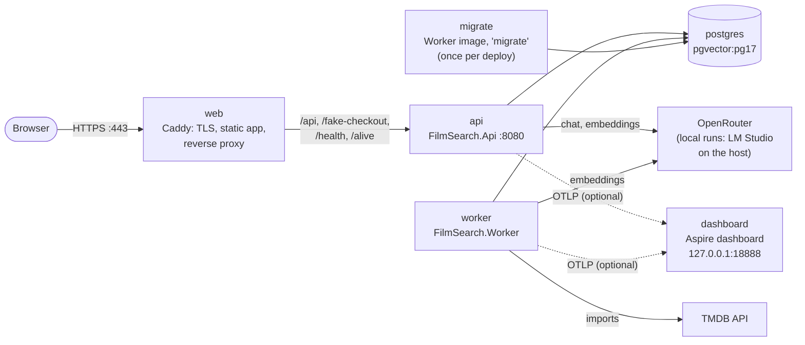

# Operator guide

> [Docs](../README.md) › [Handbook](README.md) › Operator

For the person who runs FilmSearch: the environments, the demo stack, deploy and rollback, health, telemetry, the
metrics worth watching, what to do when something breaks, and how the spend on AI models is capped. Step-by-step
commands live in the [deploy runbook](../../deploy/README.md) and the [observability runbook](../runbooks/observability.md);
this page summarises them and points there. Every setting named here is in the [configuration reference](configuration.md).

**Contents:** [Environments](#environments) · [The demo stack](#the-demo-stack) ·
[Deploy, migrate, roll back](#deploy-migrate-roll-back) · [Health](#health) · [Telemetry](#telemetry) ·
[Metrics that matter](#metrics-that-matter) · [Incident playbooks](#incident-playbooks) · [Cost control](#cost-control) ·
[Secrets](#secrets)

## Environments

| | Development | Demo |
|---|---|---|
| Started by | `dotnet run --project src/FilmSearch.AppHost` (Aspire, [local setup](local-setup.md#run)) | `deploy/deploy.sh <tag>` (Docker Compose, [deploy runbook](../../deploy/README.md)) |
| Settings | `appsettings.json` + `appsettings.Development.json`, user secrets | `appsettings.json` + `appsettings.Demo.json`, environment variables from `deploy/.env` |
| Migrations | On startup (`Database:MigrateOnStartup: true`, API and Worker, under an advisory lock) | A one-off `migrate` container before the new version starts (`Database:MigrateOnStartup: false`) |
| Seed and embeddings | Seed loaded when the catalog is empty, reindex queued on startup | Same (`Catalog:Seed:LoadOnStartup`, `Search:Embeddings:IndexOnStartup` are on in Demo too) |
| AI | LM Studio (`local` profiles) | OpenRouter (`openrouter` profiles); `CHAT_PROFILE=local` / `EMBEDDING_PROFILE=local` use LM Studio on the Docker host |
| Payments | Fake gateway (Stripe test mode as an option) | Fake gateway by default, Stripe test mode with `PAYMENTS_PROVIDER=Stripe` |
| Prompt text in traces | On (`AI:EnableSensitiveData: true`) | Off |
| Rate limits, budgets | Defaults (chat 20/min, search 60/min; 300k tokens per conversation, 1M per owner and day) | Lower (chat 10/min, search 30/min; 100k, 200k, and 5M tokens a day for the whole service) |
| Telemetry | Aspire dashboard, optional Langfuse | Optional standalone Aspire dashboard (`COMPOSE_PROFILES=dashboard`) |

**Why `Demo` and not `Production`.** The fake payment gateway refuses to start in `Production`
(`CommerceModule`: "The Fake payment gateway must not run in Production. Set Payments:Provider to Stripe."). A public
demo must still let a visitor "buy" without a card. `Demo` is not `Development`, so ASP.NET Core gives production
behavior (no OpenAPI endpoint, HSTS, no prompt content in logs or traces, no user secrets), while the fake gateway stays
allowed ([spec 10 §6](../spec/10-ops-security.md#6-deployment-i20), [ADR-0012](../adr/0012-deployment-docker-compose-vps.md)).
A real `Production` environment would need Stripe (test mode only: live keys are refused at startup).

## The demo stack

| Service | Image | Notes |
|---|---|---|
| `postgres` | `pgvector/pgvector:pg17` | Volume `postgres-data`; health check `pg_isready` |
| `migrate` | `<IMAGE_PREFIX>-worker:<tag>` with command `migrate` | Applies pending migrations and exits; `api` and `worker` wait for it ([ADR-0012](../adr/0012-deployment-docker-compose-vps.md)) |
| `api` | `<IMAGE_PREFIX>-api:<tag>` (chiseled .NET, non-root, no shell) | Port 8080 inside the network; volume `dataprotection-keys` at `/var/lib/filmsearch/keys` |
| `worker` | `<IMAGE_PREFIX>-worker:<tag>` | Background jobs (TMDB import, embedding reindex), order expiry |
| `web` | `<IMAGE_PREFIX>-web:<tag>` (Caddy 2.11 with the Vite build) | Ports `HTTP_PORT` (80) and `HTTPS_PORT` (443, TCP and UDP); volumes `caddy-data`, `caddy-config` |
| `dashboard` | `mcr.microsoft.com/dotnet/aspire-dashboard:13.6` | Only with `COMPOSE_PROFILES=dashboard`; loopback only, open through an SSH tunnel |

The compose project is named `filmsearch`, so `docker compose ps` in `deploy/` and `docker ps --filter name=filmsearch`
find everything. Files: [compose.yaml](../../deploy/compose.yaml), [compose.build.yaml](../../deploy/compose.build.yaml)
(build from source), [Caddyfile](../../deploy/Caddyfile), [.env.example](../../deploy/.env.example), Dockerfiles in
[deploy/docker/](../../deploy/docker/). Caddy proxies with `lb_try_duration 30s`: while the API restarts, requests wait
instead of failing with 502. Server requirements and the one-time setup (DNS, deploy user, GHCR access, the GitHub
environment `demo`): [deploy runbook, "Set up a server"](../../deploy/README.md#set-up-a-server-once).

## Deploy, migrate, roll back

**Release.** Pushing a tag `v*` runs the [release workflow](../../.github/workflows/release.yml): build the three images,
start the whole stack on the runner (no OpenRouter key there: the API is `Degraded` and search is keyword only), run the
Playwright smoke tests (`src/web/e2e`), push the images to GHCR, and, when the GitHub environment `demo` has
`DEPLOY_HOST`, copy `compose.yaml` and the scripts to the server, run `./deploy.sh <tag>` over SSH and run the smoke
tests against `DEMO_URL`. A manual run (`workflow_dispatch`) builds and tests; it pushes and deploys only with
`publish: true`. The ordinary [CI workflow](../../.github/workflows/ci.yml) runs build, format, tests and the web checks
on every push to `main`.

**`deploy.sh <tag>`** (on the server, in the deploy folder): pull the images (skipped with `SKIP_PULL=1`) → start
`postgres` → `backup.sh` → `docker compose run --rm migrate` → `docker compose up -d --remove-orphans` → poll
`http://api:8080/health` through the `web` container for up to 5 minutes. `Healthy` or `Degraded` (with a warning)
counts as success: the tag is written to `.env` and a line to `deploy-history.log`. On failure the script prints the
rollback command.

**Migrations** run while the old version still serves requests, so they must be expand / contract: add columns and
tables first, stop using and drop them in a later release. Then a rollback never needs a restore. Migrations are named
after the iteration (`I19_AddMessageFallback`) and live in `src/FilmSearch.Infrastructure/Persistence/Migrations`.

**Rollback** ([runbook](../../deploy/README.md#rollback)):

| Situation | Command |
|---|---|
| Code only, or only backward-compatible migrations in between | `./deploy.sh <previous tag>` (tags are in `deploy-history.log`; every release stays in GHCR) |
| A migration the old version cannot run on | `./restore.sh backups/filmsearch-<time>.dump <previous tag>`: drops and recreates the database from the dump, then runs `deploy.sh`. Data written after the dump is lost |

EF Core `Down` migrations are not written or tested: the dump is the supported way back.

**Backups.** `backup.sh` writes `backups/filmsearch-<UTC time>.dump` (`pg_dump --format=custom`) and keeps the last 10.
`deploy.sh` runs it before every migration; run it by hand before risky work and copy `backups/` off the server.

## Health

| Endpoint | Meaning | Used by |
|---|---|---|
| `GET /alive` | Liveness: only the `self` check | Caddy's upstream health check (`health_uri /alive`, every 5 s) |
| `GET /health` | Readiness: every check, including the database (Npgsql DbContext check) and the AI providers | `deploy.sh`, the release workflow, the AppHost (`WithHttpHealthCheck("/health")`) |

The answer is only the status text: `Healthy`, `Degraded` or `Unhealthy` (HTTP 503). The AI checks
(`AiProviderHealthCheck`, tag `ai`) read the model list of the active chat and embedding profiles
(`GET {Endpoint}{ModelsPath}`) and report **Degraded**, never Unhealthy: the store works without AI. A down database
makes `/health` Unhealthy. Health probes are left out of the traces. Health is mapped in every environment.

## Telemetry

- **Development:** the Aspire dashboard (login URL in the AppHost console) has logs, traces and metrics of the API and
  the Worker. Optional Langfuse (six containers, `Langfuse:Enabled=true` in the AppHost user secrets) gets only the AI
  traces and the users' ratings as scores ([local setup](local-setup.md#observability)).
- **Demo:** telemetry is exported only when `OTEL_EXPORTER_OTLP_ENDPOINT` is set. With `COMPOSE_PROFILES=dashboard` and
  `OTEL_EXPORTER_OTLP_ENDPOINT=http://dashboard:18889` the standalone dashboard runs on the server's loopback; open it
  with `ssh -L 18888:127.0.0.1:18888 <host>` (the login token is in `docker compose logs dashboard`). It keeps data in
  memory only. Container logs: `docker compose logs -f api worker` (Caddy logs JSON to stdout).
- **What is exported** (ServiceDefaults): ASP.NET Core, HttpClient, runtime and Npgsql instrumentation; the meters
  `FilmSearch`, `FilmSearch.AI`, `Polly` and `Microsoft.AspNetCore.RateLimiting`; the activity sources `FilmSearch`
  (search stages) and `FilmSearch.AI` (GenAI spans of every model call, the agent turn, tools).
- **One chat turn is one trace**, and every answer stores its trace id (`assistant.messages.trace_id`): a thumbs-down,
  a support ticket or a budget warning leads to the exact model calls, tools and SQL. How to find a slow, expensive or
  badly rated turn: [observability runbook](../runbooks/observability.md#find-a-turn).

## Metrics that matter

All custom metrics are on the meter `FilmSearch` ([spec 10 §3](../spec/10-ops-security.md#3-observability)).

| Metric | Tags | Watch for |
|---|---|---|
| `assistant.turns` | `outcome`, `prompt` | Share of `outcome != answered`: `providerUnavailable`, `budgetExceeded`, `dailyBudgetExceeded`, `serviceBudgetExceeded`, `toolsNotSupported`, `conversationBusy`, `internalError` (`cancelled` = the user pressed Stop) |
| `assistant.turn.duration` | `outcome`, `prompt` | p95 growing: a slow model or provider |
| `assistant.tool_calls` | `tool`, `ok` | `ok=false` rising: tools failing or the model sending bad arguments |
| `assistant.iteration_limit_hits` | `prompt` | Non-zero: the model loops on tools |
| `assistant.grounding_violations`, `assistant.grounding.titles` | `prompt`, `grounded` | Answers naming movies no tool returned |
| `assistant.feedback` | `rating` | Share of `down` |
| `ai.tokens`, `ai.cost_usd` | `model`, `profile`, `operation`, `direction` | Spend per model, profile and kind of call (`operation`: `chat`, `chat_stream`, `embeddings`) |
| `ai.fallbacks` | `from`, `to`, `operation` | The active chat profile failed and the fallback answered (paid, if it is a cloud model) |
| `search.requests`, `search.latency` | `mode`, `understand`, `degraded` | `degraded=true`: the embedding provider is down and semantic / hybrid fell back to keyword |
| `cache.lookups`, `cache.entries` | `cache`, `result` | Hit rate of `query_embedding` and `query_understanding`; every miss is a model call |
| `payments.webhooks` | `provider`, `type`, `result` | `rejected` (bad signature), `error` (processing failed, the provider retries) |
| `orders.status_changes` | `from`, `to` | Orders created but never reaching `paid` |
| `resilience.polly.strategy.events` (meter `Polly`) | `pipeline.name`, `event.name` | `OnRetry`, `OnCircuitOpened`, `OnTimeout` per AI profile and for payments |
| `aspnetcore.rate_limiting.requests` | policy, result | Requests refused by the rate limits |

The GenAI metrics `gen_ai.client.token.usage` and `gen_ai.client.operation.duration` (meter `FilmSearch.AI`) come from
Microsoft.Extensions.AI. There is no metric for the job queue: read the table `ingestion.jobs` or `GET /api/admin/jobs`.

## Incident playbooks

**AI provider down (LM Studio or OpenRouter).** *Symptoms:* `/health` is `Degraded`; `search.requests{degraded=true}`;
the chat ends turns with `providerUnavailable`; `OnCircuitOpened` in the Polly events. *What happens by design*
([ADR-0011](../adr/0011-ai-resilience-and-fallback.md)): each profile retries only failures that did not reach the
model (connection errors, 429, 502–504; never timeouts or 500), and after half of at least 3 attempts in a minute fail
its circuit opens for `CircuitBreakSeconds` (30), so calls fail at once instead of waiting. Search returns keyword
results with `degraded: true` (cached query vectors stay semantic). *Actions:* LM Studio: `lms ps`; a hung queue is
cleared with `lms unload --all` and loading the model again; on battery power a laptop runs the model on the CPU and
calls time out. OpenRouter: check its status and the key's credit (below). To keep the chat answering, set
`AI:FallbackChatProfile` to another profile with tools and a key; its answers are marked in the UI and counted in
`ai.fallbacks`. There is no embedding fallback: vectors of another model are not comparable with the stored ones.

**Budget exhausted.** *Symptoms:* turns end with `budgetExceeded` (one conversation), `dailyBudgetExceeded` (one owner,
last 24 hours) or `serviceBudgetExceeded` (the whole service, Demo). The checks run before any model call, and a
warning log names the budget. *Actions:* this is the cap working. Look for one abusive owner
(`assistant.conversations` by tokens, [runbook](../runbooks/observability.md#find-a-turn)); raise `Assistant:*` limits
only with the product owner. If OpenRouter itself refuses (the key's credit limit), every chat turn fails with
`providerUnavailable` and search runs without query understanding.

**Database down.** *Symptoms:* `/health` Unhealthy (503), API requests fail with 500, the Worker logs "Could not claim
a job; retrying after the poll interval". *Actions:* Demo: `docker compose ps postgres`, `docker compose logs postgres`,
`docker compose up -d postgres`; disk full is the usual cause (`docker image prune -a`, old dumps in `backups/`). Local:
the container `filmsearch-postgres` is persistent and keeps running after the AppHost stops; `docker start
filmsearch-postgres`. Data is lost only if the volume is deleted; restore with `restore.sh` from the last dump.

**Job queue stuck.** Jobs are rows of `ingestion.jobs` ([ADR-0009](../adr/0009-job-queue-in-postgresql.md)): `Queued →
Running → Succeeded / Failed / Cancelled`, one active (queued or running) job per kind. *Check:* `GET /api/admin/jobs`
or `SELECT id, kind, state, attempts, worker_id, heartbeat_at, error FROM ingestion.jobs ORDER BY queued_at DESC LIMIT 20;`.
*Cases:* jobs stay `Queued` → the Worker is not running (`docker compose ps worker`, `docker compose restart worker`).
A job `Running` with an old `heartbeat_at` → its worker died; after `Jobs:LeaseSeconds` (60) another worker claims it
again, up to `Jobs:MaxAttempts` (3), then it fails. A new import returns the existing job instead of queuing → one is
still active; cancel it with `POST /api/admin/jobs/{id}/cancel`. A reindex that fails at once → the embedding provider
is down (see above); the next start or `POST /api/admin/embeddings/reindex` catches up.

**Rate limit spikes.** *Symptoms:* `aspnetcore.rate_limiting.requests` with rejected results; clients get 429 Problem
Details with `code: "rateLimited"` and `Retry-After`. Limits are token buckets: chat per owner, new conversations and
search per client IP (`RateLimiting:*`). Behind Caddy the client IP comes from `X-Forwarded-For`
(`ASPNETCORE_FORWARDEDHEADERS_ENABLED=true` in compose); if every client is limited together, the forwarded headers are
not applied. Raise the limits in config only after checking that the traffic is real.

**Stripe webhooks failing.** *Symptoms:* orders stay `PendingPayment` and expire after `Commerce:PaymentTimeoutMinutes` (30);
`payments.webhooks{result=rejected}` (signature check failed) or `{result=error}` (processing threw, Stripe retries).
*Actions:* `rejected` → `STRIPE_WEBHOOK_SECRET` does not match the endpoint `https://<host>/api/payments/webhooks/stripe`
in the Stripe dashboard (locally: the secret of `stripe listen`). `error` → read the API log for the event. Events can
be replayed with `stripe events resend evt_…`; processing is idempotent, an order is never paid twice. Startup fails if
`Payments:Provider` is `Stripe` without `Stripe:SecretKey` / `Stripe:WebhookSecret` or with a live key.

**Everybody signed out after a deploy.** The data protection keys that sign the auth cookie must survive restarts:
`DataProtection:KeysPath` (`/var/lib/filmsearch/keys`, the volume `dataprotection-keys`). Check that the volume exists.

## Cost control

Three layers, from the outside in ([local setup, "Spending limits"](local-setup.md#demo-environment),
[guide 13](../guide/13-observability-and-cost.md)):

1. **The provider key.** The demo's OpenRouter key is its own, with a credit limit (e.g. $5): a hard cap that does not
   depend on the app.
2. **Token budgets** (`Assistant:*`): per conversation (`MaxConversationTokens`), per owner over 24 hours
   (`MaxOwnerTokensPerDay`) and for the whole service over 24 hours (`MaxTotalTokensPerDay`, 0 = off; 5M in Demo, about
   $0.2–0.3 a day with the default model). They count the tokens stored with answers. Query understanding in search is
   not in these budgets; it is cached for a day per query and rate limited.
3. **Rate limits and caches:** `RateLimiting:*`, the query vector and query understanding caches (`AI:QueryEmbeddingCache*`,
   `Search:QueryUnderstanding:Cache*`).

Watch `ai.cost_usd` (estimated from `AI:Pricing`; a model without a price has no estimate) and the OpenRouter activity
page. Per conversation: `assistant.conversations.estimated_cost_usd`.

## Secrets

| Where | What |
|---|---|
| Development | User secrets of the API (shared by the Worker and the AI playground: `Auth:Admin:Password`, `AI:ChatProfiles:openrouter:ApiKey`, `Stripe:*`, `Tmdb:ApiKey`) and of the AppHost (the generated Postgres and Langfuse parameters) |
| Demo server | `deploy/.env` only (`chmod 600`): `POSTGRES_PASSWORD`, `ADMIN_PASSWORD`, `OPENROUTER_API_KEY`, `STRIPE_*`, `TMDB_API_KEY`. `compose.yaml` turns them into environment variables (`Section__Key`) |
| GitHub | Environment `demo`: `DEPLOY_SSH_KEY`, `DEPLOY_KNOWN_HOSTS` (secrets), `DEPLOY_HOST`, `DEPLOY_USER`, `DEPLOY_PATH`, `DEMO_URL`, `E2E_FAKE_PAYMENTS` (variables) |

Nothing secret is in the images (`.dockerignore` excludes `.env`; containers do not use user secrets) or in the
repository. Stripe accepts only `sk_test_…` keys. API keys are never logged, also not with `AI:LogRawHttp`. Full list
with the setting names: [configuration reference](configuration.md#how-to-set-a-value).

---

**See also:** [Administrator](administrator.md) · [Developer](developer.md) · [AI engineer](ai-engineer.md) ·
[Configuration reference](configuration.md) · [Product owner](product-owner.md) · [Customer](customer.md) ·
[Deploy runbook](../../deploy/README.md) · [Observability runbook](../runbooks/observability.md) ·
[Guide 13: Observability and cost](../guide/13-observability-and-cost.md) ·
[Guide 14: Resilience and shipping](../guide/14-resilience-and-shipping.md) ·
[Journal M5](../journal/m5-production-ready.md) · [Spec 10](../spec/10-ops-security.md) ·
[ADR-0011](../adr/0011-ai-resilience-and-fallback.md) · [ADR-0012](../adr/0012-deployment-docker-compose-vps.md)
