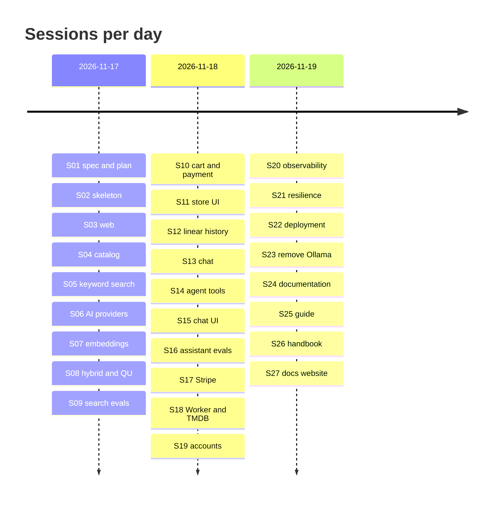

# Build journal: plan vs fact

> [Docs](../README.md) › Journal

The [roadmap](../plan/roadmap.md) says what was planned. This journal says what happened: what each iteration really
built, where it deviated from the plan, which problems came up and how they were solved, with links to the plan, the
session's prompts, the commit and the evaluation reports. It is written from the "Result" sections of the
[iteration plans](../plan/iterations/) and the [session logs](../prompts/README.md).

## In numbers

| | |
|---|---|
| Calendar time | 3 days, 2026-11-17 to 2026-11-19 |
| Sessions with a coding agent | 27 (Claude Code), some of them in parallel worktrees |
| Iterations | I00–I22 done (I21 is this documentation and its [website](https://gray0072.github.io/ai-rag-film-search/); I22 added the admin pages) |
| Architecture decisions | 12 [ADRs](../adr/README.md) |
| Evaluation reports | 30 in [evals/reports](../../evals/reports/) |
| Tests at the end of M5 | 524 .NET (375 unit, 149 integration with real PostgreSQL), 66 web, 6 Playwright smoke tests |
| Search quality, Recall@10 | keyword 0.30 → hybrid 0.87 (local model) → 0.93 (Qwen3 embeddings) |
| Assistant pass rate | 78% (Gemma 4 E4B, local), 92% (DeepSeek V4.1 Flash); 0 orders without the customer's click |

## Plan vs fact

| Milestone | Iteration | Planned sessions | Fact | Main deviation from the plan |
|---|---|---|---|---|
| [M1](m1-store-without-ai.md) | [I00 Preparation](m1-store-without-ai.md#i00--preparation) | 1 | S01 | English as the primary language |
| | [I01 Skeleton](m1-store-without-ai.md#i01--solution-skeleton-aspire-db-ci) | 1–2 | S02 | Swedish and a 1000-movie seed added to the scope |
| | [I02 Web skeleton](m1-store-without-ai.md#i02--web-skeleton) | 1 | S03 | OpenAPI document generated by the build, not fetched |
| | [I03 Catalog](m1-store-without-ai.md#i03--catalog-module-and-seed) | 1–2 | S04 | 34 hand-made movies until a TMDB key existed |
| | [I04 Keyword search](m1-store-without-ai.md#i04--keyword-search-and-filters) | 1 | S05 | A separate search document table instead of columns |
| | [I09 Cart and payment](m1-store-without-ai.md#i09--cart-orders-fake-payment) | 2 | S10 | Row locks in the webhook pipeline (found by a test) |
| | [I10 Store UI](m1-store-without-ai.md#i10--store-ui) | 2 | S11 | Strict JSON numbers in the API |
| [M2](m2-smart-search.md) | [I05 AI providers](m2-smart-search.md#i05--ai-provider-layer) | 1–2 | S06 | `ReasoningEffort` per profile; own retry pipeline |
| | [I06 Embeddings](m2-smart-search.md#i06--embeddings-and-semantic-search) | 2 | S07 | Untyped vector column, partial index per dimension |
| | [I07 Hybrid and QU](m2-smart-search.md#i07--hybrid-search-and-query-understanding) | 2 | S08 | RRF k 20 and a down-weighted keyword list instead of k 60 |
| | [I08 Search evals](m2-smart-search.md#i08--search-evaluation-harness) | 1–2 | S09 | Fresh database per run; no default changed |
| [M3](m3-ai-assistant.md) | [I11 Chat](m3-ai-assistant.md#i11--chat-foundation) | 2 | S13 | Flat tool arguments; checked with OpenRouter |
| | [I12 Agent tools](m3-ai-assistant.md#i12--agent-tools-cart-checkout-confirmation) | 2 | S14 | Confirmation bound to a cart fingerprint, order only on the click |
| | [I13 Chat UI](m3-ai-assistant.md#i13--chat-ui) | 2 | S15 | Fixed an owner cookie race from I09 |
| | [I14 Assistant evals](m3-ai-assistant.md#i14--assistant-evaluation-and-guardrails) | 2 | S16 | No off-topic classifier (not needed by the numbers) |
| [M4](m4-real-integrations.md) | [I15 Stripe](m4-real-integrations.md#i15--stripe-test-mode) | 1–2 | S17 | Ignored events answered 200; session lifetime rule |
| | [I16 Worker and TMDB](m4-real-integrations.md#i16--tmdb-sync-and-worker) | 2 | S18 | Job queue in PostgreSQL; embeddings inside the import job |
| | [I17 Accounts](m4-real-integrations.md#i17--authentication) | 1–2 | S19 | Own endpoints instead of `MapIdentityApi` |
| [M5](m5-production-ready.md) | [I18 Observability](m5-production-ready.md#i18--observability-and-cost-tracking) | 1 | S20 | Daily budget per owner added |
| | [I19 Resilience](m5-production-ready.md#i19--resilience-caching-rate-limiting) | 1 | S21 | Timeouts no longer retried; semantic search degrades |
| | [I20 Deployment](m5-production-ready.md#i20--containers-and-deployment) | 1–2 | S22, S23 | No public URL yet; migrations by the Worker; Ollama removed |
| M6 | [I21 Documentation](../plan/iterations/I21-documentation.md) | 3–4 | S24–S27 | Writing against the code found stale facts in specs and runbooks; reference pages got navigation too |
| | [I22 Admin UI](../plan/iterations/I22-admin-ui.md) | — (unplanned) | S28 | Follow-ups of I21: admin pages instead of `curl`, search defaults as a setting, image labels |

Every iteration of M1–M5 took one session (I20 had a short follow-up), at the low end of the estimate; I21, documentation only, took the planned four. The estimate assumed a person; the agents
wrote, tested and documented an iteration in a few hours. The time went into decisions, reviews and manual checks.

## Tests over time

| After | I01 | I03 | I04 | I06 | I07 | I09 | I11 | I12 | I14 | I16 | I17 | I18 | I19 | I20 |
|---|---|---|---|---|---|---|---|---|---|---|---|---|---|---|
| .NET tests | 10 | 81 | 123 | 189 | 231 | 321 | 349 | 374 | 402 | 459 | 469 | 483 | 516 | 524 |

## Problems and solutions

Every problem below is described in its iteration with the cause and the fix. Grouped by kind, so similar problems
can be found together.

### AI models and prompts
- Thinking models were slow and worse at JSON → `ReasoningEffort: None` per profile ([I05](m2-smart-search.md#i05--ai-provider-layer))
- Small models invented movie facts → facts only from the database ([I05](m2-smart-search.md#i05--ai-provider-layer))
- Bare titles read as "movies like X"; guessed genres hid good matches → prompt v2, genres only on request ([I07](m2-smart-search.md#i07--hybrid-search-and-query-understanding))
- "Buy it" only added to the cart → explicit sales rules in the prompt ([I12](m3-ai-assistant.md#i12--agent-tools-cart-checkout-confirmation), [I14](m3-ai-assistant.md#i14--assistant-evaluation-and-guardrails))
- The model passed titles as ids and asked the user for "the ID" → tool errors that say how to get an id ([I14](m3-ai-assistant.md#i14--assistant-evaluation-and-guardrails))
- Chat templates that need alternating roles → unanswered messages joined with the next one ([I11](m3-ai-assistant.md#i11--chat-foundation), [I14](m3-ai-assistant.md#i14--assistant-evaluation-and-guardrails))

### Retrieval quality
- Long queries matched nothing in full-text search → any-word fallback ([I04](m1-store-without-ai.md#i04--keyword-search-and-filters))
- `ё` vs `е` → folding in documents and queries ([I04](m1-store-without-ai.md#i04--keyword-search-and-filters))
- English-only embeddings found 0 of 12 Russian queries → a multilingual model ([I06](m2-smart-search.md#i06--embeddings-and-semantic-search))
- HNSW returned too few rows after a bulk insert → `VACUUM (ANALYZE)` after reindex ([I06](m2-smart-search.md#i06--embeddings-and-semantic-search))
- Plain RRF made hybrid worse than semantic → k 20 and a weight for the relaxed keyword list ([I07](m2-smart-search.md#i07--hybrid-search-and-query-understanding))
- Catalog growth looked like a quality drop → relevant new movies missing from the golden set ([I16](m4-real-integrations.md#i16--tmdb-sync-and-worker))

### Evaluation
- Runs on the dev database were not comparable → a fresh container per run ([I08](m2-smart-search.md#i08--search-evaluation-harness))
- Recall capped by the number of relevant movies → Recall@k over min(relevant, k) ([I08](m2-smart-search.md#i08--search-evaluation-harness))
- Dataset patterns and the grounding check flagged correct answers → read every failure, fix the dataset ([I14](m3-ai-assistant.md#i14--assistant-evaluation-and-guardrails))
- Parallel evaluation overflowed LM Studio's context; the judge hit rate limits → load settings, throttled judge ([I14](m3-ai-assistant.md#i14--assistant-evaluation-and-guardrails))

### Concurrency and data integrity
- Parallel processes migrating one database → advisory lock ([I03](m1-store-without-ai.md#i03--catalog-module-and-seed))
- Two success events both "applied"; parallel rentals → row locks, rules checked earlier ([I09](m1-store-without-ai.md#i09--cart-orders-fake-payment))
- The first page load created several anonymous owners → one first call, the rest wait ([I13](m3-ai-assistant.md#i13--chat-ui))
- Parallel tool calls on one `DbContext` → run in order ([I12](m3-ai-assistant.md#i12--agent-tools-cart-checkout-confirmation))
- A killed Worker left a job running → leases, heartbeats, re-claim ([I16](m4-real-integrations.md#i16--tmdb-sync-and-worker))
- Data owned by an anonymous visitor in several modules → one merge transaction with a handler per module ([I17](m4-real-integrations.md#i17--authentication))

### Reliability and operations
- A 10 s HTTP timeout cut local generation → per-profile timeout ([I05](m2-smart-search.md#i05--ai-provider-layer))
- Exhausted retries surfaced as 500 → provider failures map to 503 or a degraded result ([I06](m2-smart-search.md#i06--embeddings-and-semantic-search))
- Timed-out calls retried while the model still generated; POSTs to Stripe retried → retry rules per failure kind and method ([I19](m5-production-ready.md#i19--resilience-caching-rate-limiting))
- EF migration bundle failed in the container → `migrate` command of the Worker ([I20](m5-production-ready.md#i20--containers-and-deployment))
- Client IP and `Secure` cookies behind the proxy; sign-outs on every redeploy → forwarded headers, keys in a volume ([I20](m5-production-ready.md#i20--containers-and-deployment))
- Unlimited anonymous owners in a public demo → service-wide budget and a capped API key ([I20](m5-production-ready.md#i20--containers-and-deployment))

### Platform and tooling (.NET, Windows, CI)
- xUnit v3 and the .NET 10 test runner; EF Core version conflicts ([I01](m1-store-without-ai.md#i01--solution-skeleton-aspire-db-ci))
- Vitest and Vite broke with a lower-case drive letter on Windows ([I02](m1-store-without-ai.md#i02--web-skeleton), [I10](m1-store-without-ai.md#i10--store-ui)); so did the VitePress docs build, fixed with real paths ([I21](../../tools/docs-site/README.md#pitfalls))
- OpenAPI document differed between Windows and Linux (line endings) ([I04](m1-store-without-ai.md#i04--keyword-search-and-filters))
- Spans did not nest across an async iterator ([I11](m3-ai-assistant.md#i11--chat-foundation))
- Telemetry tests flaked because meters and spans are process-wide ([I06](m2-smart-search.md#i06--embeddings-and-semantic-search), [I18](m5-production-ready.md#i18--observability-and-cost-tracking))
- Two hosts with a public `Program`; a connection string without its password ([I16](m4-real-integrations.md#i16--tmdb-sync-and-worker))
- A refused `localhost` connection takes 2 s per attempt on Windows ([I19](m5-production-ready.md#i19--resilience-caching-rate-limiting))

### Security
- API keys in untracked files in the repository root → user secrets ([I04](m1-store-without-ai.md#i04--keyword-search-and-filters), [I05](m2-smart-search.md#i05--ai-provider-layer))
- A database password in an evaluation report → redacted ([I16](m4-real-integrations.md#i16--tmdb-sync-and-worker))
- Live Stripe keys → refused at startup ([I15](m4-real-integrations.md#i15--stripe-test-mode))
- Account enumeration; admin takeover by email → one error for both cases; role only with the configured password ([I17](m4-real-integrations.md#i17--authentication))
- The model could start a payment → it can only request one; the server binds the button to the cart ([I12](m3-ai-assistant.md#i12--agent-tools-cart-checkout-confirmation))

## What carried through the project

1. **Measure instead of trusting defaults.** RRF k = 60, "thinking is better", "more languages in the index is better"
   were all wrong for this data. Every AI change after I08 has a report.
2. **Safety lives in code, not in the prompt.** The model can request a checkout; only a person's click creates an
   order, and the button is bound to the exact cart the server showed.
3. **Read the failures.** Averages hid that half of the first assistant failures were bugs in the dataset or the check.
4. **Concurrency tests and browser checks find what unit tests do not.** Webhook races, migration races and the
   owner cookie race were all found that way.
5. **Spec first, and update it when it is wrong.** Almost every iteration changed the spec in the same commit, so the
   spec stayed the source of truth.
6. **Graceful degradation.** The store works without any AI: keyword search, a chat that says the model is off,
   health "Degraded" instead of "Unhealthy".

---

**Start reading:** [M1 Store without AI](m1-store-without-ai.md) · **See also:** [Roadmap](../plan/roadmap.md) ·
[Guide](../guide/README.md) · [Handbook](../handbook/README.md) · [Prompt history](../prompts/README.md)
