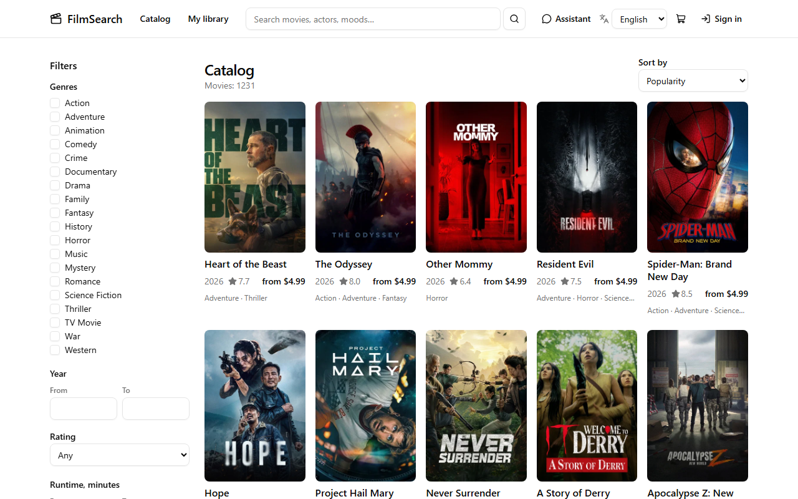

# M1 — Store without AI

> [Docs](../README.md) › [Journal](README.md) › M1 Store without AI

**Plan:** catalog, filters, keyword search, cart, fake payment and a React UI: a store that works before any AI is
added, so that later AI features have a baseline to beat. **Fact:** done on 2026-11-17 and 2026-11-18 in seven
sessions (S01–S05, S10, S11), plus one session (S12) that cleaned the git history.

| Iteration | Planned sessions | Fact | Commit | Tests after |
|---|---|---|---|---|
| [I00 Preparation](#i00--preparation) | 1 | S01 | [`0f459da`](https://github.com/gray0072/ai-rag-film-search/commit/0f459da) | — |
| [I01 Solution skeleton](#i01--solution-skeleton-aspire-db-ci) | 1–2 | S02 | [`96d2e52`](https://github.com/gray0072/ai-rag-film-search/commit/96d2e52) | 10 |
| [I02 Web skeleton](#i02--web-skeleton) | 1 | S03 | [`59674ff`](https://github.com/gray0072/ai-rag-film-search/commit/59674ff) | 10 + 7 web |
| [I03 Catalog and seed](#i03--catalog-module-and-seed) | 1–2 | S04 | [`35927a3`](https://github.com/gray0072/ai-rag-film-search/commit/35927a3) | 81 |
| [I04 Keyword search](#i04--keyword-search-and-filters) | 1 | S05 | [`c78b69b`](https://github.com/gray0072/ai-rag-film-search/commit/c78b69b) | 123 |
| [I09 Cart, orders, fake payment](#i09--cart-orders-fake-payment) | 2 | S10 | [`45d8dbd`](https://github.com/gray0072/ai-rag-film-search/commit/45d8dbd) | 321 |
| [I10 Store UI](#i10--store-ui) | 2 | S11 | [`5315493`](https://github.com/gray0072/ai-rag-film-search/commit/5315493) | 321 + 36 web |

---

## I00 — Preparation

[Plan](../plan/iterations/I00-preparation.md) · [Session S01](../prompts/sessions/2026-11-17_S01_preparation.md)

**Built:** no code. The [spec](../spec/00-overview.md) (eleven documents), the [roadmap](../plan/roadmap.md) with
twenty iterations in parallel waves, the first ADRs and [AGENTS.md](../../AGENTS.md), the rules every coding agent
follows.

**Plan vs fact:** English became the primary language of the project; Russian, and later Swedish, are supported in the
UI and in AI queries.

**Lesson:** writing the spec and the acceptance criteria first made every later session start from a clear "done".
Agents were told to update the spec when it turned out wrong, instead of silently deviating; that rule was used in
almost every iteration.

## I01 — Solution skeleton, Aspire, DB, CI

[Plan](../plan/iterations/I01-solution-skeleton.md) · [Session S02](../prompts/sessions/2026-11-17_S02_solution-skeleton.md)

**Built:** the .NET 10 solution (API, Core, Infrastructure, AI, AppHost, ServiceDefaults, two test projects), an
Aspire AppHost that starts PostgreSQL with pgvector in a persistent container, the first migration (extensions
`vector`, `pg_trgm`), health checks, Problem Details, an anonymous owner cookie, CI with Testcontainers.

**Plan vs fact:** the owner widened the scope during the session: Swedish as a third locale and a seed of about 1000
movies instead of 100. Nine spec documents, two ADRs and eight plans were updated in the same change.

| Problem | Cause | Solution |
|---|---|---|
| xUnit v3 tests did not run with `dotnet test` | The .NET 10 SDK no longer runs Microsoft.Testing.Platform tests through VSTest | `global.json` opts into the new test runner; no `Microsoft.NET.Test.Sdk` |
| Version conflict (MSB3277) between EF Core packages | Npgsql and Aspire pulled different transitive EF Core versions | Pin EF Core centrally in `Directory.Packages.props` |
| A namespace `Modules.System` broke compilation | It shadows the `System` namespace | The example module is `AppInfo` |
| FluentAssertions v8 needs a commercial license | License change of the library | Shouldly (MIT) |

## I02 — Web skeleton

[Plan](../plan/iterations/I02-web-skeleton.md) · [Session S03](../prompts/sessions/2026-11-17_S03_web-skeleton.md) ·
[ADR-0007](../adr/0007-frontend-stack.md)

**Built:** React 19 + TypeScript (strict) + Vite, shadcn/ui and Tailwind CSS v4, React Router, TanStack Query,
i18next with `en`, `ru`, `sv` and compile-time checked keys, a typed API client generated from the OpenAPI document,
the Vite app inside the Aspire AppHost, a web CI job.

**Plan vs fact:** the OpenAPI document is generated **by the API build**, not fetched from a running API: types can be
regenerated without a database, and CI catches contract drift by checking that the committed `v1.json` matches.

| Problem | Cause | Solution |
|---|---|---|
| TypeScript 7 could not be used | typescript-eslint and openapi-typescript support only 5.x | TypeScript 5.9; Dependabot ignores TS majors |
| Cookies and `Accept-Language` across origins | Browser on Vite's port, API on another | Vite dev proxy for `/api` instead of CORS |
| Vitest failed every file with "failed to find the current suite" | Windows working directory with a lower-case drive letter loads the runner twice | Run from `D:\…`; documented in AGENTS.md |

## I03 — Catalog module and seed

[Plan](../plan/iterations/I03-catalog-seed.md) · [Session S04](../prompts/sessions/2026-11-17_S04_catalog-seed.md) ·
[ADR-0003](../adr/0003-movie-data-source-tmdb.md)

**Built:** the catalog domain (movies, translations, genres, people, credits, offers), filters and sorting in SQL with
per-field English fallback, an idempotent writer (upsert by TMDB id, `SourceHash` skips unchanged movies), the seed
loader and an admin endpoint, `tools/seed-builder` for TMDB, 81 tests.

**Plan vs fact:** there was no TMDB key yet, so the seed was 34 hand-made movies; the builder was ready and the real
1000-movie seed arrived in I04. Prices are derived from vote count, not TMDB popularity (popularity changes daily, and
prices would change with every sync).

| Problem | Cause | Solution |
|---|---|---|
| Parallel test hosts failed migrating the same database | Two processes ran migrations at once (the same would happen with two API replicas) | A PostgreSQL session advisory lock around migrations |
| `sort=rating` returned 400 | Minimal APIs bind enum query parameters case-sensitively | Query enums are strings parsed case-insensitively; JSON enums are camelCase |
| Concurrent catalog writers | Two imports could insert the same movie | Transaction-level advisory lock per batch instead of retries on unique violations |

## I04 — Keyword search and filters

[Plan](../plan/iterations/I04-keyword-search.md) · [Session S05](../prompts/sessions/2026-11-17_S05_keyword-search.md) ·
[Guide: keyword search](../guide/04-keyword-search.md)

**Built:** the real seed (1000 TMDB movies; Russian titles for 976, Swedish for 483), a search document table with
weighted `tsvector` columns per language (`english`, `russian`, `swedish` configurations) and GIN indexes,
`POST /api/search` with the catalog filters, a debug view of the scores. p50 29 ms, p95 40 ms over 1000 movies.

**Plan vs fact:** the plan put `tsvector` columns on the movies table. A generated column can only read its own row,
and the texts live in four tables, so search got **its own document table** in the `search` schema, filled by a SQL
function in the same transaction as the catalog change (through an `ICatalogChangeHandler` hook that I06 reused for
embeddings).

| Problem | Cause | Solution |
|---|---|---|
| Longer queries found nothing | `websearch_to_tsquery` requires every word | If nothing matches all words, retry with any word (marked in debug, measured in I08) |
| "крестный отец" did not find «Крёстный отец» | TMDB writes `ё`, people type `е` | Fold `ё` → `е` in documents and queries |
| CI failed "OpenAPI document is up to date" | A multi-line doc comment became `\r\n` in `v1.json` on Windows and `\n` on Linux | Single-line doc comments on API types; rule in AGENTS.md |
| TMDB keys lay in files in the repository root (untracked) | Quick start of the seed builder | Moved to user secrets of the tool, files deleted |

**Lesson:** natural-language queries ("фильмы про мафию") barely match keyword search. That was expected and became
the number to beat: keyword Recall@10 was **0.30** on the golden set of I08.

## I09 — Cart, orders, fake payment

[Plan](../plan/iterations/I09-cart-orders-fake-payment.md) · [Session S10](../prompts/sessions/2026-11-18_S10_cart-orders-fake-payment.md) ·
[ADR-0004](../adr/0004-payment-gateway-abstraction.md) · [Spec 07](../spec/07-payments.md)

**Built:** cart, an `Order` aggregate with an explicit state machine, entitlements (owned or rented for 48 h), checkout
with an `Idempotency-Key`, a webhook pipeline with deduplication and row locks, a fake payment gateway inside the API
(hosted page, signed and delayed webhooks, switches for duplicates and out-of-order delivery), order expiry. 55 new
tests, among them 10 + 5 concurrent webhooks and time travel with `FakeTimeProvider`.

**Plan vs fact:** `IPaymentGateway` parses webhooks from a raw body and headers, so Core does not depend on ASP.NET
Core. The cart is kept until the payment succeeds, so a declined or cancelled payment does not lose it.

| Problem | Cause | Solution |
|---|---|---|
| Two different success events of one session could both report "applied" | Only the order's `xmin` row version protected the update | Lock the event row and the payment row (`FOR UPDATE`) in the webhook transaction (found by the concurrency test) |
| Two orders paid in parallel could both grant a rental | The rule was checked at payment time | Check "owned / rented" when adding to the cart and when creating the order |
| Waiting 30 minutes for order expiry in tests | Real time | `TimeProvider` everywhere; tests move a `FakeTimeProvider` |

## I10 — Store UI

[Plan](../plan/iterations/I10-store-ui.md) · [Session S11](../prompts/sessions/2026-11-18_S11_store-ui.md) ·
[Customer guide](../handbook/README.md#roles)

**Built:** catalog with filters in the URL, search with a mode switch, "understood" filter chips and debug scores,
movie page with similar movies, cart, checkout success and cancel pages, library; all text in three languages; an
ESLint rule that fails on hard-coded UI text. Scenario 1 of the spec walked through in a browser in English and
Russian.

| Problem | Cause | Solution |
|---|---|---|
| Blank page, "Invalid hook call" | With `d:\` (lower-case drive) Vite served `@/…` modules from `/@fs/d:/…` and loaded a second copy of React | `vite.config.ts` takes `root` and the alias from `fs.realpathSync.native` |
| Errors without a body looked like success to TanStack Query | An empty error response | A client middleware turns them into Problem Details |
| Generated TypeScript types were `number \| string` | ASP.NET Core allowed numbers as strings in JSON | `JsonNumberHandling.Strict`: the OpenAPI document says `integer` / `number` |

**Lesson:** the "understood" filters from the LLM are shown as chips the customer can remove. AI output that changes
results must be visible and reversible.

## S12 — Linear history

[Session S12](../prompts/sessions/2026-11-18_S12_linear-history.md)

The first two iterations went through pull requests and left merge commits. The owner decided to work directly on
`main` (one person, always green, checks run locally before every push), and `main` was rebased into a linear history
with the same final tree.

---

**Next:** [M2 Smart search](m2-smart-search.md) · **See also:** [Roadmap](../plan/roadmap.md) ·
[Guide](../guide/README.md) · [Handbook](../handbook/README.md)
