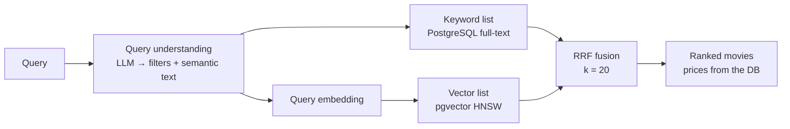

# M2 — Smart search

> [Docs](../README.md) › [Journal](README.md) › M2 Smart search

**Plan:** AI providers, embeddings, semantic and hybrid search, query understanding, and an evaluation harness that
measures them. **Fact:** done on 2026-11-17 and early 2026-11-18 in four sessions (S06–S09). This is where the store
learned to search by meaning, and where every later AI change got its numbers.

| Iteration | Planned sessions | Fact | Commit | Key number |
|---|---|---|---|---|
| [I05 AI provider layer](#i05--ai-provider-layer) | 1–2 | S06 | [`d727b31`](https://github.com/gray0072/ai-rag-film-search/commit/d727b31) | 11 chat and 2 embedding models benchmarked |
| [I06 Embeddings and semantic search](#i06--embeddings-and-semantic-search) | 2 | S07 | [`89a8518`](https://github.com/gray0072/ai-rag-film-search/commit/89a8518) | Plot query in top 3: keyword 9/36 → semantic 32/36 |
| [I07 Hybrid search and query understanding](#i07--hybrid-search-and-query-understanding) | 2 | S08 | [`56c0fea`](https://github.com/gray0072/ai-rag-film-search/commit/56c0fea) | Hybrid MRR@10 on Russian plots 0.76 → 0.92 after tuning |
| [I08 Search evaluation harness](#i08--search-evaluation-harness) | 1–2 | S09 | [`15e0274`](https://github.com/gray0072/ai-rag-film-search/commit/15e0274) | Recall@10: keyword 0.30, semantic 0.87, hybrid 0.87 |

---

## I05 — AI provider layer

[Plan](../plan/iterations/I05-ai-providers.md) · [Session S06](../prompts/sessions/2026-11-17_S06_ai-providers.md) ·
[ADR-0002](../adr/0002-ai-abstraction-meai.md) · [Model benchmark](../../evals/reports/2026-11-17_I05_model-benchmark.md)

**Built:** named AI profiles in configuration (endpoint, model, temperature, reasoning effort, retries, timeout,
prices), registered as `IChatClient` and `IEmbeddingGenerator` from Microsoft.Extensions.AI; a pipeline with
OpenTelemetry GenAI spans, token and cost metrics and logging; raw HTTP logging for "look at the wire"; health checks
that report *Degraded*, not *Unhealthy*, without LM Studio; `tools/ai-playground` with chat, stream, tools, JSON and
embedding commands and a model benchmark.

**The benchmark** chose the defaults: chat `google/gemma-4-e4b` locally (tools 10/10, JSON 10/10, ~48 tokens/s) and
`deepseek/deepseek-v4.1-flash` on OpenRouter; embeddings `text-embedding-embeddinggemma-300m` (768 dimensions, 20–30 ms
per query, Russian 10/10, Swedish 8/10 top-1).

| Problem | Cause | Solution |
|---|---|---|
| Gemma 4 thought for seconds before every answer, and its JSON got worse | Thinking models reason unless told not to | Profile setting `ReasoningEffort: None` → `reasoning_effort` on the wire; thinking on was 6.6× slower |
| Local generation was cut after 10 s | The standard resilience handler of every HTTP client has a 10 s attempt timeout | The AI HTTP client drops that handler and uses per-profile retries and timeout |
| Small models (2–4B) invented movie facts in free answers | Model size | They are fine for tools and JSON, never as a source of facts; facts come from the DB (rule in AGENTS.md) |
| Stripe and OpenRouter keys lay in files in the repository root (untracked) | Quick setup | Moved to user secrets, files deleted |

**Lesson:** measure models on your own tasks. Leaderboards did not predict that a 4B model would call tools perfectly
but must not be trusted with facts.

## I06 — Embeddings and semantic search

[Plan](../plan/iterations/I06-embeddings-semantic-search.md) · [Session S07](../prompts/sessions/2026-11-17_S07_embeddings-semantic-search.md) ·
[ADR-0008](../adr/0008-vector-storage-per-dimension.md) · [Experiments](../../evals/reports/2026-11-17_I06_semantic-search-experiments.md)

**Built:** a movie embedding text (title, year, genres, director, cast, keywords, tagline, overview; versioned
`movie-profile-v1`), vectors in `search.movie_embeddings` with a content hash so only changed movies are re-embedded,
an untyped `vector` column with **one partial HNSW index per dimension** (several models side by side), semantic
search with SQL pre-filtering, similar movies, admin endpoints for the index, a background reindex job. The whole
seed embeds in 27 s.

**Results on 36 plot queries** (12 movies × en / ru / sv, expected movie in the top 3): keyword 4 / 4 / 1, semantic
12 / 12 / 8. "a heist inside dreams" → Inception #1. An English-only model (nomic-embed-text) found 0 of 12 Russian
queries: a multilingual model is not optional for this store.

| Problem | Cause | Solution |
|---|---|---|
| HNSW returned 4.8 of 10 rows at low `ef_search`, the planner estimated 1 row | Dead graph entries and no statistics after a bulk insert | `VACUUM (ANALYZE)` after every reindex |
| Filters could remove most of the approximate top-k | Post-filtering an HNSW result | Pre-filter in SQL and `hnsw.iterative_scan = relaxed_order` |
| The planner ignored the HNSW index | At 1000 rows the planner *estimates* the exact scan as cheaper (cost ≈ 460–600 vs ≈ 1640), although HNSW is faster (0.22 vs 3.5 ms per query, recall 1.000 both) | Accepted: both are far below the 20–30 ms of embedding the query; a plan test forces the index to check the query shape |
| Admin chat answered 500 instead of 503 with LM Studio off | The OpenAI client wraps exhausted retries in `AggregateException` | Shared `IsProviderFailure` check for chat and embeddings |
| A telemetry test failed only in CI | It collected spans of the whole process, and a parallel test added its own | Tests keep only spans of their own trace |

**Lesson:** the vector index is the easy part. The embedded *text*, the model's languages, and keeping vectors in
sync with the catalog decide the quality. See the guide's advanced chapters for the storage and index choices.

## I07 — Hybrid search and query understanding

[Plan](../plan/iterations/I07-hybrid-query-understanding.md) · [Session S08](../prompts/sessions/2026-11-17_S08_hybrid-query-understanding.md) ·
[Report](../../evals/reports/2026-11-17_I07_hybrid-and-query-understanding.md)

**Built:** hybrid search as the default mode (keyword and vector candidates fused with weighted Reciprocal Rank
Fusion), keyword-only results with `degraded: true` when embeddings fail; LLM query understanding with a versioned
prompt and a JSON Schema generated from a C# record (genre enum added at run time), validation, one retry with the
error, then a fallback; "movies like X" through averaged vectors; a cache per normalized query.

| Mode (MRR@10, 46 manual queries) | en plots | ru plots | sv plots | titles, names |
|---|---|---|---|---|
| keyword | 0.15 | 0.22 | 0.11 | 0.95 |
| semantic | 0.87 | 0.78 | 0.74 | 0.83 |
| hybrid as in the spec (k 60, weights 1 / 1) | 0.51 | 0.76 | 0.43 | 1.00 |
| **hybrid tuned (k 20, relaxed keyword list 0.1)** | **0.87** | **0.92** | **0.74** | **1.00** |

| Problem | Cause | Solution |
|---|---|---|
| Plain RRF made hybrid *worse* than semantic on plot descriptions | The keyword list for a description is mostly noise from the "any word" fallback, and RRF trusts every list equally | Weight 0.1 for a relaxed keyword list, k = 20 (spec updated) |
| "the godfather" excluded The Godfather itself | Prompt v1 read bare titles as "movies like X" | Prompt v2; v1 kept for comparison |
| The spec example guessed `science-fiction` for "time travel" | A guessed genre becomes a hard filter and hides good matches | Genres only when the user asks for them (spec updated) |
| Filter words ("90-х", "рейтинг") polluted full-text search | The raw query went to the keyword retriever | Keyword search uses the semantic text from QU |
| A provider outage stuck in the cache | Fallback results were cached | Only valid results are cached |

**Lesson:** a textbook default (RRF k = 60) was wrong for this data. Fusion parameters are a measurement, not a
constant.

## I08 — Search evaluation harness

[Plan](../plan/iterations/I08-search-evaluation.md) · [Session S09](../prompts/sessions/2026-11-17_S09_search-evaluation.md) ·
[Evaluations](../../evals/README.md) · [Baseline report](../../evals/reports/2026-11-17_search_baseline.md)

**Built:** `evals/FilmSearch.Evals`, a runner that uses the API's own configuration and registrations, starts a fresh
pgvector container per run, loads and embeds the seed, and writes a markdown + JSON report with the commit, dataset
version, models, prompts and parameters. Golden sets: 105 search queries (35 per language; plot, person, title typo,
cross-language, mood, constraint, negative) and 40 query-understanding queries, validated against the seed in CI.

| Mode | Recall@10 | MRR@10 | nDCG@10 | Excluded-genre rate | p50 |
|---|---|---|---|---|---|
| keyword | 0.296 | 0.251 | 0.233 | 0.100 | 61 ms |
| semantic | 0.865 | 0.794 | 0.784 | 0.171 | 58 ms |
| hybrid (default) | 0.873 | 0.788 | 0.786 | 0.171 | 78 ms |
| hybrid + QU | 0.862 | 0.820 | 0.805 | **0.000** | 3865 ms |

Five one-parameter experiments followed ([RRF k 60](../../evals/reports/2026-11-17_search_hybrid-rrf-k60.md),
[k 10](../../evals/reports/2026-11-17_search_hybrid-rrf-k10.md), [keyword weight 0.5](../../evals/reports/2026-11-17_search_hybrid-keyword-weight-0.5.md),
[0.3](../../evals/reports/2026-11-17_search_hybrid-keyword-weight-0.3.md), [vectors in three languages](../../evals/reports/2026-11-17_search_vectors-en-ru-sv.md)).
k = 60 was clearly worse (MRR 0.732); nothing else beat the default by more than one query, so **no default changed**.
Query understanding: valid JSON 100%, exact match 83% ([report](../../evals/reports/2026-11-17_qu_baseline.md)).

| Problem | Cause | Solution |
|---|---|---|
| Runs on the dev database were not comparable | It held hand-added movies and other models' vectors | A fresh container per run (≈ 45 s) |
| Recall@5 capped at 0.5 for a director with 10 movies | Plain recall divides by all relevant | Recall@k divided by min(relevant, k) |
| Catalog ids differ between databases | GUIDs are generated | Golden sets reference TMDB ids |
| The model returned «Матрица» for «похожие на Матрицу» | Russian inflection | A crude stem in title matching |

**Lesson:** QU removed every ruled-out genre (0.171 → 0.000) at the cost of ~4 s on a local model. Numbers like this
turn "should we use the LLM here?" into a product decision (see [I19](m5-production-ready.md#i19--resilience-caching-rate-limiting)).

---

**Previous:** [M1 Store without AI](m1-store-without-ai.md) · **Next:** [M3 AI sales assistant](m3-ai-assistant.md) ·
**See also:** [Guide: retrieval, ch. 4–8](../guide/04-keyword-search.md) · [Evaluation reports](../../evals/reports/)
