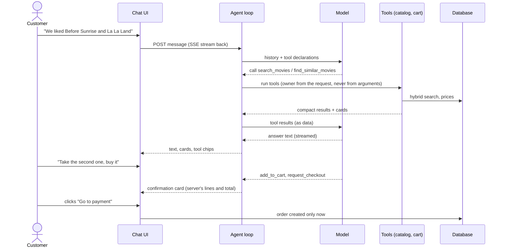
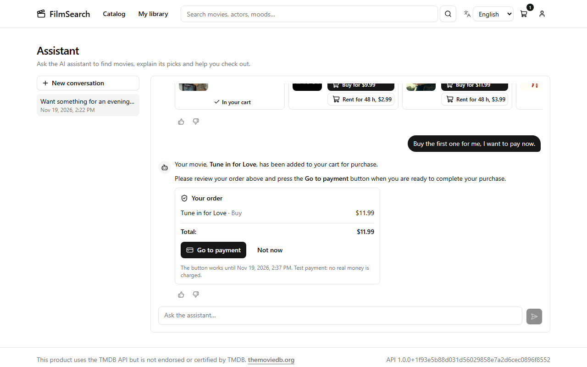

# M3 — AI sales assistant

> [Docs](../README.md) › [Journal](README.md) › M3 AI sales assistant

**Plan:** a chat that finds movies in the catalog, explains its picks, fills the cart and leads to checkout with an
explicit confirmation; a chat UI; evaluations and guardrails for it. **Fact:** done on 2026-11-18 in four sessions
(S13–S16). The assistant went from "answers grounded in one search" to a measured sales agent with seven tools.

| Iteration | Planned sessions | Fact | Commit | Key number |
|---|---|---|---|---|
| [I11 Chat foundation](#i11--chat-foundation) | 2 | S13 | [`7659d65`](https://github.com/gray0072/ai-rag-film-search/commit/7659d65) | Answers only from tool results, 349 tests |
| [I12 Agent tools](#i12--agent-tools-cart-checkout-confirmation) | 2 | S14 | [`ecdfd36`](https://github.com/gray0072/ai-rag-film-search/commit/ecdfd36) | 7 tools, no order without a click |
| [I13 Chat UI](#i13--chat-ui) | 2 | S15 | [`bb6b3b2`](https://github.com/gray0072/ai-rag-film-search/commit/bb6b3b2) | 20 new web tests, an owner cookie race from I09 found |
| [I14 Evaluation and guardrails](#i14--assistant-evaluation-and-guardrails) | 2 | S16 | [`4b9bc08`](https://github.com/gray0072/ai-rag-film-search/commit/4b9bc08) | Pass rate 63% → 78% (Gemma), 83% → 92% (DeepSeek) |

---

## I11 — Chat foundation

[Plan](../plan/iterations/I11-chat-foundation.md) · [Session S13](../prompts/sessions/2026-11-18_S13_chat-foundation.md) ·
[ADR-0006](../adr/0006-agent-own-loop-first.md) · [Spec 06](../spec/06-ai-assistant.md)

**Built:** conversations and messages in schema `assistant` (tokens, cost, latency, model, prompt version per answer),
an own agent loop over `IChatClient` (stream a model call, run tool calls, feed results back, at most 6 rounds, then a
final call without tools), the `search_movies` tool with a JSON Schema whose genre enum comes from the catalog,
versioned prompts, a rolling summary for long conversations, all events of the SSE contract, feedback. A Russian space
question got Russian titles and prices copied exactly from the tool result.

**Plan vs fact:** the real-model check ran on OpenRouter (DeepSeek) because LM Studio could not be started from the
agent's shell in this session.

| Problem | Cause | Solution |
|---|---|---|
| Spans of the turn did not nest under the agent span | An async iterator resets `Activity.Current` after every `yield` | The turn writes to a channel; the endpoint reads it |
| Gemma's chat template failed on two user messages in a row | Some templates need alternating roles | Unanswered user messages are left out (in I14: joined with the next one) |
| Small models filled nested tool arguments badly | A `filters` object inside the arguments | Flat tool arguments (spec updated) |
| Cost was missing for streamed answers | The usage middleware attaches usage only to non-streaming responses | The loop estimates cost from `AI:Pricing` |

## I12 — Agent tools, cart, checkout confirmation

[Plan](../plan/iterations/I12-agent-tools.md) · [Session S14](../prompts/sessions/2026-11-18_S14_agent-tools.md) ·
[Guide: agents and tools](../guide/README.md)

**Built:** six more tools (`get_movie_details`, `find_similar_movies`, `view_cart`, `add_to_cart`,
`remove_from_cart`, `request_checkout`) as thin adapters over module services; argument validation whose errors tell
the model how to fix the call; a **confirmation bound to a fingerprint of the cart** (lines, offers, prices) that the
customer approves with a button; a grounding post-check that compares titles in the answer with tool results; prompt
v2 with sales rules. A reflection test proves that no tool can reach the payment gateway.

| Problem | Cause | Solution |
|---|---|---|
| "Take the second one, buy it" only added the movie | The prompt draft treated "buy it" as "add" | Rule: "buy it" = `add_to_cart` + `request_checkout` in one answer |
| An abandoned confirmation would leave orders to expire | The plan created the order up front | The order is created only on the click; any cart change invalidates the button (`cartChanged`) |
| "Go to payment" was flagged as an ungrounded title | The prompt itself bolds the button label | The system prompt is a grounding reference too |
| «Ла-Ла Ленде» flagged as unknown | Russian inflection of the user's title | Documented, fixed in I14 (prefix match for Cyrillic) |
| Parallel tool calls raced on one `DbContext` | The model may call add and checkout together | Tool calls run one after another, in the model's order |

**Lesson:** the safety boundary is in the code, not the prompt. The model can only *request* a checkout; a person
approves exactly the lines and total the server shows.

## I13 — Chat UI

[Plan](../plan/iterations/I13-chat-ui.md) · [Session S15](../prompts/sessions/2026-11-18_S15_chat-ui.md) ·
[Customer guide](../handbook/README.md#roles)

**Built:** an SSE client over `fetch` (POST with a body, so not `EventSource`), a pure reducer for the streamed turn,
the chat page and a drawer available on every page, tool chips ("Searching the catalog…"), safe markdown
(`react-markdown`, no raw HTML), movie cards with buy and rent buttons, the confirmation card with every state after a
reload, Stop, feedback, all error codes in three languages. Scenario 3 walked through three times in a real browser.

| Problem | Cause | Solution |
|---|---|---|
| A new conversation returned 404 after the answer | **Owner cookie race since I09**: the first page load sent several requests without a cookie, each got a new owner, the slowest cookie won | The web client sends the first call of a page load alone, the others wait |
| The card row widened the page | A grid column without `min-w-0` | Found on a screenshot of the browser check |
| Streamed state and stored history could disagree | Two sources of truth | After an answer completes, the reloaded history replaces the local turn |

**Lesson:** the browser check found a bug that every unit and integration test missed, because each test used one
client with one cookie. Real clients run requests in parallel.

## I14 — Assistant evaluation and guardrails

[Plan](../plan/iterations/I14-assistant-eval-guardrails.md) · [Session S16](../prompts/sessions/2026-11-18_S16_assistant-eval-guardrails.md) ·
[Summary report](../../evals/reports/2026-11-18_I14_assistant-evaluation.md)

**Built:** 34 multi-turn scenarios and 20 adversarial cases in three languages (injection, a fake tool result in the
message, off-topic, discounts, "pay without the button", a card number in the chat, a 1700-character input, another
user's data), deterministic checks per turn, an LLM judge from a different model family with a rubric and structured
output, reports with mean ± deviation over three repeats and stable / flaky / failing cases. 14 reports.

| | Gemma 4 E4B (local) v2 → v3 | DeepSeek V4.1 Flash v2 → v3 |
|---|---|---|
| Scenario pass rate | 63% → **78%** | 83% → **92%** |
| Adversarial pass rate | 85% → **88%** | 93% → **98%** |
| Judge mean (1–5) | 3.76 → 4.00 | 4.39 → 4.33 |
| Turn latency p50 | 21.6 s | 3.2 s |
| Orders without a click | 0 | 0 |

| Problem found by the evaluation | Solution |
|---|---|
| Gemma passed titles or IMDb ids as `movieId`, then asked the user for "the ID" | The tool error says how to get an id; prompt v3 says it up front |
| "Buy it" → the model asked "shall I check out?" | Prompt v3: do not ask again (`confirmation` 77% → 90%) |
| "Just one, please." after Stop lost its topic | An unanswered message is joined with the next one |
| Grounding flagged correct answers (10.8% for DeepSeek) | Lower-case bold spans and runtimes are not titles, Cyrillic prefix match, `originalTitle` in tool results → 3.8% |
| The dataset itself flagged correct refusals | Two answer patterns fixed, a new dataset version (old reports keep the old one) |
| "Context size has been exceeded" with `--parallel 4` | LM Studio slots share one KV cache: load with `-c 32768 --parallel 4` |
| The judge hit OpenRouter's 20 requests per minute | A separate throttled judge stage that waits out HTTP 429 |

**Decision:** DeepSeek V4.1 Flash is recommended for real users (better on every measure, about $0.0004 per turn);
the local Gemma stays the development default. No off-topic classifier: both models declined off-topic requests
without tools; the failures were the *language* of the refusal, which a classifier would not fix.

**Lesson:** read the failed cases, not only the averages. Half of the first "failures" were bugs in the dataset or in
the grounding check, not in the model.

---

**Previous:** [M2 Smart search](m2-smart-search.md) · **Next:** [M4 Real integrations](m4-real-integrations.md) ·
**See also:** [Guide](../guide/README.md) · [Assistant reports](../../evals/reports/)
