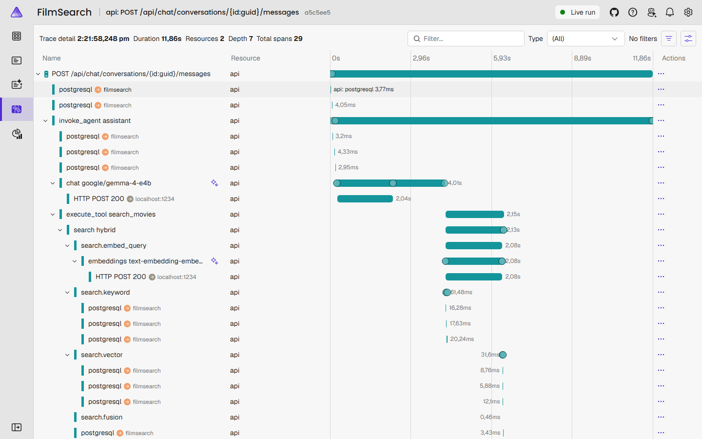

# M5 — Production ready

> [Docs](../README.md) › [Journal](README.md) › M5 Production ready

**Plan:** observability and cost tracking, resilience and caching, containers and deployment. **Fact:** done on
2026-11-19 in four sessions (S20–S23). Everything up to a public server is ready and was run production-like on the
dev machine; renting the server was postponed by the owner.

| Iteration | Planned sessions | Fact | Commit | Key number |
|---|---|---|---|---|
| [I18 Observability and cost](#i18--observability-and-cost-tracking) | 1 | S20 | [`aa8b5be`](https://github.com/gray0072/ai-rag-film-search/commit/aa8b5be) | One trace per chat turn, its id stored with the answer |
| [I19 Resilience, caching, rate limiting](#i19--resilience-caching-rate-limiting) | 1 | S21 | [`9528bc5`](https://github.com/gray0072/ai-rag-film-search/commit/9528bc5) | Outage: 10 s for the first call, then 0.2 s (open circuit) |
| [I20 Containers and deployment](#i20--containers-and-deployment) | 1–2 | S22, S23 | [`6b493be`](https://github.com/gray0072/ai-rag-film-search/commit/6b493be), [`1f93e5b`](https://github.com/gray0072/ai-rag-film-search/commit/1f93e5b) | Qwen3 embeddings: semantic Recall@10 0.87 → 0.92 |

---

## I18 — Observability and cost tracking

[Plan](../plan/iterations/I18-observability-cost.md) · [Session S20](../prompts/sessions/2026-11-19_S20_observability-cost.md) ·
[Runbook](../runbooks/observability.md)

**Built:** metrics for the assistant (turns by outcome, duration, tool calls, iteration limit, grounding violations,
feedback), search (requests and latency by mode and degraded flag), payments (webhooks by result) and orders (status
changes); search stage spans (`search.understand`, `.keyword`, `.embed_query`, `.vector`, `.fusion`); the trace id of
each answer stored in the database, so a 👎 leads to its trace; prompt and tool content in traces only when
`AI:EnableSensitiveData` is on; a daily token budget per owner; optional self-hosted Langfuse (six containers) that
receives only AI traces, plus user ratings as scores; a runbook to find a bad, slow or expensive turn.

| Problem | Cause | Solution |
|---|---|---|
| A new conversation reset the conversation budget | The budget was per conversation only | Daily budget per owner over all conversations |
| Langfuse would receive every HTTP and SQL span | One OTLP exporter for everything | Separate exporters per signal; a trace filter passes AI spans, their children and the request root |
| `UseOtlpExporter` cannot be combined with a second exporter | OpenTelemetry SDK restriction | Explicit exporters per signal when Langfuse is configured |
| MinIO has no community images on Docker Hub anymore | Vendor change | Chainguard image, for local development only |
| Tests that read metrics flaked in parallel | Meters are process-wide | `MeterRecorder` records only the meters of one app's `IMeterFactory` |

**Lesson:** the cheapest observability win was storing the trace id with the answer. A rating, a support ticket or a
budget alert now leads to the exact model calls, tools and SQL of that turn.

## I19 — Resilience, caching, rate limiting

[Plan](../plan/iterations/I19-resilience-caching.md) · [Session S21](../prompts/sessions/2026-11-19_S21_resilience-caching.md) ·
[ADR-0011](../adr/0011-ai-resilience-and-fallback.md)

**Built:** a Polly pipeline per AI profile (retry only for connection errors, 429, 502–504; circuit breaker; attempt
timeout), an optional fallback chat profile with flagged answers, search that never fails because of the AI provider
(keyword results with `degraded: true`), bounded caches for query vectors and query understanding with hit metrics,
idempotent-only retries for Stripe, token-bucket rate limits on search, chat and new conversations with 429 and
`Retry-After`.

**Manual outage drill** with LM Studio stopped: a cached query stayed semantic (167 ms); a new query degraded to
keyword after 10.2 s, then the breaker opened and the next calls took about 0.2 s; 31 s after `lms server start` the
circuit closed and search was semantic again.

| Problem | Cause | Solution |
|---|---|---|
| A timed-out local call was sent three times | The SDK retried timeouts, and the model was still generating in LM Studio's queue | Timeouts and 500 are not retried |
| The first call of an outage took ~10 s on Windows | A refused `localhost` connection takes ~2 s per attempt (::1 then 127.0.0.1) × 3 | Accepted and documented; the breaker makes later calls fast |
| The standard HTTP handler retried Stripe POSTs | It retries every method | Own payment pipeline: only GET / HEAD or requests with an `Idempotency-Key` |
| A client that drops its cookie gets a new chat limit and budget | Limits per owner | New conversations are also limited per IP |
| Semantic search returned 503 when embeddings failed | Hybrid degraded, semantic did not | Both degrade; `POST /api/search` has no 503 anymore |

**Lesson:** resilience for AI is not "retry more". A slow model must not be retried, an outage should fail fast, and
the product should have a non-AI answer ready (keyword search) for the minutes the provider is down.

## I20 — Containers and deployment

[Plan](../plan/iterations/I20-deployment.md) · [Session S22](../prompts/sessions/2026-11-19_S22_deployment.md) ·
[Session S23](../prompts/sessions/2026-11-19_S23_remove-ollama.md) · [ADR-0012](../adr/0012-deployment-docker-compose-vps.md) ·
[Deploy runbook](../../deploy/README.md)

**Built:** chiseled non-root images for the API and the Worker (282 / 275 MB) and a Caddy image for the web app (93 MB);
a Docker Compose stack with HTTPS, security headers and a reverse proxy that holds requests while the API restarts;
migrations as a one-off step; persisted data protection keys (sign-ins survive a redeploy); a service-wide daily token
budget; deploy, backup and restore scripts; a release workflow that builds the images, runs the stack on the runner
with Playwright smoke tests, pushes to GHCR and deploys over SSH when a server is configured.

| Embeddings (105 golden queries) | Semantic Recall@10 | Semantic MRR@10 | Hybrid Recall@10 | Semantic p50 / p95 |
|---|---|---|---|---|
| EmbeddingGemma 300M, local | 0.865 | 0.794 | 0.873 | 60 / 73 ms |
| Qwen3-Embedding-8B, OpenRouter | **0.917** | **0.921** | **0.927** | 577 / 4628 ms |

([report](../../evals/reports/2026-11-19_search_i20-openrouter-qwen3-embedding-8b.md); Qwen3 is better mostly in
Russian, 0.94 vs 0.86, and Swedish, 0.90 vs 0.82, but every new query is a network call; the query vector cache from
I19 hides most of it.)

| Problem | Cause | Solution |
|---|---|---|
| The EF Core migration bundle failed in the container | `System.Diagnostics.DiagnosticSource 11.0` needed by OpenTelemetry 1.21 | `dotnet FilmSearch.Worker.dll migrate`: the app's own migration code and lock, no extra image |
| Behind Caddy the rate limits saw one IP, cookies lost `Secure` | No forwarded headers | `ASPNETCORE_FORWARDEDHEADERS_ENABLED`; the API skips its own HTTPS redirect |
| Every redeploy signed everyone out | Data protection keys lived in the container | Keys in a volume |
| A public demo has unlimited anonymous owners | The per-owner budget does not cap the total | `MaxTotalTokensPerDay` + a separate OpenRouter key with a credit limit |
| The OpenRouter embedding profile was always "Degraded" | OpenRouter lists embedding models under `/embeddings/models` | Profile setting `ModelsPath` |
| The fake gateway is refused in Production | A safety rule from I09 | The demo runs as environment `Demo`: production behavior, fake payments allowed |
| Ollama added a second local AI runtime to maintain (S23) | Embeddings in the demo stack | Removed: OpenRouter in the demo, LM Studio on the Docker host for local runs |

**Plan vs fact:** the public demo URL is the one open acceptance criterion (no server for now, the owner's decision).

---

**Previous:** [M4 Real integrations](m4-real-integrations.md) · **Back to:** [Journal](README.md) ·
**See also:** [Operator guide](../handbook/README.md#roles) · [Spec 10 Ops and security](../spec/10-ops-security.md)
