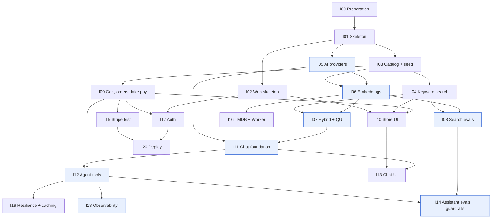

# Roadmap

Work goes in **iterations** (`Ixx`). One iteration = one feature branch = one or more sessions with an AI agent. Each iteration has a plan file in [iterations/](iterations/) with tasks, acceptance criteria and a "Result" section filled in at the end.

Status values: `todo`, `in progress`, `done`, `skipped`. **This table is the single source of truth for status.** Update it when an iteration starts and ends.

## Milestones

| Milestone | Meaning | Iterations |
|---|---|---|
| **M1 Store without AI** | Catalog, filters, keyword search, cart, fake payment, React UI | I01–I04, I09, I10 |
| **M2 Smart search** | AI providers, embeddings, semantic + hybrid search, query understanding, search evaluations | I05–I08 |
| **M3 AI sales assistant** | Chat, agent with tools, checkout with confirmation, chat UI, assistant evaluations and guardrails | I11–I14 |
| **M4 Real integrations** | Stripe test mode, TMDB sync + Worker, authentication | I15–I17 |
| **M5 Production ready** | Observability and cost, resilience and caching, deployment | I18–I20 |

## Iterations

| ID | Iteration | Depends on | Wave | Sessions (est.) | Status |
|---|---|---|---|---|---|
| I00 | [Preparation: spec, plan, conventions](iterations/I00-preparation.md) | — | 0 | 1 | done |
| I01 | [Solution skeleton, Aspire, DB, CI](iterations/I01-solution-skeleton.md) | I00 | 1 | 1–2 | done |
| I02 | [Web app skeleton (React, i18n, API client)](iterations/I02-web-skeleton.md) | I01 | 2 | 1 | done |
| I03 | [Catalog module and 1000-movie seed](iterations/I03-catalog-seed.md) | I01 | 2 | 1–2 | done |
| I05 | [AI provider layer (LM Studio / OpenRouter)](iterations/I05-ai-providers.md) | I01 | 2 | 1–2 | todo |
| I04 | [Keyword search and filters](iterations/I04-keyword-search.md) | I03 | 3 | 1 | done |
| I06 | [Embeddings and semantic search](iterations/I06-embeddings-semantic-search.md) | I03, I05 | 3 | 2 | todo |
| I09 | [Cart, orders, fake payment](iterations/I09-cart-orders-fake-payment.md) | I03 | 3 | 2 | todo |
| I07 | [Hybrid search and query understanding](iterations/I07-hybrid-query-understanding.md) | I04, I06 | 4 | 2 | todo |
| I08 | [Search evaluation harness](iterations/I08-search-evaluation.md) | I04, I06 (dataset: I03) | 4 | 1–2 | todo |
| I10 | [Store UI: catalog, search, cart, checkout](iterations/I10-store-ui.md) | I02, I04, I09 | 4 | 2 | todo |
| I15 | [Stripe test mode](iterations/I15-stripe-test-mode.md) | I09 | 4 | 1–2 | todo |
| I11 | [Chat foundation: conversations, streaming, grounded answers](iterations/I11-chat-foundation.md) | I05, I07 | 5 | 2 | todo |
| I16 | [TMDB sync and Worker](iterations/I16-tmdb-sync-worker.md) | I06 | 5 | 2 | todo |
| I17 | [Authentication (Identity)](iterations/I17-authentication.md) | I09, I02 | 5 | 1–2 | todo |
| I12 | [Agent: tools, cart, checkout confirmation](iterations/I12-agent-tools.md) | I11, I09 | 6 | 2 | todo |
| I13 | [Chat UI](iterations/I13-chat-ui.md) | I10, I11 (contract) | 6 | 2 | todo |
| I14 | [Assistant evaluation and guardrails](iterations/I14-assistant-eval-guardrails.md) | I12, I08 | 7 | 2 | todo |
| I18 | [Observability and cost tracking](iterations/I18-observability-cost.md) | I12 | 7 | 1 | todo |
| I19 | [Resilience, caching, rate limiting](iterations/I19-resilience-caching.md) | I12 | 8 | 1 | todo |
| I20 | [Containers and deployment](iterations/I20-deployment.md) | I15, I17 | 8 | 1–2 | todo |

IDs are stable and do not follow the execution order. Order is defined by **waves**.

## Dependency graph

Blue = AI-focused iterations.

## Waves (what can run in parallel)

| Wave | Parallel tracks | Notes |
|---|---|---|
| 0 | I00 | Done. |
| 1 | I01 | Blocks everything. Do it alone. |
| 2 | **I02 ‖ I03 ‖ I05** | Three independent tracks: frontend, catalog data, AI layer. |
| 3 | **I04 ‖ I06 ‖ I09** | I04 and I06 both touch search: keep keyword code and vector code in separate files; I09 is independent. The golden set for I08 can be written by hand during this wave. |
| 4 | **I07 ‖ I08 ‖ I10 ‖ I15** | I07 and I08 work well together: I08 gives numbers for I07 tuning. Do I08 first if only one AI track is possible. |
| 5 | **I11 ‖ I16 ‖ I17** | |
| 6 | **I12 ‖ I13** | I13 works against the SSE contract from spec 04 with a mocked stream, then connects to the real one. |
| 7 | **I14 ‖ I18** | |
| 8 | **I19 ‖ I20** | |

Shortest path to a working AI assistant: I01 → I03 + I05 → I06 → I04 → I07 → I11 → I12 (+ I09 for checkout, I02/I10/I13 for UI).

### How to run parallel tracks
- One git **worktree** per iteration: `git worktree add ../fs-I06 -b iter/I06-embeddings`. Start a separate agent session in each worktree.
- **Merge order** inside a wave: whoever finishes first merges first (fast-forward into `main`, no pull requests); the others rebase.
- **EF Core migrations** are the main conflict point. Rule: each iteration adds migrations only for its own module. If two branches both added migrations, the one merged second **deletes its migration and regenerates it** after rebase (never hand-merge the model snapshot).
- Shared files (`Program.cs`, `Directory.Packages.props`, AppHost): only add lines, through module extension methods. Expect small conflicts and resolve them by keeping both sides.

## Stretch goals (after M5, or when a topic is interesting)

| ID | Idea | What you learn |
|---|---|---|
| S01 | **MCP server** exposing catalog search and cart as MCP tools (so Claude Desktop / other agents can use the store) | Model Context Protocol, tool design for other agents |
| S02 | Reranking: LLM listwise vs cross-encoder, measured with I08 | Rerankers, cost / quality trade-offs |
| S03 | Compare own agent loop with `FunctionInvokingChatClient` / Microsoft Agent Framework on I14 suites | Agent frameworks |
| S04 | User preference memory (structured extraction, used in prompts) | Long-term memory |
| S05 | Python notebook: embedding space exploration (UMAP plot, clustering, comparing models) | Python AI tooling, embeddings intuition |
| S06 | Dedicated vector DB (Qdrant) behind `IMovieSearch`, compare | Vector DB internals, quantization |
| S07 | Refunds through Stripe + entitlement revoke | Payments lifecycle |
| S08 | Chunked RAG over long texts (e.g. public-domain movie reviews or Wikipedia plots) with citations | Chunking strategies, citation grounding |
| S09 | User simulator for multi-turn evaluations | Advanced evaluation |
| S10 | Small fine-tune / LoRA of an embedding or chat model on project data | Fine-tuning basics |
| S11 | Prompt caching and semantic cache, measured | Cost optimization |
