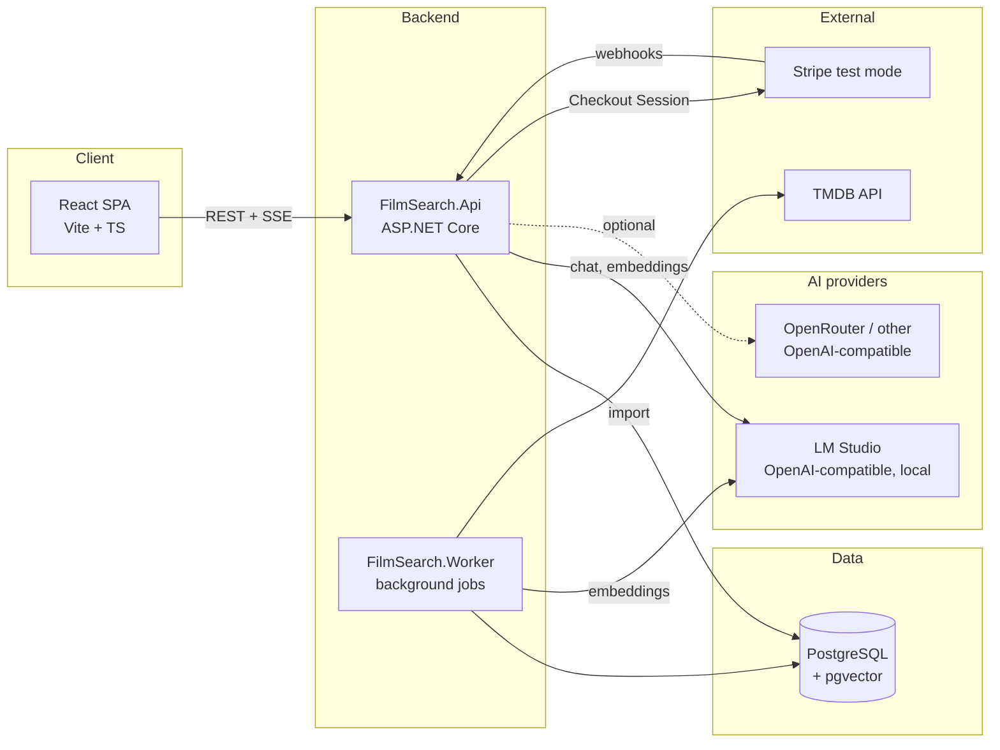

# 02 — Architecture

## 1. Style

**Modular monolith** on ASP.NET Core with feature modules: Catalog, Search, Assistant, Commerce (cart, orders, payments), Ingestion, Identity. One PostgreSQL database, one schema per module where practical. A separate **Worker** process runs background jobs (ingestion, embeddings, order expiry).

Why not microservices: for a single developer they add cost without new learning about AI. Module boundaries still matter: modules talk through interfaces from `FilmSearch.Core`, not through each other's DbContext tables.

## 2. Components



Local orchestration: **.NET Aspire AppHost** starts PostgreSQL (container with pgvector), the API, the Worker and the Vite dev server, and shows logs, traces and metrics in the Aspire dashboard. See [ADR-0005](../adr/0005-dotnet-aspire.md).

## 3. Tech stack

| Layer | Choice | Notes |
|---|---|---|
| Runtime | .NET 10 (LTS), C# latest | |
| Web API | ASP.NET Core Minimal APIs, endpoint groups per module | OpenAPI document generated by `Microsoft.AspNetCore.OpenApi` |
| Data access | EF Core 10 + Npgsql + `Pgvector.EntityFrameworkCore` | Migrations in the Infrastructure project |
| Database | PostgreSQL 17 + pgvector | Full-text search with `tsvector`, vectors with HNSW index. [ADR-0001](../adr/0001-postgresql-pgvector.md) |
| AI abstraction | `Microsoft.Extensions.AI` (`IChatClient`, `IEmbeddingGenerator`) + OpenAI-compatible client | [ADR-0002](../adr/0002-ai-abstraction-meai.md) |
| Agent | Own tool-calling loop on top of `IChatClient` first; Microsoft Agent Framework can be tried later | [ADR-0006](../adr/0006-agent-own-loop-first.md) |
| Payments | `IPaymentGateway`: Fake, then Stripe.net (test mode) | [ADR-0004](../adr/0004-payment-gateway-abstraction.md) |
| Movie data | Seed JSON, then TMDB API | [ADR-0003](../adr/0003-movie-data-source-tmdb.md) |
| Resilience | `Microsoft.Extensions.Http.Resilience` (Polly v8) | |
| Observability | OpenTelemetry (ServiceDefaults), Aspire dashboard; Langfuse as an option | |
| Frontend | React 19 + TypeScript + Vite, React Router, TanStack Query, i18next, a component library (shadcn/ui or Mantine, decided in I02) | API types generated from OpenAPI |
| Tests | xUnit, FluentAssertions or Shouldly, Testcontainers, Vitest + Testing Library, Playwright (e2e, later) | |
| CI | GitHub Actions | |
| Containers | Dockerfiles for Api, Worker, Web; deployment target decided in I20 | |

Exact package versions are fixed in iteration I01 and recorded in `Directory.Packages.props` (central package management).

## 4. Solution layout (target)

```
/
├── AGENTS.md, CLAUDE.md, README.md
├── FilmSearch.slnx
├── Directory.Build.props, Directory.Packages.props, global.json
├── src/
│   ├── FilmSearch.AppHost/          # Aspire orchestration
│   ├── FilmSearch.ServiceDefaults/  # OpenTelemetry, health checks, resilience defaults
│   ├── FilmSearch.Api/              # HTTP host: endpoints per module, auth, SSE
│   │   └── Modules/{Catalog,Search,Assistant,Commerce,Admin}/
│   ├── FilmSearch.Worker/           # background jobs (from I16)
│   ├── FilmSearch.Core/             # domain entities, module contracts, use cases
│   │   └── {Catalog,Search,Assistant,Commerce,Ingestion}/
│   ├── FilmSearch.Infrastructure/   # EF Core, migrations, Stripe, TMDB clients
│   ├── FilmSearch.AI/               # providers, embeddings, search ranking, agent loop, prompts
│   │   └── Prompts/                 # prompt templates as versioned files
│   └── web/                         # React app (Vite)
├── tests/
│   ├── FilmSearch.UnitTests/
│   └── FilmSearch.IntegrationTests/ # Testcontainers
├── evals/
│   ├── FilmSearch.Evals/            # console runner
│   ├── datasets/                    # golden sets (JSONL)
│   └── reports/                     # committed evaluation reports (markdown)
├── data/
│   └── seed/movies.seed.json
├── deploy/                          # Dockerfiles / compose / IaC (from I20)
└── docs/                            # spec, plan, ADRs, prompts
```

Project references: `Api → Core, Infrastructure, AI, ServiceDefaults`; `Worker → Core, Infrastructure, AI, ServiceDefaults`; `Infrastructure → Core`; `AI → Core`. `Core` references no other project and no EF Core / Stripe / AI SDKs.

## 5. Module boundaries

| Module | Owns | Exposes to others |
|---|---|---|
| Catalog | Movies, genres, people, offers | `ICatalogReader` (get movies by ids, offers, prices) |
| Search | Embeddings, search indexes, ranking | `IMovieSearch` (keyword / semantic / hybrid), `IQueryUnderstanding` |
| Assistant | Conversations, messages, tool definitions, agent loop | Nothing (top-level consumer) |
| Commerce | Carts, orders, payments, webhook events, entitlements | `ICartService`, `ICheckoutService` |
| Ingestion | Import jobs, source sync state | Writes to Catalog through `ICatalogWriter` |
| Identity | Users, roles (ASP.NET Core Identity) | Current user accessor |

Rule: the Assistant calls the same services as the HTTP endpoints. A tool is a thin adapter over a module service, with no own business logic.

## 6. Key cross-cutting decisions

- **Errors:** RFC 9457 Problem Details everywhere.
- **IDs:** `Guid` v7 for own entities, external ids stored separately (`TmdbId`, `ImdbId`).
- **Time:** `DateTimeOffset` UTC, `TimeProvider` injected (testable rentals and expiry).
- **Money:** integer minor units (`AmountMinor` in cents) + ISO currency (`USD`).
- **Configuration:** strongly typed options with validation on start (`ValidateOnStart`).
- **Each module registers itself** with one extension method (`services.AddCatalogModule(config)`, `app.MapCatalogEndpoints()`). This keeps `Program.cs` small and reduces merge conflicts between parallel iterations.
