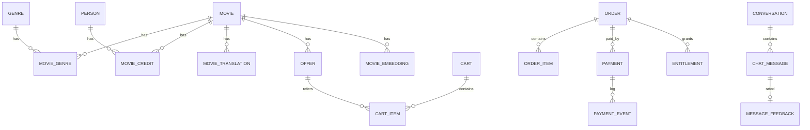
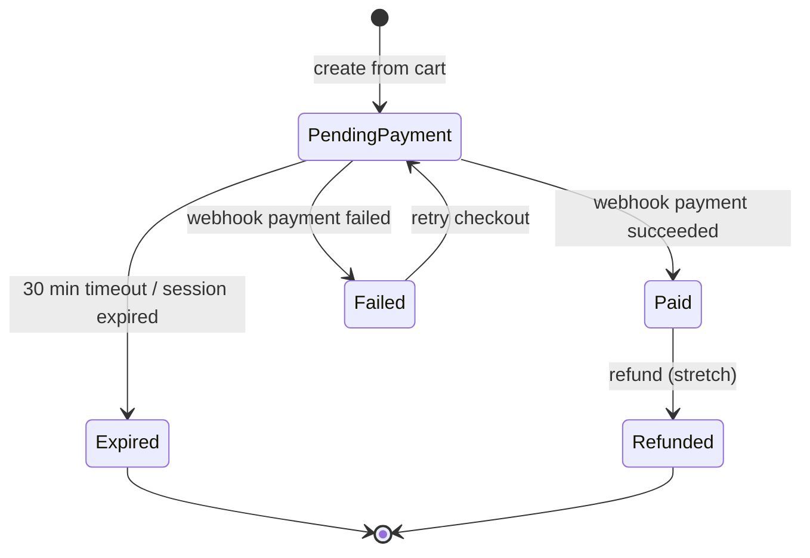

# 03 — Domain model

The schema below is a target. Iterations add tables gradually. Column names are in snake_case in PostgreSQL (EF Core naming convention), PascalCase in C#.

## 1. Entities

### Catalog
| Entity | Fields |
|---|---|
| **Movie** | `Id` (Guid v7), `TmdbId` (int, unique, nullable for manual), `ImdbId` (string?), `Title`, `OriginalTitle`, `OriginalLanguage`, `ReleaseDate`, `Year` (set from `ReleaseDate` on write, stored for filters), `RuntimeMinutes`, `Overview`, `Tagline`, `PosterPath`, `BackdropPath`, `VoteAverage` (numeric(3,1)), `VoteCount`, `Popularity`, `Keywords` (text[]), `AgeRating?`, `SearchVector*` (tsvector, generated, from I04), `Source` (Seed/Tmdb/Manual), `SourceHash` (sha256 of the imported data: an import with the same hash changes nothing), `CreatedAt`, `UpdatedAt` |
| **MovieTranslation** | `MovieId`, `Locale` (`en`/`ru`/`sv`), `Title?`, `Overview?`, `Tagline?`. `en` values are also kept on `Movie` for simple queries. A missing field falls back to English per field. |
| **Genre** | `Id` (int, TMDB genre id), `Slug` (unique, from the English name: `science-fiction`), `NameEn`, `NameRu`, `NameSv` |
| **Person** | `Id`, `TmdbId?` (unique; null for people from a hand-made seed, matched by name), `Name` |
| **MovieCredit** | `MovieId`, `PersonId`, `Role` (Director/Cast/Writer), `Character?`, `Order` (cast order, top 10 stored). Key: (`MovieId`, `PersonId`, `Role`). |
| **Offer** | `Id`, `MovieId`, `Type` (`Buy`/`Rent`), `PriceMinor`, `Currency`, `RentalHours?` (48), `IsActive`. Unique: (`MovieId`, `Type`). |

Prices are synthetic: `PricingRule` (Core) runs on every upsert and the result is stored in `Offer`. USD; buy 7.99–14.99 and rent 2.99–4.99 by age (≤ 2, ≤ 10, ≤ 25 years, older), +2.00 / +1.00 for movies with at least 10 000 votes (vote count, not TMDB popularity, so prices do not move daily).

The catalog tables live in the `catalog` schema: `movies`, `movie_translations`, `genres`, `movie_genres`, `people`, `movie_credits`, `offers`. Enums are stored as strings.

### Search
| Entity | Fields |
|---|---|
| **MovieEmbedding** | `Id`, `MovieId`, `Model` (string), `Dimensions` (int), `Kind` (`Profile` for now; `Review`, `Plot` chunks possible later), `Locale`, `Text` (the exact embedded text), `ContentHash` (sha256 of text), `Vector` (vector(N)), `CreatedAt`. Unique: (`MovieId`, `Model`, `Kind`, `Locale`). |

One vector column per dimension is a pgvector limitation for indexes. Approach: one table per active dimension, or a fixed `vector(1024)` column and models with that size. Decided in I06 and recorded as an ADR.

### Commerce
| Entity | Fields |
|---|---|
| **Cart** | `Id`, `OwnerId` (user id or anonymous session id), `UpdatedAt` |
| **CartItem** | `CartId`, `MovieId`, `OfferId`, `AddedAt`, `AddedBy` (`User`/`Assistant`) |
| **Order** | `Id`, `OwnerId`, `Status`, `TotalMinor`, `Currency`, `CreatedAt`, `ExpiresAt`, `PaidAt?`, `Source` (`Web`/`Assistant`), `ConversationId?` |
| **OrderItem** | `OrderId`, `MovieId`, `OfferId`, `OfferType`, `TitleSnapshot`, `PriceMinorSnapshot`, `RentalHours?` |
| **Payment** | `Id`, `OrderId`, `Provider` (`Fake`/`Stripe`), `ProviderSessionId`, `ProviderPaymentIntentId?`, `Status`, `AmountMinor`, `Currency`, `CheckoutUrl`, `CreatedAt`, `UpdatedAt` |
| **PaymentEvent** | `Id`, `Provider`, `ProviderEventId` (unique per provider: dedup), `Type`, `PayloadJson`, `ReceivedAt`, `ProcessedAt?`, `Error?` |
| **Entitlement** | `Id`, `OwnerId`, `MovieId`, `OrderId`, `Type` (`Owned`/`Rental`), `ValidFrom`, `ValidUntil?`, `RevokedAt?` |

### Assistant
| Entity | Fields |
|---|---|
| **Conversation** | `Id`, `OwnerId`, `Title?`, `Locale`, `ProfileName` (AI profile), `CreatedAt`, `UpdatedAt`, `TotalInputTokens`, `TotalOutputTokens`, `EstimatedCostUsd` |
| **ChatMessage** | `Id`, `ConversationId`, `Seq`, `Role` (`user`/`assistant`/`tool`/`system`), `Content`, `ToolCallsJson?`, `ToolCallId?`, `Model?`, `InputTokens?`, `OutputTokens?`, `LatencyMs?`, `PromptVersion?`, `CreatedAt` |
| **MessageFeedback** | `MessageId`, `Rating` (+1/−1), `Comment?`, `CreatedAt` |

### Identity (from I17)
ASP.NET Core Identity tables in schema `identity`. `OwnerId` in other modules becomes the user id after login. The anonymous id is migrated on login.

## 2. Order state machine

Rules:
- State changes go only through methods on the `Order` aggregate (`MarkPaid(...)`, `Expire(...)`) which check the current state.
- `Paid` creates entitlements in the same transaction.
- A late success webhook for an `Expired` order still marks it `Paid` (money was taken) and logs a warning.
- Optimistic concurrency on `Order` (`xmin` row version).

## 3. Invariants

- An `OrderItem` price never changes after the order is created.
- One active `Rental` per (owner, movie) at a time; buying a movie that is rented is allowed.
- A `MovieEmbedding` row is valid only if `ContentHash` equals the hash of the current embedding text built from the movie.
