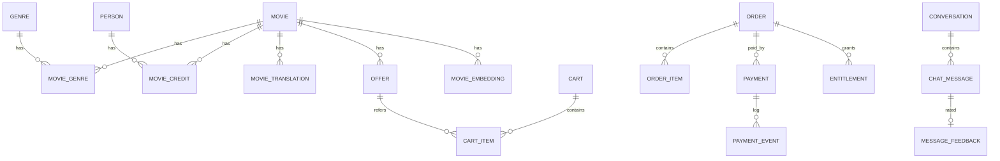
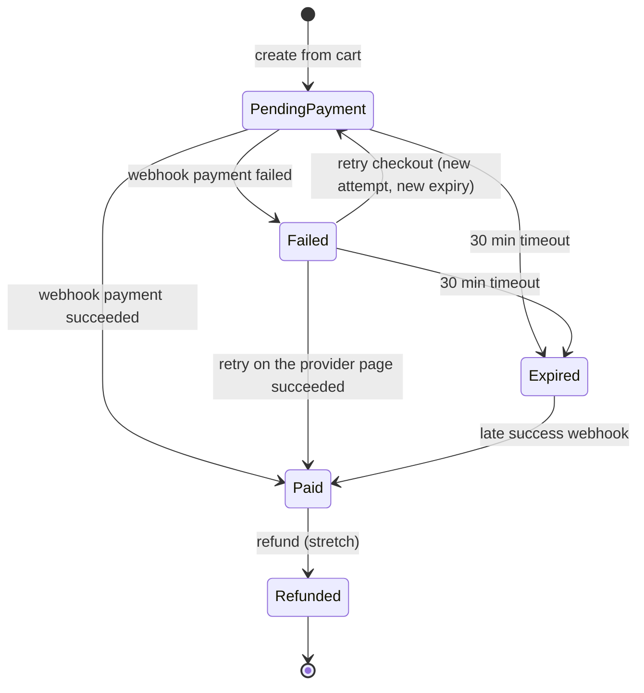

# 03 — Domain model

> [Docs](../README.md) › [Spec](00-overview.md) › 03 — Domain model

The schema below is a target. Iterations add tables gradually. Column names are in snake_case in PostgreSQL (EF Core naming convention), PascalCase in C#.

## 1. Entities

### Catalog
| Entity | Fields |
|---|---|
| **Movie** | `Id` (Guid v7), `TmdbId` (int, unique, nullable for manual), `ImdbId` (string?), `Title`, `OriginalTitle`, `OriginalLanguage`, `ReleaseDate`, `Year` (set from `ReleaseDate` on write, stored for filters), `RuntimeMinutes`, `Overview`, `Tagline`, `PosterPath`, `BackdropPath`, `VoteAverage` (numeric(3,1)), `VoteCount`, `Popularity`, `Keywords` (text[]), `AgeRating?`, `Source` (Seed/Tmdb/Manual), `SourceHash` (sha256 of the imported data: an import with the same hash changes nothing), `CreatedAt`, `UpdatedAt` |
| **MovieTranslation** | `MovieId`, `Locale` (`en`/`ru`/`sv`), `Title?`, `Overview?`, `Tagline?`. `en` values are also kept on `Movie` for simple queries. A missing field falls back to English per field. |
| **Genre** | `Id` (int, TMDB genre id), `Slug` (unique, from the English name: `science-fiction`), `NameEn`, `NameRu`, `NameSv` |
| **Person** | `Id`, `TmdbId?` (unique; null for people from a hand-made seed, matched by name), `Name` |
| **MovieCredit** | `MovieId`, `PersonId`, `Role` (Director/Cast/Writer), `Character?`, `Order` (cast order, top 10 stored). Key: (`MovieId`, `PersonId`, `Role`). |
| **Offer** | `Id`, `MovieId`, `Type` (`Buy`/`Rent`), `PriceMinor`, `Currency`, `RentalHours?` (48), `IsActive`. Unique: (`MovieId`, `Type`). |

Prices are synthetic: `PricingRule` (Core) runs on every upsert and the result is stored in `Offer`. USD; buy 7.99–14.99 and rent 2.99–4.99 by age (≤ 2, ≤ 10, ≤ 25 years, older), +2.00 / +1.00 for movies with at least 10 000 votes (vote count, not TMDB popularity, so prices do not move daily).

The catalog tables live in the `catalog` schema: `movies`, `movie_translations`, `genres`, `movie_genres`, `people`, `movie_credits`, `offers`. Enums are stored as strings.

### Search
| Entity | Fields |
|---|---|
| **MovieSearchDocument** (`search.movie_documents`, from I04) | `MovieId` (PK, FK to the movie, cascade), texts flattened per locale with English fallback: `TitleEn/Ru/Sv`, `OriginalTitle`, `Keywords`, `People` (directors, writers, cast), `TaglineEn/Ru/Sv`, `OverviewEn/Ru/Sv`; generated `SearchEn/Ru/Sv` (`tsvector`, GIN index). Written only by the SQL function `search.refresh_movie_documents(uuid[])`, which the catalog writer calls for created / changed movies through `ICatalogChangeHandler` (spec 05 §2). |
| **MovieEmbedding** (`search.movie_embeddings`, from I06) | `Id`, `MovieId` (FK, cascade), `Model` (string), `Dimensions` (int), `Kind` (`Profile` for now; `Review`, `Plot` chunks possible later), `Locale`, `Text` (the exact embedded text, document prefix included), `ContentHash` (sha256 of the template version and `Text`), `Vector` (`vector` without a fixed dimension), `CreatedAt` (when the vector was computed). Unique: (`MovieId`, `Model`, `Kind`, `Locale`); index (`Model`, `Locale`). |

pgvector indexes only columns of a fixed dimension, so the HNSW index is a partial expression index per dimension: `((vector::vector(768)) vector_cosine_ops) WHERE dimensions = 768` ([ADR-0008](../adr/0008-vector-storage-per-dimension.md)). The migration creates it for 768; the embedding indexer creates it for any other dimension on first use.

### Commerce
| Entity | Fields |
|---|---|
| **Cart** | `Id`, `OwnerId` (user id or anonymous session id, unique), `UpdatedAt` |
| **CartItem** | `CartId`, `MovieId`, `OfferId`, `OfferType`, `AddedAt`, `AddedBy` (`User`/`Assistant`). Key (`CartId`, `MovieId`): one line per movie. No price: the cart shows the current offer from the catalog. |
| **Order** | `Id`, `OwnerId`, `Status`, `TotalMinor`, `Currency`, `CreatedAt`, `ExpiresAt`, `PaidAt?`, `Source` (`Web`/`Assistant`), `ConversationId?`, `IdempotencyKey` (unique per owner), `xmin` row version |
| **OrderItem** | `OrderId`, `MovieId`, `OfferId`, `OfferType`, `TitleSnapshot` (title in the request locale), `PriceMinorSnapshot`, `RentalHours?`. Key (`OrderId`, `MovieId`). No foreign keys to the catalog: order history survives a deleted movie. |
| **Payment** | `Id`, `OrderId`, `Provider` (`Fake`/`Stripe`), `Attempt` (1, 2, … per order; part of the provider idempotency key), `ProviderSessionId` (unique per provider), `ProviderPaymentIntentId?`, `Status` (`Pending`/`Succeeded`/`Failed`/`Expired`/`Refunded`), `AmountMinor`, `Currency`, `CheckoutUrl`, `CreatedAt`, `UpdatedAt` |
| **PaymentEvent** | `Id`, `Provider`, `ProviderEventId` (unique per provider: dedup), `Type` (normalized), `PayloadJson` (jsonb), `ReceivedAt`, `ProcessedAt?`, `Error?` |
| **Entitlement** | `Id`, `OwnerId`, `MovieId`, `OrderId`, `Type` (`Owned`/`Rental`), `ValidFrom`, `ValidUntil?`, `RevokedAt?` |

The commerce tables live in the `commerce` schema: `carts`, `cart_items`, `orders`, `order_items`, `payments`, `payment_events`, `entitlements`.

### Assistant
| Entity | Fields |
|---|---|
| **Conversation** | `Id`, `OwnerId`, `Title?` (first user message, ≤ 80 chars), `Locale`, `ProfileName` (AI profile of the last turn), `CreatedAt`, `UpdatedAt`, `TotalInputTokens`, `TotalOutputTokens`, `EstimatedCostUsd` (answers and summaries), `Summary?` (rolling summary), `SummarizedThroughSeq` (last message covered by the summary; 0 = none) |
| **ChatMessage** (class `ConversationMessage`, so it does not clash with `Microsoft.Extensions.AI.ChatMessage`) | `Id`, `ConversationId`, `Seq` (unique per conversation), `Role` (`user`/`assistant`/`tool`/`system`), `Content`, `ToolCallsJson?` (jsonb `[{ callId, name, arguments }]`), `ToolCallId?`, `Model?`, `InputTokens?`, `OutputTokens?`, `EstimatedCostUsd?`, `LatencyMs?`, `PromptVersion?`, `MovieIds` (uuid[], the cards of an answer; no foreign key), `CreatedAt`. A turn is stored as: user message → per tool round an assistant message with `ToolCallsJson` and one tool message per call → the answer (assistant, no tool calls: all text the user saw, usage, cost, prompt version, cards). |
| **MessageFeedback** | `MessageId` (key: one per answer, a new rating replaces the old one), `Rating` (+1/−1, check constraint), `Comment?` (≤ 1000), `CreatedAt` |

| **CheckoutConfirmation** (I12) | `Id`, `OwnerId`, `ConversationId` (cascade delete), `MessageId` (the answer that asked; no foreign key), `Kind` (`checkout`), `Status` (`Pending`/`Approved`/`Declined`/`Superseded`; a pending one past `ExpiresAt` is shown as `expired`, never stored), `CartHash` (SHA-256 fingerprint of the cart lines: movie, offer, price, currency, availability, and the total; line order does not matter), `SummaryJson` (jsonb: what the user was shown), `CreatedAt`, `ExpiresAt`, `ResolvedAt?`, `OrderId?` (no foreign key: orders belong to Commerce) |

The assistant tables live in the `assistant` schema: `conversations`, `messages`, `message_feedback`, `confirmations`.

### Ingestion (I16)
| Entity | Fields |
|---|---|
| **Job** | `Id`, `Kind` (`TmdbImport` / `EmbeddingReindex`), `State` (`Queued` / `Running` / `Succeeded` / `Failed` / `Cancelled`), `Trigger` (`Admin` / `Schedule` / `Startup`), `Parameters`, `Progress?`, `Result?` (jsonb), `Error?`, `Attempts`, `CancelRequested`, `WorkerId?`, `LeaseId?`, `QueuedAt`, `StartedAt?`, `HeartbeatAt?`, `FinishedAt?` |

Table `ingestion.jobs`; at most one queued or running job per kind (partial unique index). Queue rules: [spec 08 §3](08-data-ingestion.md#job-queue).

### Identity (from I17)
ASP.NET Core Identity tables in schema `identity` (I17): `users` (`AppUser`: Identity columns with a uuid `Id` and `CreatedAt`; user name = email), `roles` (`admin`), `user_roles`, `user_claims`, `user_logins`, `user_tokens`, `role_claims`. `OwnerId` in other modules is the user id of a signed-in user. On login the anonymous id's rows are moved to the user by each module (`IOwnerMergeHandler`; Commerce: orders, entitlements, cart lines; Assistant: conversations, confirmations).

## 2. Order state machine

Rules:
- State changes go only through methods on the `Order` aggregate (`MarkPaid`, `MarkFailed`, `RetryPayment`, `Expire`, `MarkRefunded`) which check the current state. Webhook-driven methods return false for a duplicate or stale event (a failure after the success, a second success) instead of throwing, because providers deliver events more than once and out of order; `RetryPayment` and `Expire` before the expiry time throw.
- `Paid` creates entitlements in the same transaction.
- A late success webhook for an `Expired` order still marks it `Paid` (money was taken) and logs a warning.
- A "session expired" event closes the payment; the order expires only at its own `ExpiresAt` (a new checkout is still possible before that).
- Optimistic concurrency on `Order` (`xmin` row version).

## 3. Invariants

- An `OrderItem` price never changes after the order is created.
- One active `Rental` per (owner, movie) at a time; buying a movie that is rented is allowed. An owned movie cannot be bought or rented again. Checked when a movie is added to the cart and when the order is created (two orders paid in parallel could still both grant a rental; accepted).
- A `MovieEmbedding` row is valid only if `ContentHash` equals the hash of the current embedding text built from the movie.

---

**Previous:** [02 — Architecture](02-architecture.md) ·
**Next:** [04 — API](04-api.md) ·
**See also:** [Docs hub](../README.md) · [ADRs](../adr/README.md) · [Guide](../guide/README.md)
