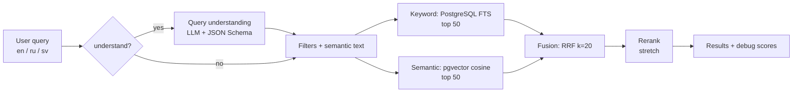

# 05 — Search

Search is the retrieval part of RAG. The UI and the assistant use the same `IMovieSearch` service.

## 1. Pipeline



Filters (genre, year, rating, price…) are applied **inside** both the keyword and the vector query (pre-filtering in SQL), not after the top-k is taken. Otherwise strict filters can return empty results.

## 2. Keyword search
- **Search document** per movie in `search.movie_documents`: the catalog texts flattened into one row (title, tagline and overview per locale with English fallback, original title, keywords, names of directors, writers and cast). Generated columns can only read their own row, so the texts are copied from the catalog tables by the SQL function `search.refresh_movie_documents(movie_ids)`; the catalog writer calls it inside its transaction for created and changed movies (`ICatalogChangeHandler`), and the migration used it to fill the table.
- Three generated `tsvector` columns with GIN indexes: `english`, `russian` and `swedish` configs (each over the texts of its locale). Weights: title A, original title A, keywords and people B, tagline C, overview D. `ё` is folded to `е` in documents and queries (Russian texts use both spellings: TMDB has "Крёстный отец", users type "крестный отец").
- Query with `websearch_to_tsquery` on all three configs (a movie matches when any config matches), rank with `ts_rank_cd` (normalization 32: `rank / (rank + 1)`, 0–1), take the best score per movie. Ties: popularity, then id. Filters are in the same SQL query.
- If no movie matches all the words, the query is relaxed once to any word (`a or b or c`); `debug.keywordMatch` is `all` or `any`.
- Title typos: `pg_trgm` similarity on titles as an extra signal (not added in I07; decide with I08 numbers on typo queries).

## 3. Semantic search
- **Embedding document** of a movie, built by `MovieEmbeddingTextBuilder` (deterministic, versioned):
  ```
  Title: Inception (2010)
  Genres: Action, Science Fiction, Adventure
  Director: Christopher Nolan
  Cast: Leonardo DiCaprio, Joseph Gordon-Levitt, Elliot Page
  Keywords: dream, subconscious, heist
  Tagline: Your mind is the scene of the crime.
  Overview: Cobb, a skilled thief who commits corporate espionage by infiltrating the subconscious...
  ```
  The builder version is part of `ContentHash`, so changing the template triggers re-embedding.
  Labels stay in English for every locale; empty fields are left out; up to 5 cast members and 20 keywords; `Original title` only when it differs. `MovieEmbeddingText.Version` (`movie-profile-v1`) is part of `ContentHash` together with the exact text sent (document prefix included), so changing the template or the prefix triggers re-embedding.
- One vector per movie and locale. Default `Search:Embeddings:Locales = ["en"]`: the multilingual model maps ru / sv queries close to English texts. Per-locale vectors (`en`, `ru`, `sv`) can be added with the reindex endpoint; search then takes the best vector per movie. I06 experiment: per-locale vectors helped Russian a little and Swedish not at all ([report](../../evals/reports/2026-11-17_I06_semantic-search-experiments.md)); I08 measures it properly.
- Query side: some models need prefixes (`query: ` / `passage: ` for e5; instructions for others). This is part of the embedding profile config.
- Query: the text is embedded with the active profile's model (query prefix), compared with that model's vectors by cosine distance (`<=>`), `similarity = 1 − distance`. Catalog filters are in the same SQL (pre-filtering). The list is cut at `Search:Semantic:MaxResults` (100) and paged in memory; `total` is the list length. If the provider is down, semantic search returns 503 and keyword search keeps working.
- Index: HNSW, `vector_cosine_ops`, a partial expression index per dimension ([ADR-0008](../adr/0008-vector-storage-per-dimension.md)). Per query `hnsw.ef_search = max(40, rows requested)` and `hnsw.iterative_scan = relaxed_order` (pgvector 0.8: keep walking the graph while filters reject candidates). On the seed, HNSW recall@10 vs exact is ≥ 0.999 and a query is 10–40× faster, but the planner still prefers the exact scan at ~1000 rows; both are far below the query embedding time. After changing vectors the indexer runs `VACUUM (ANALYZE)`: dead entries in the graph cost recall, and fresh statistics guide the planner.

## 4. Hybrid search
- Default mode of `POST /api/search` (FR-SRCH-3). Keyword and semantic retrieval each return their top `Search:Hybrid:CandidatesPerList` (50) candidates with the same pre-filters; the lists are fused with Reciprocal Rank Fusion: `score = Σ weight_i / (k + rank_i)` over the lists that contain the movie. RRF uses ranks only, so `ts_rank_cd` and cosine similarity never have to be made comparable. Ties: better best rank, more lists, movie id. The result list (union of the candidates, ≤ 100) is paged in memory; `score` is the fused score.
- Parameters (`Search:Hybrid`), tuned on manual queries in I07 ([report](../../evals/reports/2026-11-17_I07_hybrid-and-query-understanding.md)) and checked on the I08 golden set (k 10 / 20 / 60, keyword weight 1.0 / 0.5 / 0.3: k 60 is clearly worse, the rest within about one query; [baseline](../../evals/reports/2026-11-17_search_baseline.md), [keyword weight 0.3](../../evals/reports/2026-11-17_search_hybrid-keyword-weight-0.3.md)):
  - `RrfK` = **20** (the paper's 60 flattened the ranks too much: a movie at keyword rank 1 and vector rank 30 beat the vector #1);
  - `KeywordWeight` = 1.0 when every query word matched (`keywordMatch = all`: titles, names);
  - `RelaxedKeywordWeight` = **0.1** when the keyword query was relaxed to any word (`keywordMatch = any`). For descriptions ("a man discovers that his life is a TV show") the relaxed list matches every overview with "man" or "life"; with full weight it pushed the right semantic hits down (hybrid MRR 0.51 vs semantic 0.87 on English plot queries);
  - `SemanticWeight` = 1.0.
- Latency: the query embedding (an HTTP call to the model) runs while the keyword query runs; the two database queries stay sequential (one `DbContext`). Median ≈ 110 ms vs ≈ 95 ms for one mode on the laptop.
- When the query cannot be embedded (provider down, open circuit), hybrid and semantic mode return the keyword list with `degraded: true` (I19; semantic mode returned 503 before). Search never fails because of the AI provider. A query embedded before the outage still has its cached vector and stays semantic.
- Debug output per item: `keywordRank`, `keywordScore`, `keywordMatch`, `vectorRank`, `similarity`, `fusedScore`.

## 5. Query understanding (QU)
An LLM call with structured output turns free text into:
```json
{
  "semanticQuery": "outer space, astronauts, space travel",
  "filters": {
    "genresInclude": [],
    "genresExclude": ["horror"],
    "yearFrom": 1990, "yearTo": 1999,
    "minRating": 7,
    "maxPriceMinor": null,
    "language": null
  },
  "similarToTitles": [],
  "detectedLocale": "ru"
}
```
(for "фильмы 90-х про космос с рейтингом выше 7, без ужасов").
- `IQueryUnderstanding` (contract in `FilmSearch.Core`, implementation `QueryUnderstandingService` in `FilmSearch.AI`). The prompt is a versioned embedded file `src/FilmSearch.AI/Prompts/query-understanding.vN.md` loaded by `PromptLibrary` (latest version unless `Search:QueryUnderstanding:PromptVersion` pins one). The prompt id (`query-understanding.v2`) is a span tag (`filmsearch.prompt.id`) and part of the response (`understoodQuery.promptVersion`).
- The system prompt holds the instructions and the catalog's genre slugs with their en/ru/sv names; the user's query is the user message (untrusted text never goes into the instructions). Temperature 0.
- The JSON Schema is generated from a C# record (`QueryUnderstandingOutput`, `AIJsonUtilities.CreateJsonSchema`, all properties required, no extra properties); the genre arrays get an `enum` of the known slugs at run time, so providers with constrained decoding cannot return an unknown genre. It is sent as `response_format: json_schema`.
- The answer is validated (known genres, include ∩ exclude empty, years 1870–2100 and from ≤ to, rating 0–10, price ≥ 0, ISO 639-1 language, ≤ 5 titles). On invalid output: one retry with the model's answer and the error message, then fallback to "no filters, full query as semantic text". A provider error falls back at once. `understoodQuery.source` is `llm`, `cache` or `fallback`.
- Genres are filters only when the user asks for a genre ("sci-fi"), not guessed from the plot ("about space"): a guessed genre is a hard pre-filter and would hide good matches. Excluded genres become `MovieFilter.ExcludedGenreSlugs`.
- Merging: a filter set explicitly in the request wins over the same filter found in the text; excluded genres add up.
- Both retrievers search for `semanticQuery` (filter words removed); an empty `semanticQuery` falls back to the original text.
- `similarToTitles` ("movies like X", only when the user asks for similar movies — a bare title or name is a normal search) is resolved to movie ids through keyword search (best hit with all words matched, at most `Search:Hybrid:MaxSimilarTitles` = 3). The named movies are left out of the results (`MovieFilter.ExcludedMovieIds`), and the vector search is steered by them. Two strategies (`Search:Hybrid:SimilarTitles`): **`AverageVector`** (default) — `normalize(normalize(query) + mean(normalize(movie vectors)))`; `ExtraList` — the neighbours of each named movie are an extra RRF list (hybrid mode only). On 10 manual queries they were equally good (I07 report); `AverageVector` needs one vector query instead of one per title. Semantic mode always averages.
- QU results are cached per normalized query (case, whitespace, ё/е), prompt id and chat profile in a bounded memory cache (I19: `Search:QueryUnderstanding:CacheMinutes` = 1440, `CacheMaxEntries` = 10000; it was 60 minutes, unbounded). A result depends only on the query, the prompt, the model and the catalog's genres, which change rarely, so a day is safe. Fallbacks are not cached, so the model is asked again after an outage. Lookups are counted in `cache.lookups{cache=query_understanding}`.
- Latency with `google/gemma-4-e4b` on the laptop: ≈ 2.6–3.2 s per call (first call after loading ≈ 7 s); a cached query adds nothing.

## 6. Reranking (stretch)
Options to compare in an evaluation: (a) LLM as listwise reranker on top 20, (b) a cross-encoder reranker model behind an HTTP endpoint (e.g. a local `bge-reranker` service), (c) no reranker. Recorded as an ADR if adopted.

## 7. Quality targets (calibrated in I08)
Measured on `evals/datasets/search.golden.jsonl` (105 queries, 35 per language) with the evaluation runner (spec 09), hybrid mode, defaults of §4, EmbeddingGemma 300M — [baseline report](../../evals/reports/2026-11-17_search_baseline.md):

| Locale | Recall@10 baseline | MRR@10 baseline | Target Recall@10 | Target MRR@10 |
|---|---|---|---|---|
| en | 0.914 | 0.808 | ≥ 0.85 | ≥ 0.75 |
| ru | 0.871 | 0.833 | ≥ 0.85 | ≥ 0.75 |
| sv | 0.834 | 0.721 | ≥ 0.80 | ≥ 0.70 |

The initial targets (Recall@10 ≥ 0.8, MRR ≥ 0.6 per language) were met by the first run, so they are raised to just below the baseline: a change that drops a language below its target is a regression to explain. Swedish keeps a lower target until its gap is closed (weakest language since I05). Also tracked, without a target: excluded-genre rate of negative queries (hybrid 0.17, hybrid + QU 0.00), p50 latency in process (hybrid 78 ms, hybrid + QU 3.9 s on the laptop).
