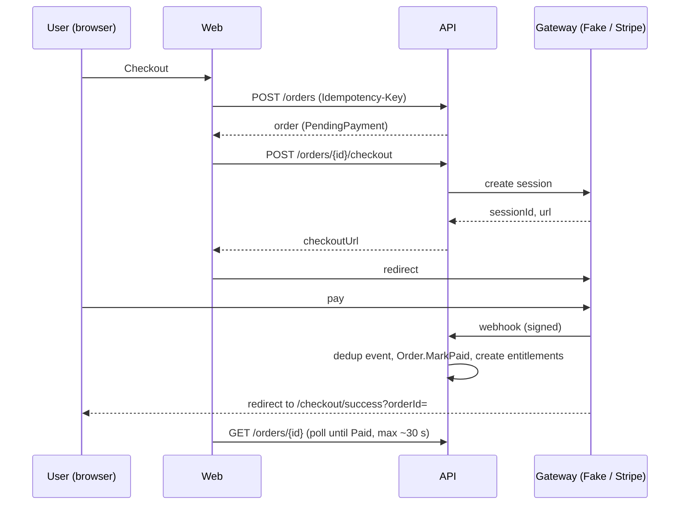

# 07 — Payments

## 1. Abstraction

```csharp
public interface IPaymentGateway
{
    PaymentProvider Provider { get; }
    Task<CheckoutSession> CreateCheckoutSessionAsync(CreateCheckoutRequest request, CancellationToken ct);
    // Parses and verifies an incoming webhook; throws on invalid signature.
    Task<PaymentWebhookEvent> ParseWebhookAsync(HttpRequest request, CancellationToken ct);
    Task RefundAsync(Payment payment, CancellationToken ct); // stretch
}
```

`CreateCheckoutRequest`: order id, items (title, amount, currency), success URL, cancel URL, idempotency key (`order:{orderId}:attempt:{n}`), expiry.
`PaymentWebhookEvent`: provider event id, type (`Succeeded`, `Failed`, `Expired`, `Refunded`), session id, order id (from metadata), amount.

The active gateway is chosen by config `Payments:Provider` = `Fake` | `Stripe`. Webhook processing is the same for both after parsing.

## 2. Flow



The success page **never** marks the order paid. It polls the order status.

## 3. Fake gateway (I09)
- Creates a `fake_cs_<guid>` session and returns `/fake-checkout/{sessionId}`, a simple page served by the API (Development only).
- Buttons: **Pay**, **Decline**, **Cancel**. Pay / Decline send a webhook to `/api/payments/webhooks/fake` through an in-process HTTP call **with a delay (1–3 s)** and an HMAC signature, so the async nature of real webhooks is visible from day one.
- Config switches to simulate problems: duplicate webhook delivery, out-of-order events, delay up to N seconds. Used in integration tests.

## 4. Stripe test mode (I15)
- Stripe.net SDK. **Checkout Session** (hosted page), `mode=payment`, line items with `price_data` (we do not create Stripe products for every movie), `metadata.orderId`, `expires_at` = 30 min, `client_reference_id` = order id.
- Idempotency key on session creation.
- Webhooks: `checkout.session.completed` (check `payment_status == paid`), `checkout.session.async_payment_succeeded` / `failed`, `checkout.session.expired`, `charge.refunded` (stretch). Signature check with `EventUtility.ConstructEvent` and the endpoint secret.
- Local development: `stripe listen --forward-to https://localhost:<port>/api/payments/webhooks/stripe`. The CLI prints the webhook secret → user-secrets.
- Test cards: `4242 4242 4242 4242` success, `4000 0000 0000 9995` declined, `4000 0025 0000 3155` 3-D Secure.
- Keys: `Stripe:SecretKey` (`sk_test_...`), `Stripe:WebhookSecret` (`whsec_...`) only in user-secrets / env. Startup check: refuse to start if the key is not a test key (`sk_test_` prefix).

## 5. Webhook processing rules
1. Verify the signature. Invalid → 400, nothing stored.
2. Insert `PaymentEvent` with unique (`Provider`, `ProviderEventId`). Duplicate → 200 and stop.
3. Process in a transaction: load payment and order, apply the state transition, create entitlements, set `ProcessedAt`.
4. Processing error → store `Error`, return 500 so the provider retries. Processing is safe to repeat.
5. Respond fast. Heavy follow-up work (emails etc., if ever) goes to a background queue (outbox pattern, stretch).

## 6. Expiry
A Worker job every minute expires `PendingPayment` orders past `ExpiresAt` (and expires Stripe sessions if still open). A late success webhook after expiry is handled as described in spec 03.
