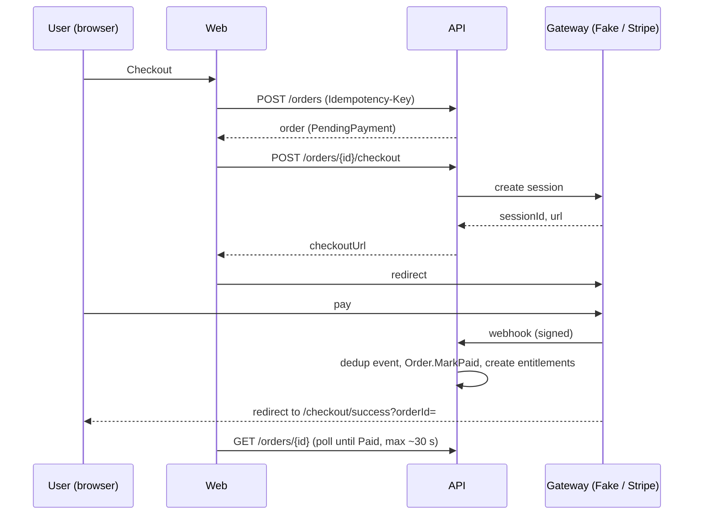

# 07 — Payments

> [Docs](../README.md) › [Spec](00-overview.md) › 07 — Payments

## 1. Abstraction

```csharp
public interface IPaymentGateway   // FilmSearch.Core.Commerce
{
    PaymentProvider Provider { get; }
    Task<CheckoutSession> CreateCheckoutSessionAsync(CreateCheckoutRequest request, CancellationToken ct);
    // Closes an open session (a new attempt replaces it, or the order expired). No-op for a closed session.
    Task ExpireCheckoutSessionAsync(string sessionId, CancellationToken ct);
    // Verifies the signature and parses the event; throws WebhookSignatureException / FormatException.
    // A verified event the shop does not act on comes back with Event = null (I15).
    ParsedWebhook ParseWebhook(PaymentWebhookRequest request);
    // RefundAsync(...) comes with refunds (stretch, S07).
}
```

`PaymentWebhookRequest` is the raw body plus the headers, so Core does not depend on ASP.NET Core (`HttpRequest`); the endpoint of each provider reads the body and calls the gateway (I09 change of the original `ParseWebhookAsync(HttpRequest)`).
`CreateCheckoutRequest`: order id, items (title, amount, currency), success URL, cancel URL, idempotency key (`order:{orderId}:attempt:{n}`), expiry (= the order's `ExpiresAt`).
`PaymentWebhookEvent`: provider event id, type (`Succeeded`, `Failed`, `Expired`, `Refunded`), session id, order id (from metadata), amount, currency, raw payload.
`ParsedWebhook`: provider event id, provider event type, the `PaymentWebhookEvent` or null, and the reason when it is null. A provider sends many event types (Stripe: every event of the account to an endpoint that subscribes to them, `stripe listen` with `--events`); the ones the shop does not act on are acknowledged with 200 so the provider does not retry them for days (I15 change).

The active gateway is chosen by config `Payments:Provider` = `Fake` | `Stripe`. Webhook processing is the same for both after parsing.

## 2. Flow



The success page **never** marks the order paid. It polls the order status.

## 3. Fake gateway (I09)
- Lives in the API (`Modules/Commerce/FakeGateway`): it serves a page and calls the API's own webhook endpoint, so it is part of the host. Sessions are kept in memory, as a real provider keeps them on its side; a restart forgets them.
- Creates a `fake_cs_<guid>` session (the same idempotency key returns the same session) and returns the relative URL `/fake-checkout/{sessionId}`. The Vite dev server proxies `/fake-checkout` to the API, like `/api`, so the URL works from the web app; success and cancel URLs are relative too (`Commerce:SuccessUrl` = `/checkout/success?orderId={orderId}`, `Commerce:CancelUrl` = `/checkout/cancel?orderId={orderId}` (the web app shows the cancel page with a link back to the cart)). When `Commerce:WebBaseUrl` is set (the AppHost sets it to the Vite endpoint), relative success and cancel URLs are resolved against it for every provider; Stripe needs absolute URLs (I15).
- Buttons: **Pay**, **Decline**, **Cancel**. Pay / Decline queue a webhook to `/api/payments/webhooks/fake`, sent over HTTP to the API itself **with a delay (1–3 s)** and an HMAC signature, so the async nature of real webhooks is visible from day one. After Decline the session stays open and can still be paid (as on Stripe's page). Cancel only redirects; no webhook, the order stays pending until it expires.
- Signature header `Fake-Signature: t=<unix seconds>,v1=<hex HMAC-SHA256 of "t.body">`, 5 minutes tolerance (replay protection). Key `Payments:Fake:WebhookSecret`; empty = a random key per process.
- A failed delivery (5xx, network error) is retried by the standard resilience handler of the HTTP client, like a provider retries.
- Config switches (`Payments:Fake`): `WebhookDelayMinMs` / `WebhookDelayMaxMs` (1000 / 3000), `DuplicateDeliveries` (extra copies of every event, same event id), `DeliverFailuresLate` + `LateDeliveryDelayMs` (out of order: a failure is held back, so a later success overtakes it), `WebhookBaseUrl` (default: the server's own address). Used in integration tests.
- Not allowed in Production: the API refuses to start with `Payments:Provider = Fake` there, and with Stripe active the fake page and the fake webhook endpoint are not registered at all in Production (I15).

## 4. Stripe test mode (I15)
- Stripe.net SDK, only in `FilmSearch.Infrastructure/Commerce/StripeGateway` (`StripePaymentGateway`). **Checkout Session** (hosted page), `mode=payment`, line items with `price_data` from the order's price snapshot (we do not create Stripe products for every movie), `metadata.orderId`, `payment_intent_data.metadata.orderId`, `client_reference_id` = order id, absolute success / cancel URLs (see §3).
- **Expiry:** Stripe accepts `expires_at` from 30 minutes to 24 hours after creation, and the order may have less than 30 minutes left. The session gets `expires_at` = the order's `ExpiresAt` + 30 minutes (at most 24 hours from now). The order's own expiry is enforced by the expiry job, which closes the session at Stripe (`POST /v1/checkout/sessions/{id}/expire`, §6); a payment in the minute between order expiry and the job is a late success (spec 03 §2).
- **Idempotency key** on session creation: `order:{orderId}:attempt:{n}`. Stripe keeps keys for 24 hours and refuses a known key with different parameters, so every parameter is derived from the order (not from the current time); a repeated call after a failure on our side returns the same session.
- **Closing a session** that is not open (Stripe answers 400; the session is complete or expired) or unknown (404) is a no-op.
- **HTTP:** a named `HttpClient` (`Stripe`) with the standard resilience handler of ServiceDefaults (retries, timeouts, traces in the dashboard); the SDK's own retries are off, so requests are not retried twice.
- **Webhooks** at `POST /api/payments/webhooks/stripe`. Signature check with the endpoint secret and a 5-minute tolerance (`EventUtility.ValidateSignature`, on `TimeProvider`), then the event is parsed without the API version check (the few fields read are stable across versions). Mapping:

  | Stripe event | Normalized |
  |---|---|
  | `checkout.session.completed` with `payment_status` `paid` or `no_payment_required` | `Succeeded` |
  | `checkout.session.completed` with `payment_status` `unpaid` (asynchronous method still processing) | ignored |
  | `checkout.session.async_payment_succeeded` / `async_payment_failed` | `Succeeded` / `Failed` |
  | `checkout.session.expired` | `Expired` |
  | a session without `metadata.orderId` (another integration, `stripe trigger`) | ignored |
  | any other type (`payment_intent.*`, `charge.*`, …) | ignored; `charge.refunded` comes with refunds (S07) |

- **A declined card** produces no Checkout event: Stripe's page shows the error and the customer can try another card in the same session; the order stays `PendingPayment` until it is paid or expires. (`Failed` comes only from asynchronous methods.)
- Local development: `stripe listen --api-key sk_test_… --events checkout.session.completed,checkout.session.async_payment_succeeded,checkout.session.async_payment_failed,checkout.session.expired --forward-to https://localhost:7180/api/payments/webhooks/stripe --skip-verify` (the CLI needs `--events` since 1.55; `--skip-verify` because of the development certificate). The CLI's signing secret (`stripe listen --print-secret`) stays the same between runs → user-secrets.
- Test cards: `4242 4242 4242 4242` success, `4000 0000 0000 9995` declined (insufficient funds), `4000 0025 0000 3155` 3-D Secure.
- Keys: `Stripe:SecretKey` (`sk_test_...`), `Stripe:WebhookSecret` (`whsec_...`) only in user-secrets / env. The gateway is registered when a secret key is set (so webhooks of Stripe sessions are still accepted after switching back to Fake). Startup checks: refuse to start if the key is not a test key (`sk_test_` prefix; live and restricted keys are refused); with `Payments:Provider = Stripe` the webhook secret and absolute return URLs are required.

## 5. Webhook processing rules
1. Verify the signature. Invalid signature or body → 400, nothing stored. A verified event the shop does not act on → 200 `ignored`, nothing stored.
2. Insert `PaymentEvent` with unique (`Provider`, `ProviderEventId`) (`INSERT … ON CONFLICT DO NOTHING`).
3. Process in a transaction: lock the event row (`FOR UPDATE`); if `ProcessedAt` is set, it is a duplicate → 200 and stop. Lock the payment row, so all events of one session are applied one at a time; load the order, apply the state transition, create entitlements, remove the paid movies from the owner's cart, set `ProcessedAt`. A concurrent change of the order (`xmin`) retries the step. An event of an older attempt does not fail or expire the order while a newer attempt is open.
4. Processing error → store `Error`, return 500 so the provider retries. A recorded but unprocessed event is processed on the next delivery; processing is safe to repeat.
5. Events that change nothing are acknowledged (200) with a note in `Error`: unknown session, order id mismatch, stale event (a failure after the success), amount or currency mismatch (logged as an error for manual review; the order is not marked paid).
6. Respond fast. Heavy follow-up work (emails etc., if ever) goes to a background queue (outbox pattern, stretch).

Answer of the webhook endpoints: `{ eventId, result: "applied" | "duplicate" | "ignored" }`.

## 6. Expiry
A job every minute (`Commerce:ExpiryScanSeconds`) expires unpaid (`PendingPayment` or `Failed`) orders past `ExpiresAt` and closes their open sessions at the provider. It was a hosted service in the API until I16 and runs in the Worker since then. Several replicas may run it: the row version keeps that safe. The Worker has no Fake gateway (it lives in the API): the payment of an expired fake order is marked expired, and the fake session expires by its own time. `POST /api/orders/{id}/checkout` past `ExpiresAt` expires the order at once. A late success webhook after expiry is handled as described in spec 03.

---

**Previous:** [06 — AI assistant and AI providers](06-ai-assistant.md) ·
**Next:** [08 — Data ingestion](08-data-ingestion.md) ·
**See also:** [Docs hub](../README.md) · [ADRs](../adr/README.md) · [Guide](../guide/README.md)
