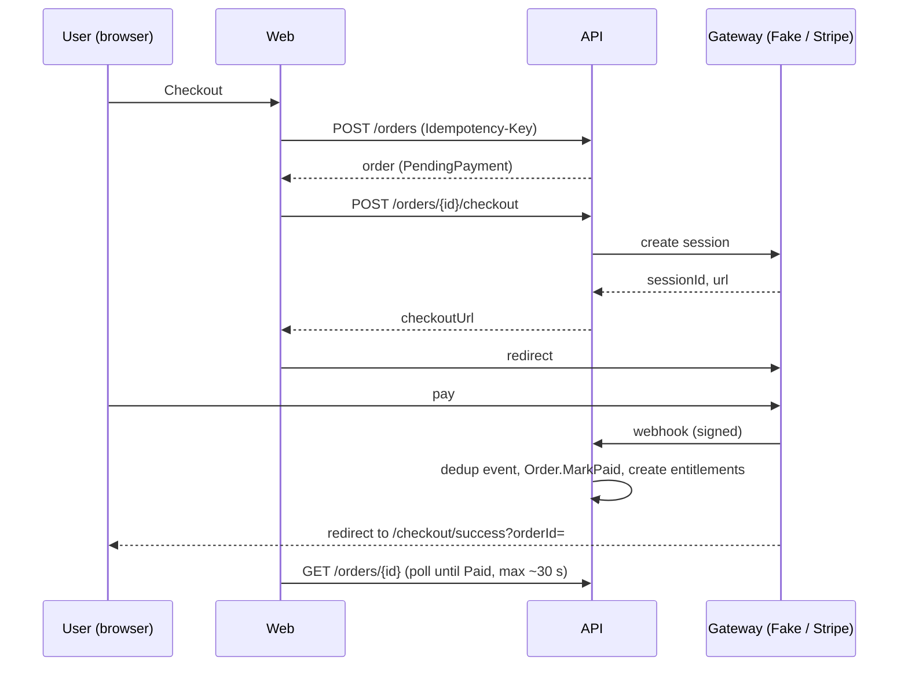

# 07 — Payments

## 1. Abstraction

```csharp
public interface IPaymentGateway   // FilmSearch.Core.Commerce
{
    PaymentProvider Provider { get; }
    Task<CheckoutSession> CreateCheckoutSessionAsync(CreateCheckoutRequest request, CancellationToken ct);
    // Closes an open session (a new attempt replaces it, or the order expired). No-op for a closed session.
    Task ExpireCheckoutSessionAsync(string sessionId, CancellationToken ct);
    // Verifies the signature and parses the event; throws WebhookSignatureException / FormatException.
    PaymentWebhookEvent ParseWebhook(PaymentWebhookRequest request);
    // RefundAsync(...) comes with refunds (stretch, S07).
}
```

`PaymentWebhookRequest` is the raw body plus the headers, so Core does not depend on ASP.NET Core (`HttpRequest`); the endpoint of each provider reads the body and calls the gateway (I09 change of the original `ParseWebhookAsync(HttpRequest)`).
`CreateCheckoutRequest`: order id, items (title, amount, currency), success URL, cancel URL, idempotency key (`order:{orderId}:attempt:{n}`), expiry (= the order's `ExpiresAt`).
`PaymentWebhookEvent`: provider event id, type (`Succeeded`, `Failed`, `Expired`, `Refunded`), session id, order id (from metadata), amount, currency, raw payload.

The active gateway is chosen by config `Payments:Provider` = `Fake` | `Stripe`. Webhook processing is the same for both after parsing.

## 2. Flow



The success page **never** marks the order paid. It polls the order status.

## 3. Fake gateway (I09)
- Lives in the API (`Modules/Commerce/FakeGateway`): it serves a page and calls the API's own webhook endpoint, so it is part of the host. Sessions are kept in memory, as a real provider keeps them on its side; a restart forgets them.
- Creates a `fake_cs_<guid>` session (the same idempotency key returns the same session) and returns the relative URL `/fake-checkout/{sessionId}`. The Vite dev server proxies `/fake-checkout` to the API, like `/api`, so the URL works from the web app; success and cancel URLs are relative too (`Commerce:SuccessUrl` = `/checkout/success?orderId={orderId}`, `Commerce:CancelUrl` = `/checkout/cancel?orderId={orderId}` (the web app shows the cancel page with a link back to the cart)). Stripe (I15) will need absolute URLs.
- Buttons: **Pay**, **Decline**, **Cancel**. Pay / Decline queue a webhook to `/api/payments/webhooks/fake`, sent over HTTP to the API itself **with a delay (1–3 s)** and an HMAC signature, so the async nature of real webhooks is visible from day one. After Decline the session stays open and can still be paid (as on Stripe's page). Cancel only redirects; no webhook, the order stays pending until it expires.
- Signature header `Fake-Signature: t=<unix seconds>,v1=<hex HMAC-SHA256 of "t.body">`, 5 minutes tolerance (replay protection). Key `Payments:Fake:WebhookSecret`; empty = a random key per process.
- A failed delivery (5xx, network error) is retried by the standard resilience handler of the HTTP client, like a provider retries.
- Config switches (`Payments:Fake`): `WebhookDelayMinMs` / `WebhookDelayMaxMs` (1000 / 3000), `DuplicateDeliveries` (extra copies of every event, same event id), `DeliverFailuresLate` + `LateDeliveryDelayMs` (out of order: a failure is held back, so a later success overtakes it), `WebhookBaseUrl` (default: the server's own address). Used in integration tests.
- Not allowed in Production: the API refuses to start with `Payments:Provider = Fake` there.

## 4. Stripe test mode (I15)
- Stripe.net SDK. **Checkout Session** (hosted page), `mode=payment`, line items with `price_data` (we do not create Stripe products for every movie), `metadata.orderId`, `expires_at` = 30 min, `client_reference_id` = order id.
- Idempotency key on session creation.
- Webhooks: `checkout.session.completed` (check `payment_status == paid`), `checkout.session.async_payment_succeeded` / `failed`, `checkout.session.expired`, `charge.refunded` (stretch). Signature check with `EventUtility.ConstructEvent` and the endpoint secret.
- Local development: `stripe listen --forward-to https://localhost:<port>/api/payments/webhooks/stripe`. The CLI prints the webhook secret → user-secrets.
- Test cards: `4242 4242 4242 4242` success, `4000 0000 0000 9995` declined, `4000 0025 0000 3155` 3-D Secure.
- Keys: `Stripe:SecretKey` (`sk_test_...`), `Stripe:WebhookSecret` (`whsec_...`) only in user-secrets / env. Startup check: refuse to start if the key is not a test key (`sk_test_` prefix).

## 5. Webhook processing rules
1. Verify the signature. Invalid signature or body → 400, nothing stored.
2. Insert `PaymentEvent` with unique (`Provider`, `ProviderEventId`) (`INSERT … ON CONFLICT DO NOTHING`).
3. Process in a transaction: lock the event row (`FOR UPDATE`); if `ProcessedAt` is set, it is a duplicate → 200 and stop. Lock the payment row, so all events of one session are applied one at a time; load the order, apply the state transition, create entitlements, remove the paid movies from the owner's cart, set `ProcessedAt`. A concurrent change of the order (`xmin`) retries the step. An event of an older attempt does not fail or expire the order while a newer attempt is open.
4. Processing error → store `Error`, return 500 so the provider retries. A recorded but unprocessed event is processed on the next delivery; processing is safe to repeat.
5. Events that change nothing are acknowledged (200) with a note in `Error`: unknown session, order id mismatch, stale event (a failure after the success), amount or currency mismatch (logged as an error for manual review; the order is not marked paid).
6. Respond fast. Heavy follow-up work (emails etc., if ever) goes to a background queue (outbox pattern, stretch).

Answer of the webhook endpoints: `{ eventId, result: "applied" | "duplicate" | "ignored" }`.

## 6. Expiry
A job every minute (`Commerce:ExpiryScanSeconds`) expires unpaid (`PendingPayment` or `Failed`) orders past `ExpiresAt` and closes their open sessions at the provider. Until I16 it is a hosted service in the API; it moves to the Worker there. Several replicas may run it: the row version keeps that safe. `POST /api/orders/{id}/checkout` past `ExpiresAt` expires the order at once. A late success webhook after expiry is handled as described in spec 03.
