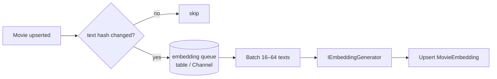

# 08 — Data ingestion

## 1. Sources

| Stage | Source | Content |
|---|---|---|
| I03 | `data/seed/movies.seed.json` (committed) | About 1000 well-known movies (TMDB top rated, topped up with popular ones if needed, deduplicated): ids, titles (en, ru, sv), year, runtime, genres, overview (en, ru, sv), tagline, director, top cast, keywords, rating, vote count, poster path. |
| I16 | TMDB API v3 | Same fields, plus incremental sync. |

Why TMDB and not IMDb: see [ADR-0003](../adr/0003-movie-data-source-tmdb.md). The `ImdbId` field is stored (TMDB returns it), so links to IMDb pages are possible.

## 2. Seed file

- Created in I03 with a small script (`tools/seed-builder`, .NET console or a one-off script) that calls TMDB with a free API key and writes the JSON. The resulting file is committed, so the app runs **without** any API key.
- If no TMDB key is available yet, a hand-made seed of 20–30 movies is acceptable as a start; the 1000-movie file replaces it as soon as a key exists.
- Size: about 1000 movies × 3 locales is a few MB of JSON. The file is written with stable ordering (by `TmdbId`) and indentation, so regenerating it gives readable diffs.
- Building it takes about 1000 detail requests: the builder respects the TMDB rate limit and can resume (cached responses in a local, ignored folder).
- Format: JSON array of objects that match a `SeedMovie` record. Schema documented in `data/seed/README.md` (created in I03).
- Posters: only `posterPath` is stored; the UI builds the TMDB image URL. No images are committed.
- Prices: computed by `PricingRule` at load time, not stored in the file.
- Loading is idempotent: upsert by `TmdbId`, in batches (one transaction per batch), so the full seed loads in well under a minute.

## 3. TMDB import (I16)

- Typed `HttpClient` with resilience (retry, rate limit about 40 req/10 s, respect `429 Retry-After`).
- Endpoints: `/movie/top_rated`, `/movie/popular`, `/movie/{id}?append_to_response=credits,keywords,translations,external_ids`, `/genre/movie/list` (en, ru and sv).
- Job runs in the **Worker**. Job state in table `ingestion_jobs` (status, counters, errors). Triggered by the admin endpoint or by a schedule (daily, disabled by default).
- Mapping: TMDB DTO → `SeedMovie`-like model → `ICatalogWriter.Upsert`. One mapping path for seed and TMDB.

## 4. Embeddings pipeline

- After seed load (I06) and TMDB import (I16) the stale embeddings are found by comparing `ContentHash` and processed in batches.
- Before the Worker exists (I06), embeddings are generated by an admin endpoint / startup task in the API.
- Reindex for a new model: vectors are written under the new `Model` value; search keeps using the active profile's model; switch the profile after reindex ends. Old vectors are deleted by a separate command.
- Counters and timing are logged and traced (texts/s, tokens).

## 5. Legal notes
- TMDB: "This product uses the TMDB API but is not endorsed or certified by TMDB." plus logo in the footer. Non-commercial use.
- The seed file contains descriptive metadata only. No posters, no trailers, no full plots from other sites.
