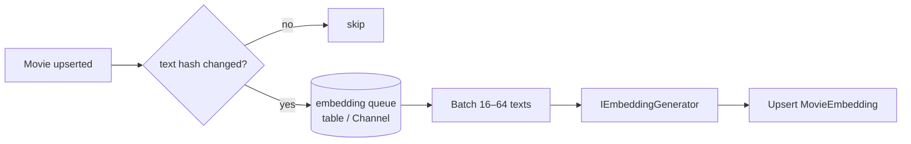

# 08 — Data ingestion

## 1. Sources

| Stage | Source | Content |
|---|---|---|
| I03 | `data/seed/movies.seed.json` (committed) | About 1000 well-known movies (TMDB top rated, topped up with popular ones if needed, deduplicated): ids, titles (en, ru, sv), year, runtime, genres, overview (en, ru, sv), tagline, director, top cast, keywords, rating, vote count, poster path. |
| I16 | TMDB API v3 | Same fields, imported by list or by id in the Worker, plus a daily sync (off by default). |

Why TMDB and not IMDb: see [ADR-0003](../adr/0003-movie-data-source-tmdb.md). The `ImdbId` field is stored (TMDB returns it), so links to IMDb pages are possible.

## 2. Seed file

- Created in I03 with a small script (`tools/seed-builder`, .NET console or a one-off script) that calls TMDB with a free API key and writes the JSON. The resulting file is committed, so the app runs **without** any API key.
- If no TMDB key is available yet, a hand-made seed of 20–30 movies is acceptable as a start; the 1000-movie file replaces it as soon as a key exists.
- Size: about 1000 movies × 3 locales is a few MB of JSON. The file is written with stable ordering (by `TmdbId`) and indentation, so regenerating it gives readable diffs.
- Building it takes about 1000 detail requests: the builder respects the TMDB rate limit and can resume (cached responses in a local, ignored folder).
- Format: a JSON object `{ version, source, generatedAt, genres: [GenreImport], movies: [MovieImport] }` (records in `FilmSearch.Core`). Genres are in the file so their `ru` / `sv` names come from TMDB too. Schema documented in [`data/seed/README.md`](../../data/seed/README.md).
- Posters: only `posterPath` is stored; the UI builds the TMDB image URL. No images are committed.
- Prices: computed by `PricingRule` at load time, not stored in the file.
- Loading is idempotent: upsert by `TmdbId`, in batches of 100 (one transaction per batch, serialized by a PostgreSQL advisory lock so concurrent loaders never duplicate rows). A movie whose `SourceHash` matches the import is not touched. 1000 synthetic TMDB-shaped movies load in a few seconds (integration test).
- Loaded on API startup when `Catalog:Seed:LoadOnStartup` is true (Development) and the catalog is empty, and by `POST /api/admin/ingestion/seed`.

## 3. TMDB import (I16)

- Typed `TmdbClient` (`FilmSearch.Infrastructure/Tmdb`) with its own resilience pipeline instead of the standard one, outer to inner: total timeout (5 min) → retry (429, 5xx, 408, network errors, attempt timeouts; exponential backoff with jitter from `Tmdb:RetryBaseDelayMs`, a `Retry-After` header wins) → sliding window rate limiter (`Tmdb:RequestsPerWindow` / `Tmdb:WindowSeconds`, 40 per 10 s; each attempt takes a permit, requests over the limit queue) → attempt timeout (20 s). The limiter is shared by every TMDB call of the process. Key: `Tmdb:ApiKey` (a v4 token is sent as a bearer header, a v3 key as `api_key`) in the user secrets of the API, which the Worker shares.
- Endpoints: `/movie/top_rated`, `/movie/popular`, `/movie/{id}?language=en-US&append_to_response=credits,keywords,translations,external_ids`, `/genre/movie/list` (en, ru and sv).
- Job `TmdbImport` (FR-DATA-2) with parameters `{ list: "topRated" | "popular", pages }` or `{ tmdbIds: [] }`, run by `TmdbImporter` in the **Worker**: genres in every locale → movie ids of the list pages (adult items skipped, duplicates across pages removed) → details with `Tmdb:MaxConcurrency` (4) requests in flight, in chunks of 100 → `TmdbMovieMapper` → `ICatalogWriter.UpsertMoviesAsync(…, MovieSource.Tmdb)` (one transaction per chunk; keyword documents are updated inside it) → stale-only reindex of the embeddings (§4). The job ends after the embeddings, so new movies are searchable in every mode when it has succeeded. A movie TMDB does not know counts as `notFound`, an adult or untitled one as `skipped`, one whose request still fails after the retries as `failed` (the first 20 errors are kept); none of them stops the job. The job fails when every movie failed, and when the embeddings failed (the movies stay saved; the result has their counters and a reindex catches up).
- Idempotent: upsert by `TmdbId`, and a movie whose `SourceHash` matches is not touched, so a rerun with unchanged TMDB data reports every movie as unchanged. A seed movie updated by TMDB keeps `Source = Seed`.
- Mapping: one path for seed and TMDB: `TmdbMovieMapper` in `FilmSearch.Infrastructure/Tmdb` (movies and genre lists; also used by the seed builder).
- Daily schedule (`Tmdb:Schedule`, off by default): after `TimeUtc` (03:00) the Worker queues one import of `List` / `Pages` (popular, 5 pages) per day. It asks the job table, not its memory, so restarts and replicas do not queue it twice.

### Job queue

Background jobs live in table `ingestion.jobs` ([ADR-0009](../adr/0009-job-queue-in-postgresql.md)): kind (`TmdbImport`, `EmbeddingReindex`), state (`queued` → `running` → `succeeded` / `failed` / `cancelled`), trigger (`admin`, `schedule`, `startup`), JSON parameters, progress and result, error, attempts, cancel flag, worker id, lease id and heartbeat.

- The API queues jobs (`IBackgroundJobs.EnqueueAsync`); a partial unique index allows one queued or running job per kind, otherwise the active job is returned (the endpoints answer 409).
- The Worker (`JobWorker`, one job at a time per process) claims the oldest due row with `SELECT … FOR UPDATE SKIP LOCKED LIMIT 1` in a short transaction and gives it a new lease id; the handler runs outside the transaction. Progress and a heartbeat are written every `Jobs:HeartbeatIntervalMs` (2 s). Writes carry the lease id: a worker that lost its lease cannot overwrite the job.
- A running job whose heartbeat is older than `Jobs:LeaseSeconds` (60 s) belongs to a lost worker and is claimed again, up to `Jobs:MaxAttempts` (3), then failed. On shutdown the Worker puts its job back in the queue (not counted as an attempt). `POST /api/admin/jobs/{id}/cancel` cancels a queued job at once and a running one at its next heartbeat.
- The queue is polled every `Jobs:PollIntervalMs` (2 s). Jobs are idempotent, so running one twice is safe.

## 4. Embeddings pipeline

- After seed load (I06) and TMDB import (I16) the stale embeddings are found by comparing `ContentHash` and processed in batches.
- Before the Worker existed (I06), embeddings were generated by a background job in the API; since I16 the Worker runs them.
- Reindex for a new model: vectors are written under the new `Model` value; search keeps using the active profile's model; switch the profile after reindex ends. Old vectors are deleted by a separate command (`DELETE /api/admin/embeddings?model=`).
- I06 implementation: `IMovieEmbeddingIndexer` walks the catalog in batches (`Search:Embeddings:BatchSize`, 32), builds each text through `ICatalogReader.GetMovieDetailsAsync`, compares hashes and embeds only stale texts; each batch is saved on its own, so a failed run continues where it stopped. After changes the indexer runs `VACUUM (ANALYZE)` on the table.
- I16: reindex jobs are rows of the job queue (kind `EmbeddingReindex`, `IEmbeddingJobs` over `IBackgroundJobs`) run by the Worker; in Development the API queues a stale-only job on startup after the seed (`Search:Embeddings:IndexOnStartup`). A TMDB import runs the stale-only reindex itself as its last phase. Reindex runs are serialized across processes by a session advisory lock (`ReindexLock`), so an import's reindex and a reindex job never embed the same texts at once.
- Telemetry: span `embeddings.reindex` (source `FilmSearch`, tags model, dimensions, locales, counts), a log line with counts and texts/s; each embedding call is a GenAI span with tokens (I05 pipeline).
- Counters and timing are logged and traced (texts/s, tokens).

## 5. Legal notes
- TMDB: "This product uses the TMDB API but is not endorsed or certified by TMDB." plus logo in the footer. Non-commercial use.
- The seed file contains descriptive metadata only. No posters, no trailers, no full plots from other sites.
